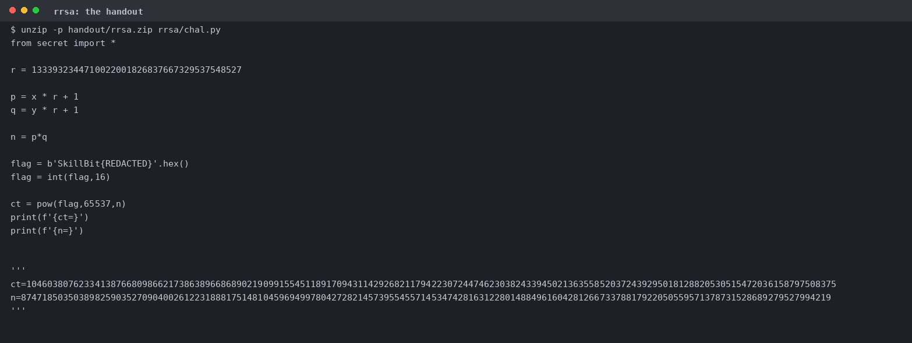
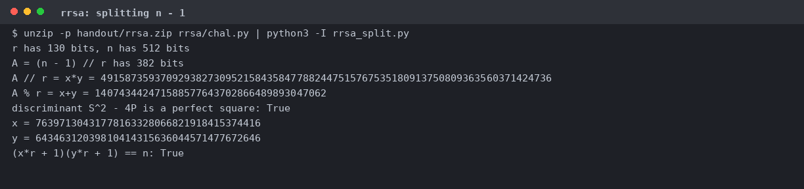
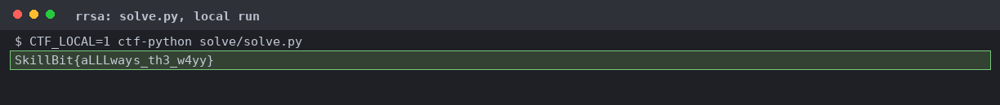

# RRSA

| | |
|---|---|
| Event | MetaCTF October 2026 Flash CTF |
| Category | crypto |
| Points | 200 |
| Solves at capture | 123 |
| Status | solved |

> Putting the R in RRSA.

Files: [`rrsa.zip`](handout/rrsa.zip)

<details>
<summary><b>Solution</b></summary>

Both primes are one more than a multiple of the published `r`, so `n - 1 = r * (x*y*r + x + y)`. Since `x + y` is smaller than `r`, one more division by `r` gives `x * y` and `x + y`. The primes then fall out of a quadratic.

## The handout



```python
r = 1333932344710022001826837667329537548527
p = x * r + 1
q = y * r + 1
n = p * q
flag = int(b'SkillBit{REDACTED}'.hex(), 16)
ct = pow(flag, 65537, n)
```

`n` and `ct` are in a trailing comment. `x` and `y` come from a missing `secret` module.

## Splitting n - 1

```
n = (x*r + 1)(y*r + 1) = x*y*r^2 + (x + y)*r + 1
```

Call the quotient `A = (n - 1) / r = x*y*r + (x + y)`. Since `r` has 130 bits and `x` and `y` have about 126 each, `x + y` is less than `r`. So one more division leaves `x*y` as the quotient (`A / r`) and `x + y` as the remainder (`A mod r`). Then `x` and `y` are the roots of `t^2 - (x + y)*t + x*y = 0`.



From `p = x*r + 1` and `q = y*r + 1` it's textbook RSA. The flag says `aLLLways`, so the author probably expected an LLL lattice. Two divisions were enough.

## Reproduce

    CTF_LOCAL=1 ctf-python solve/solve.py



Flag: `SkillBit{aLLLways_th3_w4yy}`

</details>
