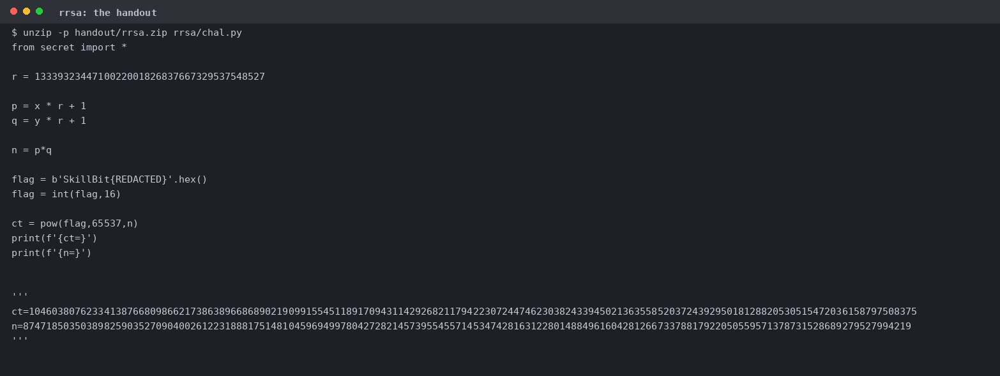
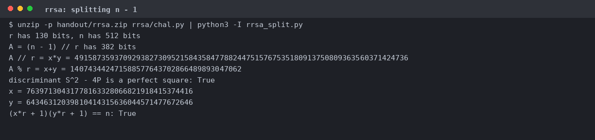
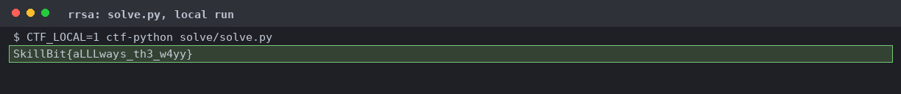

 - The handout, with a REDACTED flag. The modulus and ciphertext are in the trailing comment.
 - `A // r` is `x*y` and `A % r` is `x+y`. The discriminant is a perfect square.
 - A local run. The values are hardcoded, so it works offline.
