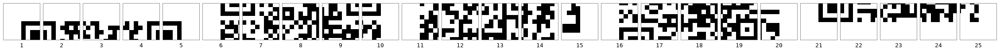
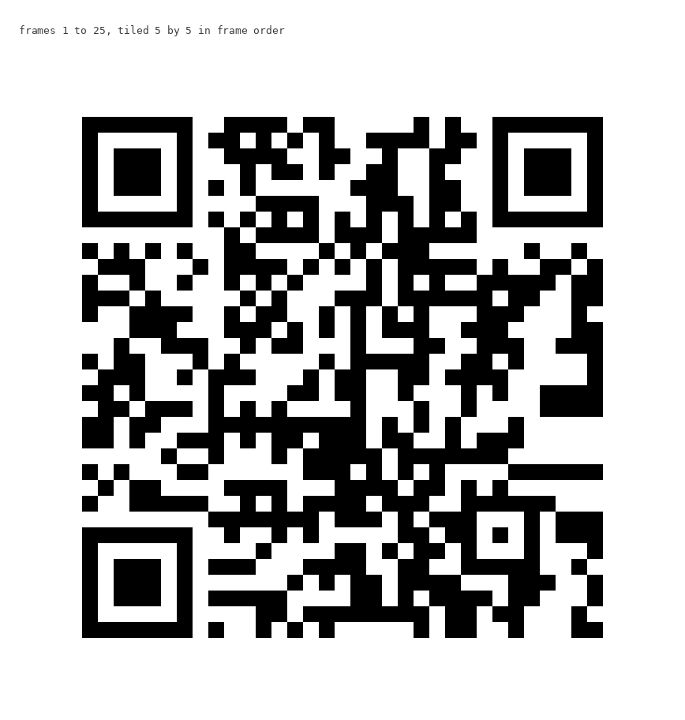
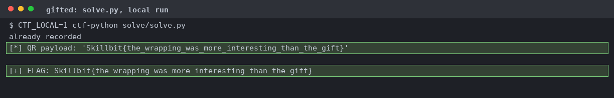

# GIFted

| | |
|---|---|
| Event | MetaCTF October 2026 Flash CTF |
| Category | misc |
| Points | 150 |
| Solves at capture | 167 |
| Status | solved |

> Someone left you a mysterious digital gift. It came with no card and no sender. Unwrap it and recover the message inside.

Files: [`gifted.zip`](handout/gifted.zip)

<b>Solution</b>

Each of the GIF's 25 frames is one tile of a QR code. Laid out 5 by 5 in frame order, they scan with `zbarimg`.

## Recon

The handout is one animated GIF. `exiftool` and `binwalk` say it's a clean GIF89a with 25 frames and nothing after the `0x3b` trailer, so the secret is in the frames.

## Rebuild the QR

Every frame is an 82 by 82 bitmap at the same spot, so playback shows one tile at a time. Tiled row by row, the frames form the 410 by 410 code.

The flag spells `Skillbit` with a lowercase `b`, and the platform took it as written.

## Reproduce

    CTF_LOCAL=1 ctf-python solve/solve.py

Flag: `Skillbit{the_wrapping_was_more_interesting_than_the_gift}`

