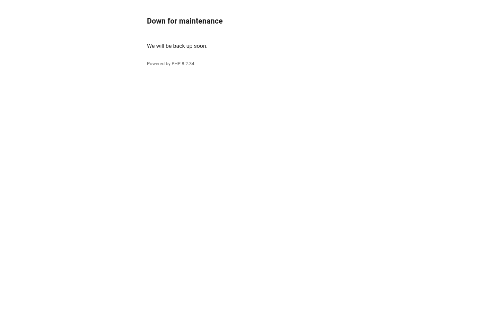
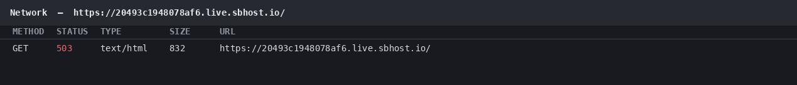
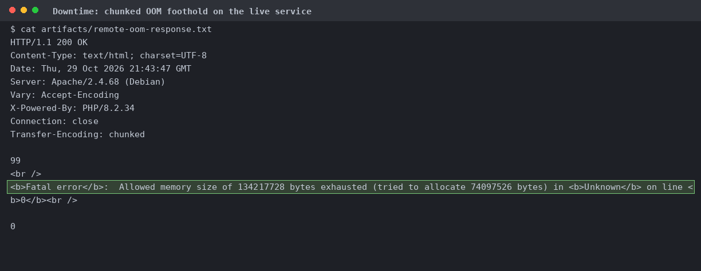

 - The site's one page, a 503 "Down for maintenance" notice.

 - The response headers: 503, Retry-After 3600, Apache/2.4.68 (Debian), and PHP/8.2.34.

 - A chunked multipart POST pushes the live server past its memory limit. It answers 200 with "Allowed memory size of 134217728 bytes exhausted", before the 503 app code runs.
