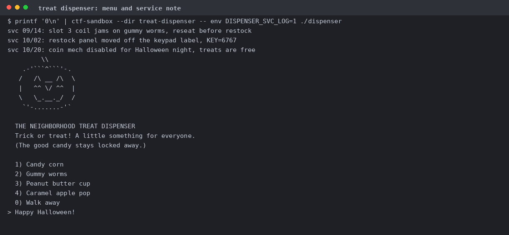
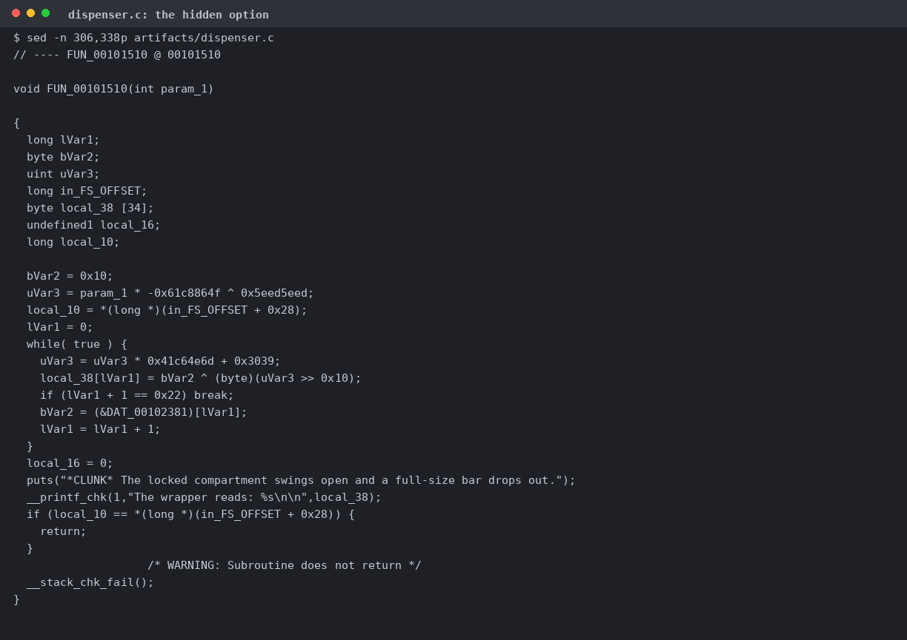
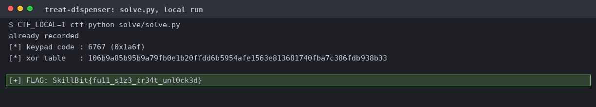

# Treat Dispenser

| | |
|---|---|
| Event | MetaCTF October 2026 Flash CTF |
| Category | web |
| Points | 100 |
| Solves at capture | 196 |
| Status | solved |

> Trick or treat! The neighborhood's new Treat Dispenser promises a little something for everyone. The good candy is locked away, of course. Figure out how to get your hands on it.

Files: [`treat-dispenser.zip`](handout/treat-dispenser.zip)

<details>
<summary><b>Solution</b></summary>

A hidden menu option takes a four-digit code, and `strings` prints the code. Entering `6767` runs a routine that rebuilds the flag from a keystream.

## Recon

The handout is a stripped x86-64 PIE ELF with a text menu. `strings` shows a debug switch `DISPENSER_SVC_LOG` and a service note `KEY=6767`. Setting the switch prints the note to stderr.



## The hidden option

On `6767`, `main` calls an unlisted function. It XORs a keystream with a 34-byte table in `.rodata` at virtual address `0x2380`.



The keystream is a linear congruential generator seeded from the entered code.

```python
seed = (code * 0x9e3779b1) & 0xffffffff ^ 0x5eed5eed
for i in range(34):
    seed = (seed * 0x41c64e6d + 0x3039) & 0xffffffff
    out[i] = table[i] ^ ((seed >> 16) & 0xff)
```

## Reproduce

    CTF_LOCAL=1 ctf-python solve/solve.py



The script turns `0x2380` into a file offset and replays the generator. The real binary prints the same flag:

```
$ printf '6767\n0\n' | ctf-sandbox ./dispenser
The wrapper reads: SkillBit{fu11_s1z3_tr34t_unl0ck3d}
```

Flag: `SkillBit{fu11_s1z3_tr34t_unl0ck3d}`

</details>
