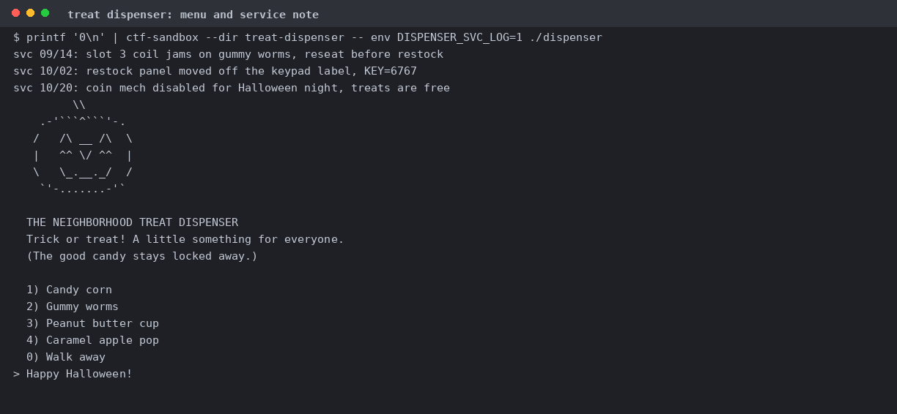
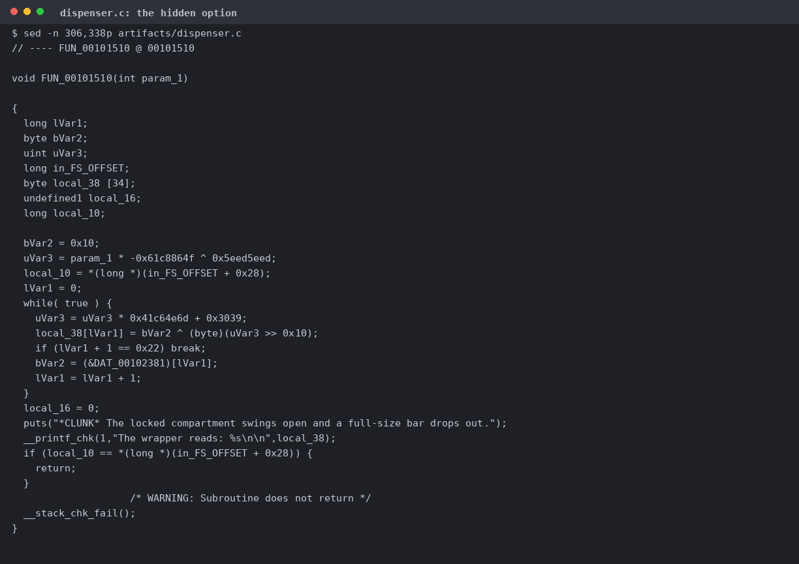
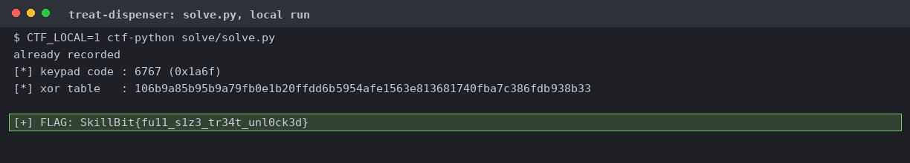

 - With `DISPENSER_SVC_LOG=1` set, the 10/02 service note shows `KEY=6767`. The run sends `0` (Walk away), so no flag.
 - `FUN_00101510` seeds the generator from the entered code and XORs each table byte with the keystream.
 - The flag on the last line of a local run.
