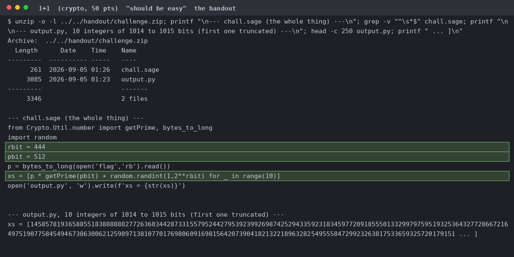
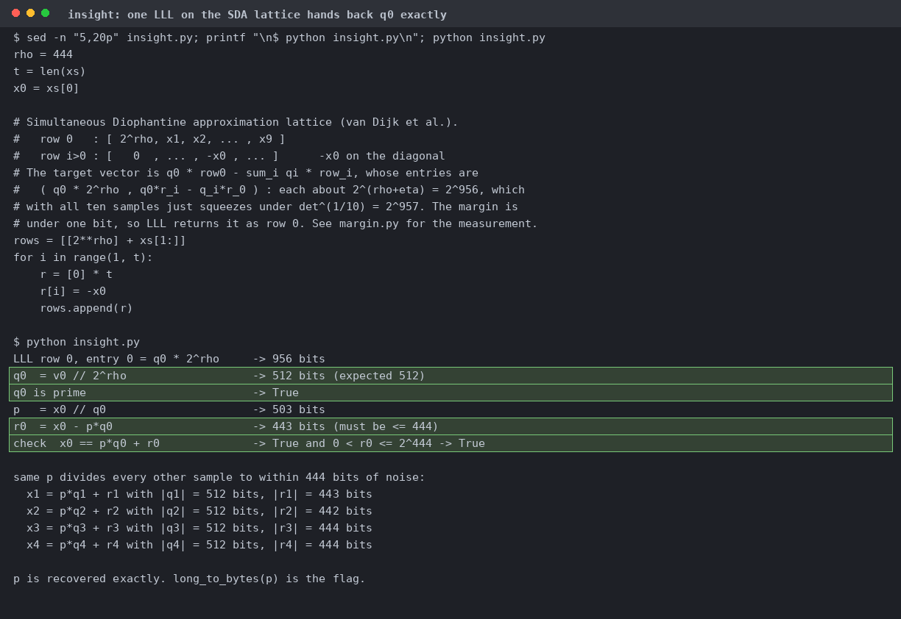
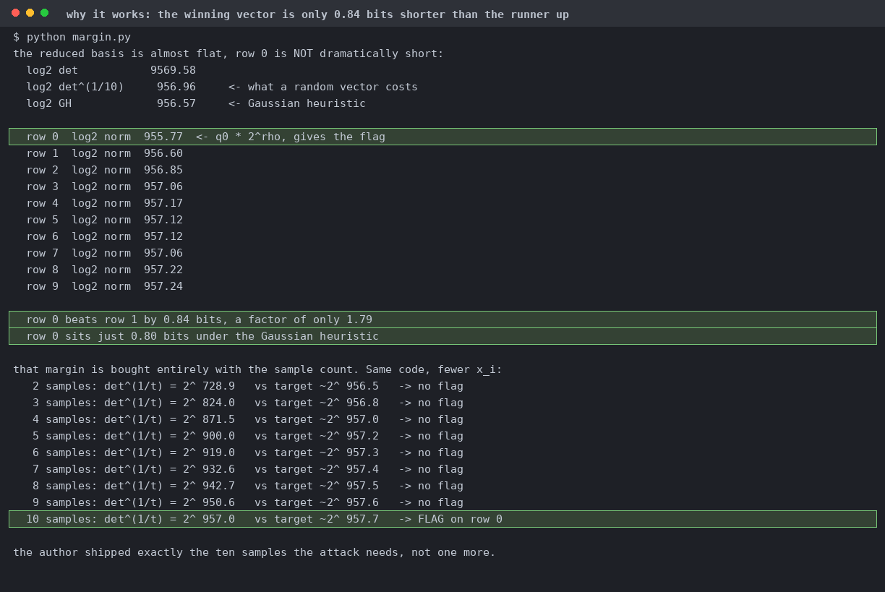
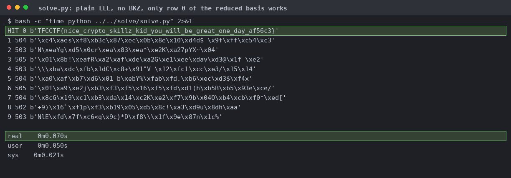

# 1+1

| | |
|---|---|
| Event | The Few Chosen CTF 2026 |
| Category | crypto |
| Difficulty | baby |
| Author | minipif |
| Points at close | 50 |
| Solves | 365 |
| Status | solved |

> should be easy

Files: [`challenge.zip`](handout/challenge.zip)

<details>
<summary><b>Solution</b></summary>

Each of the ten published integers is the flag times a fresh 512-bit prime, plus noise of at most `2^444`. One LLL on a simultaneous Diophantine approximation lattice recovers the first sample's prime. Then `p = x0 // (abs(LLL(M)[0][0]) >> 444)` is the flag. The lattice comes from [van Dijk, Gentry, Halevi, and Vaikuntanathan, "Fully Homomorphic Encryption over the Integers", 2009](https://eprint.iacr.org/2009/616).

## The generator

```
$ unzip -o handout/challenge.zip -d scratch/x
$ cat scratch/x/chall.sage
```

`chall.sage` sets `rbit = 444` and `pbit = 512`, then builds the samples.

```python
p = bytes_to_long(open('flag','rb').read())
xs = [p * getPrime(pbit) + random.randint(1,2**rbit) for _ in range(10)]
```



`scratch/x/structure.py` prints the sizes.

```
$ python3 scratch/x/structure.py
samples          : 10
bit length of x_i: [1014, 1014, 1014, 1014, 1014, 1014, 1014, 1015, 1015, 1015]
```

With `gamma = 1014` bits of sample and `eta = 512` bits of cofactor, the flag has about 503 bits (63 bytes). The noise bound is `rho = 444`, so it's the approximate common divisor problem.

## Why gcd fails

The same script prints the pairwise gcds of the first four samples.

```
  gcd(x0, x1) = 1   (1 bits)
  gcd(x0, x2) = 1   (1 bits)
  gcd(x0, x3) = 1   (1 bits)
  gcd(x1, x2) = 6   (3 bits)
  gcd(x1, x3) = 2   (2 bits)
  gcd(x2, x3) = 2   (2 bits)
```

The largest is 6, far short of a 503-bit divisor, because fresh noise on every sample breaks the exact gcd.


## The lattice

Put `2^rho` and the nine samples `x1` through `x9` across row 0, and `-x0` down the diagonal of the remaining nine rows.

```python
rows = [[2**RHO] + xs[1:]]
for i in range(1, t):
    r = [0] * t
    r[i] = -x0
    rows.append(r)
```

The target vector is `q0 * row0 + sum_i q_i * row_i`. Its first entry is `q0 * 2^rho` and the rest are `q0*r_i - q_i*r_0`. Each entry is about `2^(rho + eta) = 2^956`, small because the noise is bounded. On this instance LLL puts it in row 0, so `q0 = |v[0]| >> rho` and `p = x0 // q0`. Plain `fpylll` at dimension 10 was enough, without BKZ. `scratch/x/insight.py` checks the result.

```
$ python3 scratch/x/insight.py
q0  = v0 // 2^rho                   -> 512 bits (expected 512)
q0 is prime                         -> True
p   = x0 // q0                      -> 503 bits
r0  = x0 - p*q0                     -> 443 bits (must be <= 444)
check  x0 == p*q0 + r0              -> True and 0 < r0 <= 2^444 -> True
```

The same `p` divides every other sample, up to the 444-bit noise.



## Why ten samples

`scratch/x/margin.py` prints the norms of the reduced basis.

```
$ python3 scratch/x/margin.py
  log2 det^(1/10)     956.96     <- what a random vector costs
  log2 GH             956.57     <- Gaussian heuristic
  row 0  log2 norm  955.77  <- q0 * 2^rho, gives the flag
  row 1  log2 norm  956.60
  row 0 beats row 1 by 0.84 bits, a factor of only 1.79
  row 0 sits just 0.80 bits under the Gaussian heuristic
```

Row 0 wins by under a bit. The margin comes from the sample count, because `det^(1/t)` climbs toward the target length as `t` grows. The script also reruns the attack on fewer samples.

```
   2 samples: det^(1/t) = 2^ 728.9   vs target ~2^ 956.5   -> no flag
   5 samples: det^(1/t) = 2^ 900.0   vs target ~2^ 957.2   -> no flag
   9 samples: det^(1/t) = 2^ 950.6   vs target ~2^ 957.6   -> no flag
  10 samples: det^(1/t) = 2^ 957.0   vs target ~2^ 957.7   -> FLAG on row 0
```

The table's target is the estimate `sqrt(t) * 2^956` (the real row 0 came in under it, at 955.77). The 2, 5, and 9 sample runs all fail, so ten looks like the minimum.



## Reproduce

`solve/solve.py` reads `output.py` from the handout zip, runs the same LLL, and prints the row that decodes. It needs only `fpylll` and `pycryptodome`.



Flag: `TFCCTF{nice_crypto_skillz_kid_you_will_be_great_one_day_af56c3}`
</details>
