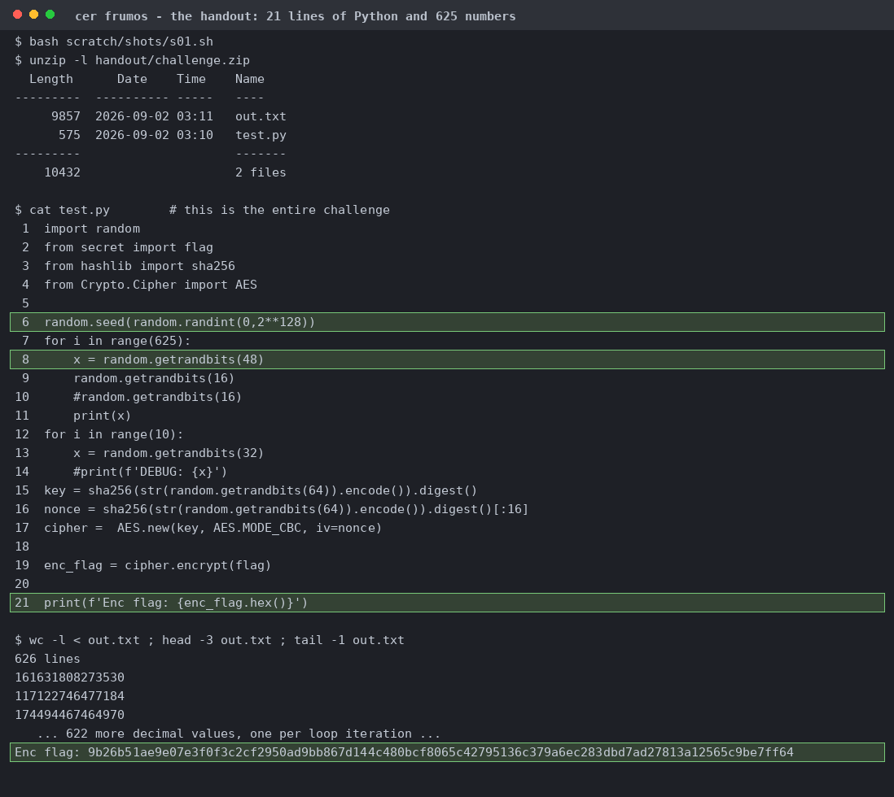
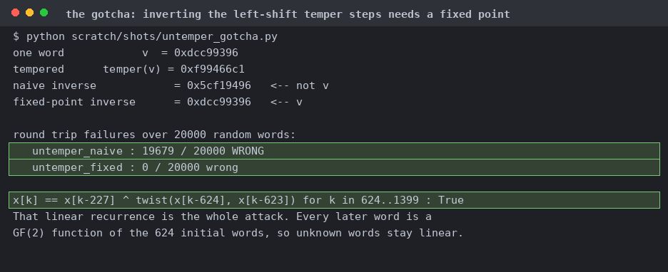
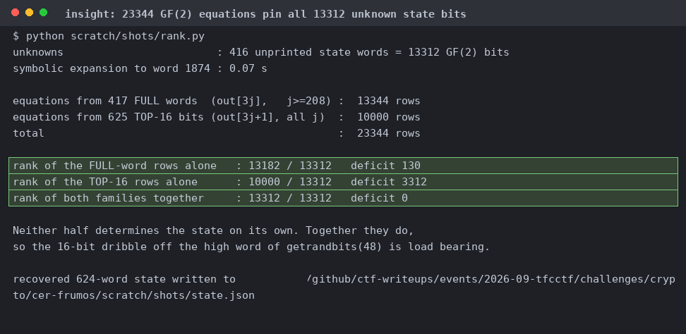
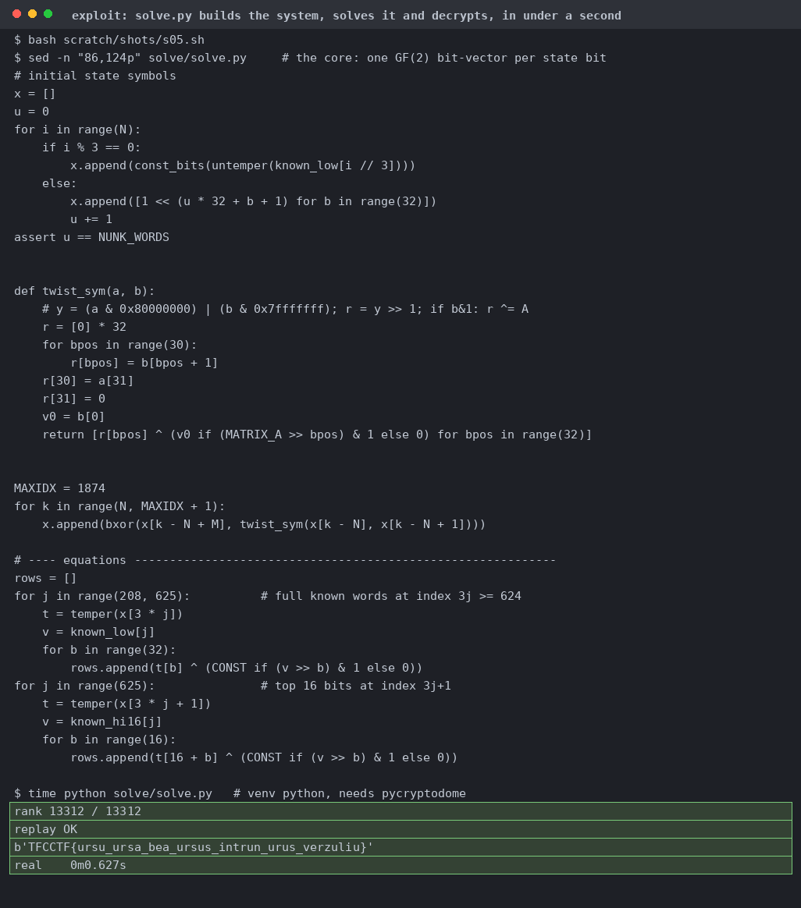
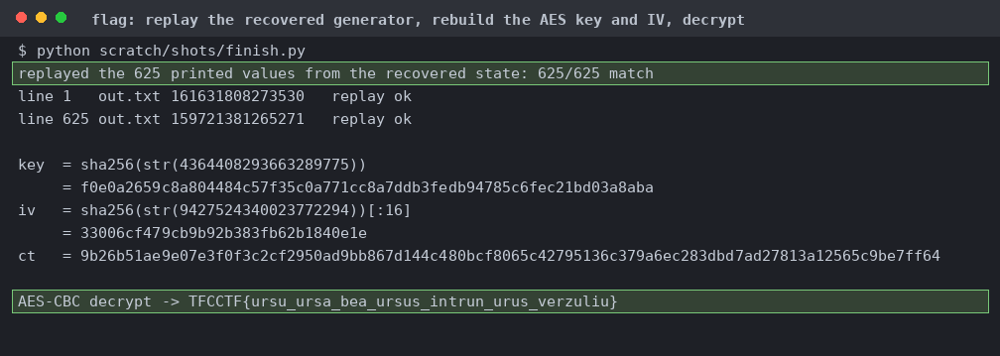

# cer frumos

| | |
|---|---|
| Event | The Few Chosen CTF 2026 |
| Category | crypto |
| Difficulty | grandpa |
| Author | minipif |
| Points at close | 50 |
| Solves | 303 |
| Status | solved |

> A description indeed.

Files: [`challenge.zip`](handout/challenge.zip)

<details>
<summary><b>Solution</b></summary>

The handout prints 625 partial Mersenne Twister draws, then encrypts the flag under a key from later draws. Only one word in three is printed in full, so the textbook untemper-and-reload attack fails. But MT19937 is linear over GF(2), tempering included. If each of the 416 state words not printed in full gets 32 symbols, running the recurrence forward turns the printed bits into linear equations. That's 23,344 equations in 13,312 unknowns, and one Gaussian elimination returns the state.

## The handout

```python
random.seed(random.randint(0,2**128))
for i in range(625):
    x = random.getrandbits(48)
    random.getrandbits(16)
    print(x)
for i in range(10):
    x = random.getrandbits(32)
key = sha256(str(random.getrandbits(64)).encode()).digest()
nonce = sha256(str(random.getrandbits(64)).encode()).digest()[:16]
```

A seed drawn from `random.randint(0,2**128)` is out of brute-force range. The key and IV come from later draws, so the target is the generator state. The bare `random.getrandbits(16)` throws its value away but still advances the generator.



## What the loop leaks

CPython's `getrandbits(k)` pulls `ceil(k/32)` 32-bit words from the twister, low word first, so each iteration consumes three words. The printed 48-bit value is the low word in full plus the top 16 bits of the second word. The third word feeds the discarded 16-bit draw and never appears. `scratch/shots/wordmap2.py` prints the layout from the recovered state, asserted against `out.txt`.

```
$ python3 scratch/shots/wordmap2.py
word | value      | how the loop uses it                  | leaked to out.txt
-----+------------+---------------------------------------+------------------
   0 | 0xd6843c7a | getrandbits(48) low  word              | ALL 32 bits
   1 | 0x93008ce7 | getrandbits(48) high word, >> 16       | top 16 only  (0x9300....)
   2 | 0xc8dfdf19 | getrandbits(16), return value dropped  | NOTHING
     |            | out.txt line 1 -> 161631808273530
```

The 625 iterations leak 30,000 bits against 19,937 bits of state, plenty in principle.

The textbook attack untempers 624 consecutive full outputs and loads them back as the state. Here the first 624 state words include only 208 printed in full (indices 0, 3, 6, and so on). The other 416 words show at most their top 16 bits, so untempering can't reach them.


## The untemper trap

A wrong untemper fails silently. Re-applying the `>> 18` step inverts it, which tempts you to invert the left shifts the same way. Inverting `y ^= (y << s) & m` means finding the fixed point of `y = z ^ ((y << s) & m)` with `z` held constant. Feeding `y` back into itself instead round trips on only a small minority of inputs. Test the inverse on local random words, not challenge data.

```
$ python3 scratch/shots/untemper_gotcha.py
one word            v  = 0xdcc99396
tempered      temper(v) = 0xf99466c1
naive inverse            = 0x5cf19496   <-- not v
fixed-point inverse      = 0xdcc99396   <-- v

round trip failures over 20000 random words:
   untemper_naive : 19679 / 20000 WRONG
   untemper_fixed : 0 / 20000 wrong
```

The same script checks that untempered words satisfy `x[k] == x[k-227] ^ twist(x[k-624], x[k-623])` for every `k` from 624 to 1399. Both `twist` and tempering are GF(2)-linear, so every output is a fixed linear function of the 624 initial words.



## Symbolic state

Each bit of a state word is a Python integer bitmask over 13,313 symbols. Bit 0 is the constant 1 and bit `i+1` is unknown `i`. A known word gets constant bits and an unknown word gets 32 fresh symbols. Then the recurrence runs forward as the twister runs it.

```python
for i in range(N):
    if i % 3 == 0:
        x.append(const_bits(untemper(known_low[i // 3])))
    else:
        x.append([1 << (u * 32 + b + 1) for b in range(32)])
        u += 1

for k in range(N, MAXIDX + 1):
    x.append(bxor(x[k - N + M], twist_sym(x[k - N], x[k - N + 1])))
```

Expanding to word 1874 covers all 625 iterations. `temper(x[3j])` must equal the low 32 bits of each printed value, and the top 16 bits of `temper(x[3j+1])` must equal the high half. The full words below index 624 are state words we already know, so full-word equations start at `j = 208`, giving 417 of them.

## The rank

`scratch/shots/rank.py` splits the system to check whether the top-16 fragments matter.

```
$ python3 scratch/shots/rank.py
unknowns                        : 416 unprinted state words = 13312 GF(2) bits
equations from 417 FULL words  (out[3j],   j>=208) :  13344 rows
equations from 625 TOP-16 bits (out[3j+1], all j)  :  10000 rows
total                                              :  23344 rows

rank of the FULL-word rows alone   : 13182 / 13312   deficit 130
rank of the TOP-16 rows alone      : 10000 / 13312   deficit 3312
rank of both families together     : 13312 / 13312   deficit 0
```

The full words alone come up 130 short, and 10,000 fragment bits can't cover 13,312 unknowns. Together they reach full rank. The high half of `getrandbits(48)` looks like a leftover of the 48-bit request, but the solve needs it.



## Recovering the key

Elimination keeps the rows in a dictionary keyed by pivot, then back substitution recovers the unknown bits. The 624 words go into `random.setstate((3, tuple(state) + (0,), None))` with the index set to 0. After the ten discarded 32-bit draws, the next two 64-bit draws give the key and IV.

```
$ python3 scratch/shots/finish.py
replayed the 625 printed values from the recovered state: 625/625 match
key  = sha256(str(4364408293663289775))
     = f0e0a2659c8a804484c57f35c0a771cc8a7ddb3fedb94785c6fec21bd03a8aba
iv   = sha256(str(9427524340023772294))[:16]
     = 33006cf479cb9b92b383fb62b1840e1e
AES-CBC decrypt -> TFCCTF{ursu_ursa_bea_ursus_intrun_urus_verzuliu}
```

## Reproduce

`solve/solve.py` goes from `out.txt` to the plaintext in one pass and wants `pycryptodome`. It prints the rank and a replay check on stderr.





Flag: `TFCCTF{ursu_ursa_bea_ursus_intrun_urus_verzuliu}`
</details>
