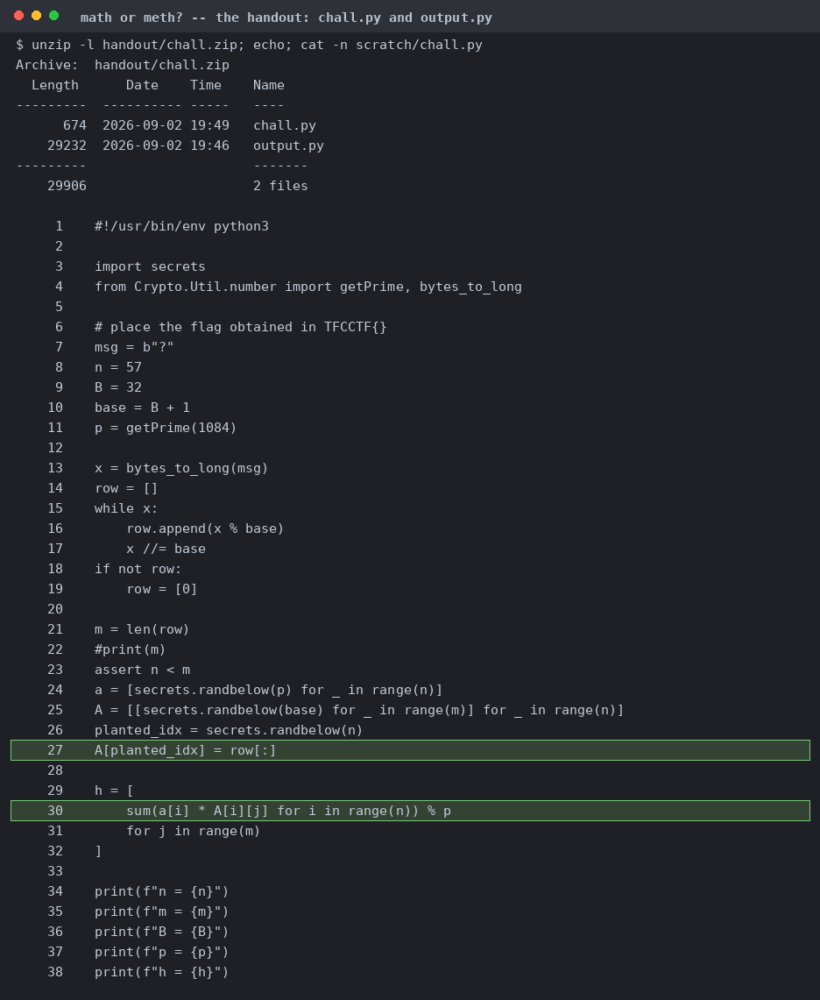
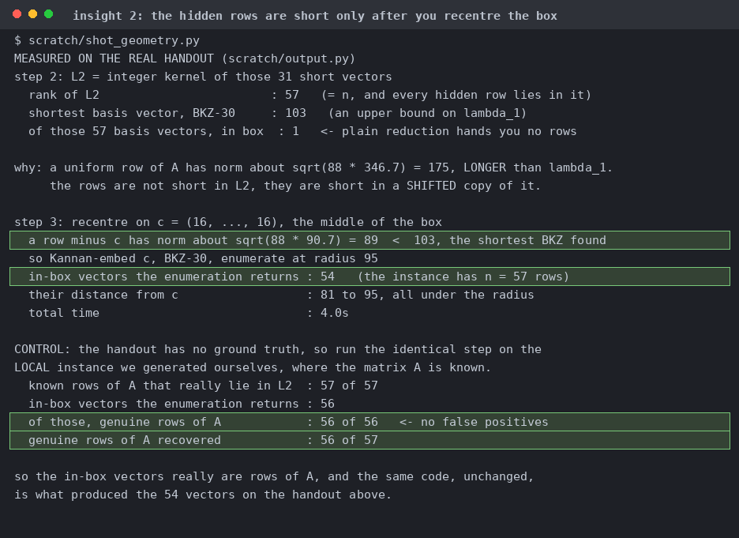
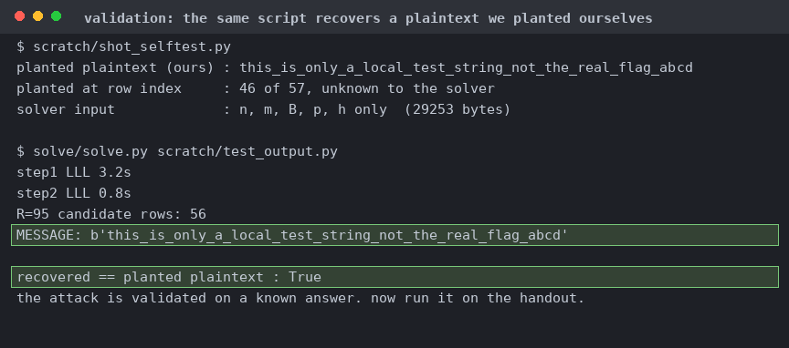
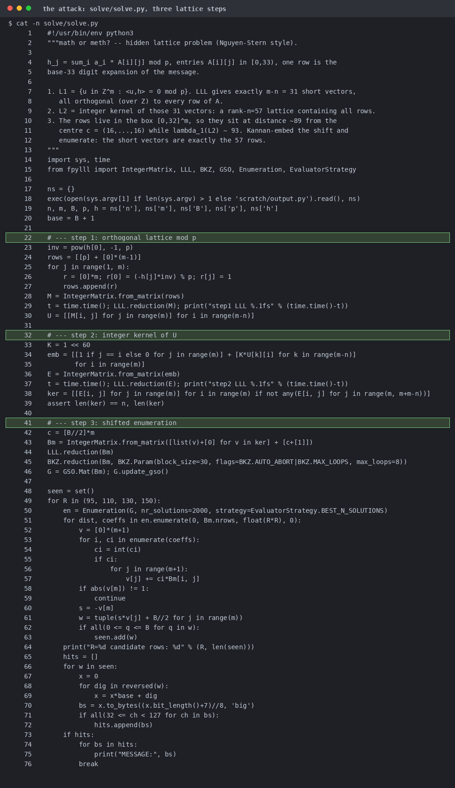
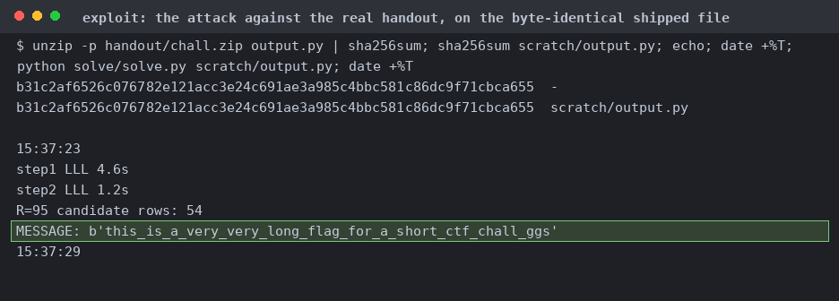
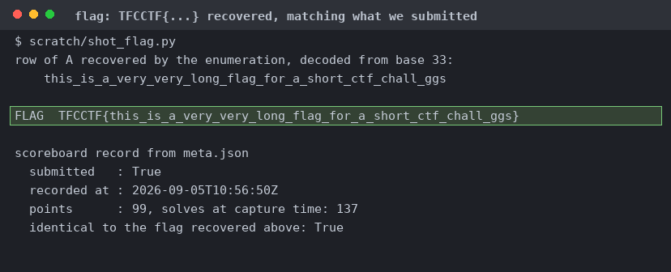

# math or meth?

| | |
|---|---|
| Event | The Few Chosen CTF 2026 |
| Category | crypto |
| Difficulty | grandpa |
| Author | minipif |
| Points at close | 50 |
| Solves | 215 |
| Status | solved |

> Br Ba

Files: [`chall.zip`](handout/chall.zip)

<details>
<summary><b>Solution</b></summary>

The handout publishes 88 residues modulo a 1084-bit prime and hides both the 57 secret weights and the 57-by-88 matrix they weight. One row of that matrix is the inside of the flag's braces in base 33. The key observation is that a short vector orthogonal to the residues modulo `p` is orthogonal to every hidden row over the integers. Its inner product with a row of base-33 digits stays under `2^21`, so the congruence is an exact equation. That's the orthogonal lattice attack of [Nguyen and Stern, "The Hardness of the Hidden Subset Sum Problem and Its Cryptographic Implications", CRYPTO 1999](https://link.springer.com/chapter/10.1007/3-540-48405-1_3). Then it's three lattice reductions, and the last one only finds rows after recentering.

## The generator

```
$ unzip -o handout/chall.zip -d scratch
$ cat scratch/chall.py
```

It picks `n = 57` secret weights below a 1084-bit prime and fills a 57-by-88 matrix `A` with digits from `[0, 33)`. One random row becomes the flag's base-33 digits, and the only output besides the parameters is

```python
h = [sum(a[i] * A[i][j] for i in range(n)) % p for j in range(m)]
```

The planted row index stays secret too.



## Counting bits

```
$ python3 scratch/shot_params.py
  n    = 57       secret rows of A
  m    = 88       columns, one per base-33 digit of the message
  B    = 32       so every entry A[i][j] lives in [0, 32]
  p    = 1084-bit prime
  data given          :   88 residues, 1084 bits each  =  95392 bits
  unknown weights a   :   57 values,   1084 bits each  =  61788 bits
  unknown matrix A    : 5016 digits,   5.04 bits each  =  25280 bits
```

The 87,068 secret bits are fewer than the 95,392 data bits, so the solution should be unique. Algebra still fails, because every residue is uniform modulo `p` and the 57 free weights absorb any choice of `A`. The weakness is that `A`'s entries are tiny while the weights and residues are 1084-bit numbers.


## A local answer key

The handout doesn't come with an answer key, so `solve/gen_test.py` builds a local instance with the same `n`, `m`, `B`, and prime size. It saves `A` and the planted row index next to `h`, and every step below ran on it first.

```
$ python3 solve/gen_test.py
$ python3 solve/step1.py
```

## Step 1, the orthogonal lattice

Take `L = { u in Z^88 : <u, h> = 0 mod p }`, with determinant `p`, dimension 88, and a basis built from `h[0]^-1 mod p`. LLL splits the reduced basis in two.

```
$ python3 scratch/shot_gap.py
   idx    ||u||    <u, A[k]> = 0 over Z for all 57 hidden rows?
     0      4500    YES
    30      6047    YES   <- last short vector, index m-n-1
    31     19097    no    <- first long vector, 3x jump
short vectors (norm < 10000): 31   and m - n = 88 - 57 = 31
every one of them is integer-orthogonal to every hidden row: True

why: u short and A[k] tiny forces the mod-p relation to hold over Z.
   |<u, A[k]>| <= ||u|| * ||A[k]|| <= 6169 * 193 < 2^21
   but the relation is 0 mod p with p ~ 2^1084, so it is 0 exactly.
```

The 6169 is the longest of the 31 short vectors, and 193 is the longest row of `A`. Thirty one short vectors come first, then the norm jumps threefold. That's `m - n`, the dimension of the orthogonal complement of an `n`-dimensional row space in `Z^88`. The `YES` column needs `A`, so it only prints on the local instance.


## Step 2, the kernel

The integer kernel of those 31 vectors contains the row space. `solve/step2.py` appends `K * U[k][i]` columns with `K = 1 << 60`, so LLL zeros the tail before anything else. The reduced rows whose tail is zero span the kernel.

```python
K = 1 << 60
emb = [[1 if j == i else 0 for j in range(m)] + [K * U[k][i] for k in range(m - n)]
       for i in range(m)]
```

The result is a rank-57 lattice `L2` holding every row of `A`, flag row included. On the local instance all 57 known rows lie in it.

## Step 3, recentering

Reducing `L2` hard and reading off short vectors fails. After BKZ-30 the shortest basis vector has norm 103, while a uniform row of `A` has expected norm `sqrt(88 * 346.7) = 175`.

```
$ python3 scratch/shot_geometry.py
  rank of L2                        : 57   (= n, and every hidden row lies in it)
  shortest basis vector, BKZ-30     : 103   (an upper bound on lambda_1)
  of those 57 basis vectors, in box  : 1   <- plain reduction hands you no rows
```

The fix is a change of origin. A row's entries lie in `[0, 32]`, so subtracting the box center `c = (16, ..., 16)` drops its expected norm to `sqrt(88 * 90.7) = 89`. That's under the 103 BKZ found, so the rows are short in a shifted copy of `L2`. The solver Kannan-embeds `c` as an extra basis row with a marker coordinate, reduces, and enumerates.

```python
c = [B // 2] * m
Bm = IntegerMatrix.from_matrix([list(v) + [0] for v in ker] + [c + [1]])
LLL.reduction(Bm)
BKZ.reduction(Bm, BKZ.Param(block_size=30, flags=BKZ.AUTO_ABORT | BKZ.MAX_LOOPS, max_loops=8))
```

On the handout, enumeration at radius 95 returns 54 in-box vectors at distances 81 to 95 from the center. Read as base-33 digits, one of them is printable ASCII.



## The control run

On the handout alone, the 54 vectors could be rows of `A`, near misses, or noise. The same script reruns the identical code on the local instance.

```
CONTROL: the handout has no ground truth, so run the identical step on the
LOCAL instance we generated ourselves, where the matrix A is known.
  known rows of A that really lie in L2  : 57 of 57
  in-box vectors the enumeration returns : 56
  of those, genuine rows of A            : 56 of 56   <- no false positives
  genuine rows of A recovered            : 56 of 57
```

Every in-box vector on the local instance is a genuine row of `A`, so the 54 on the handout should be rows too.

`scratch/shot_selftest.py` gives `solve/solve.py` only `n`, `m`, `B`, `p`, and `h` from a local instance, with the planted row index hidden. It checks that the planted string comes back.



## Reproduce

`solve/solve.py` runs the three steps in `fpylll` on the shipped `output.py`. It keeps any vector whose digits land in `[0, 32]` and decode to printable ASCII.



`solve/step1.py`, `solve/step2.py`, and `solve/step3.py` are the same pipeline split apart, with each step checked on the local answer key.

The run first hashes `output.py` from `chall.zip` and the extracted copy, and the hashes match.



The recovered row decodes to the inside of the braces, and wrapping it in `TFCCTF{}` gives the flag.



Flag: `TFCCTF{this_is_a_very_very_long_flag_for_a_short_ctf_chall_ggs}`
</details>
