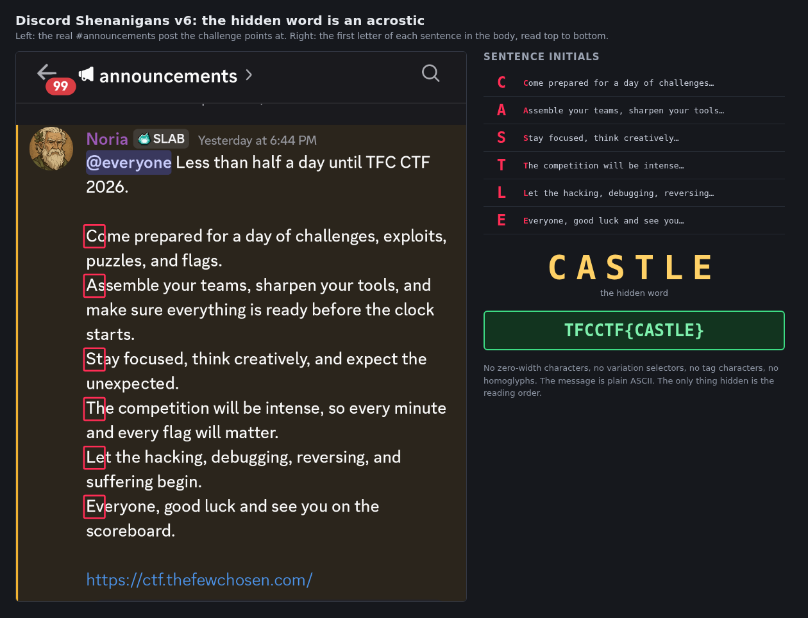
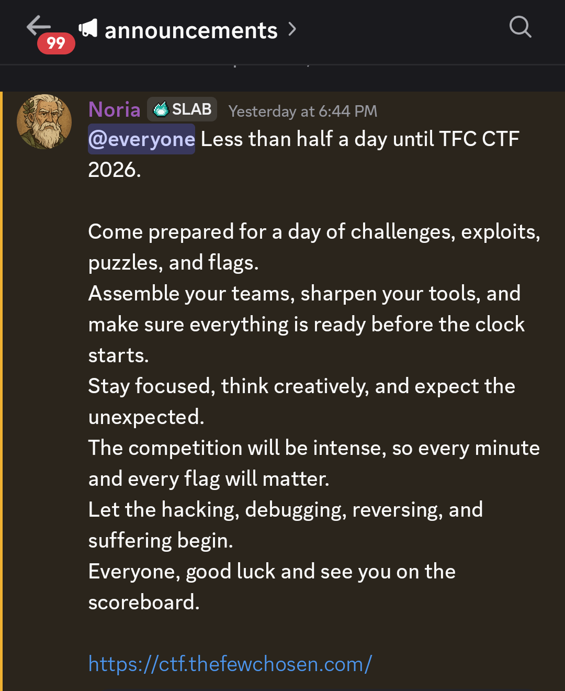

# Discord Shenanigans v6

| | |
|---|---|
| Event | The Few Chosen CTF 2026 |
| Category | misc |
| Difficulty | baby |
| Author | hofill |
| Points at close | 50 |
| Solves | 265 |
| Status | solved |

> You already know. We don't want this challenge to be guessy. Wrap the hidden word in TFCCTF{}. It's in #announcements.

<b>Solution</b>

## Solution

The hidden word is an acrostic. The six sentences in the previous day's `#announcements` post start with Come, Assemble, Stay, The, Let, Everyone, which spells CASTLE. The @everyone line and the closing link don't count.

## The Unicode dead end

A hidden word in a chat message smells like Unicode stego, so I checked for non-ASCII codepoints first.

A scan of my transcription came back empty. But I transcribed it from a screenshot, which can't show invisible characters, so that only proves the visible text is plain ASCII.

Flag: `TFCCTF{CASTLE}`

