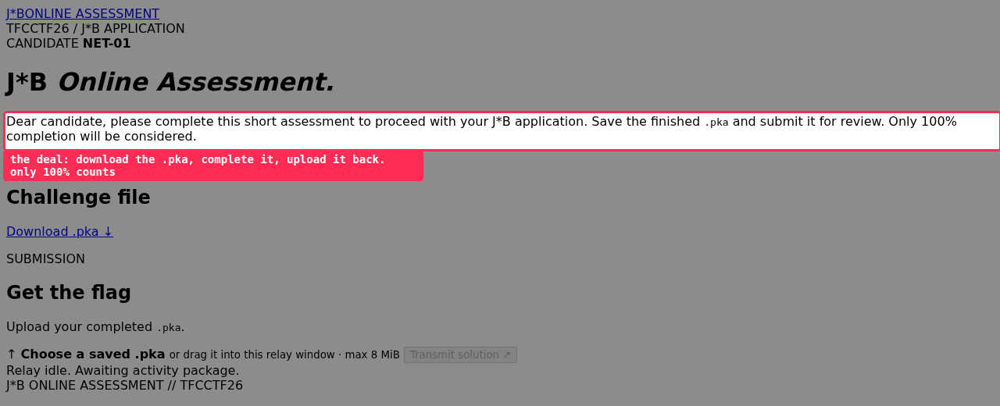
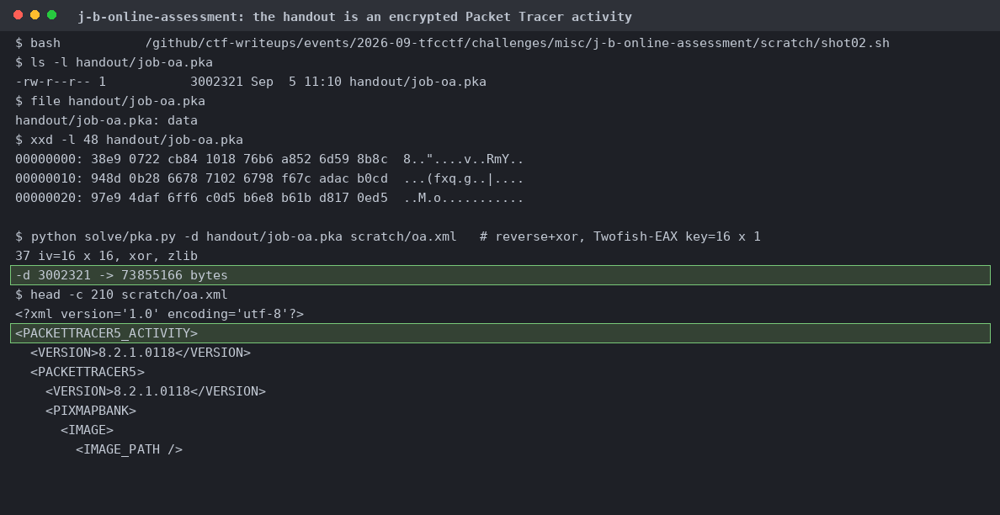
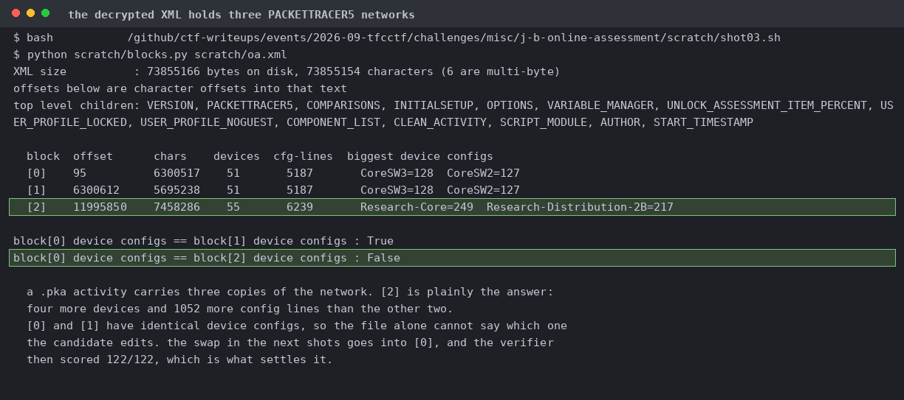
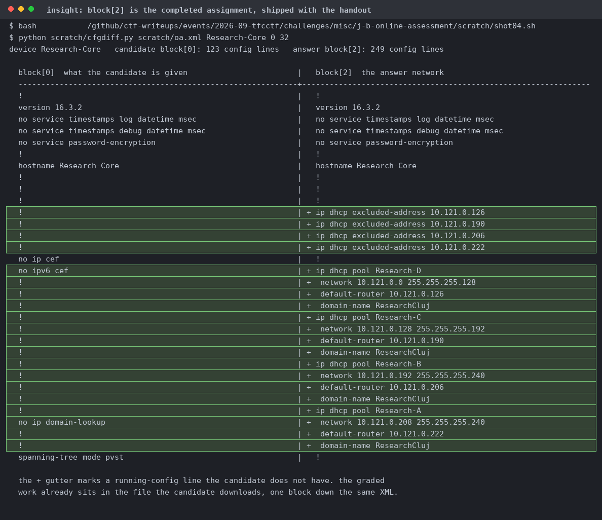
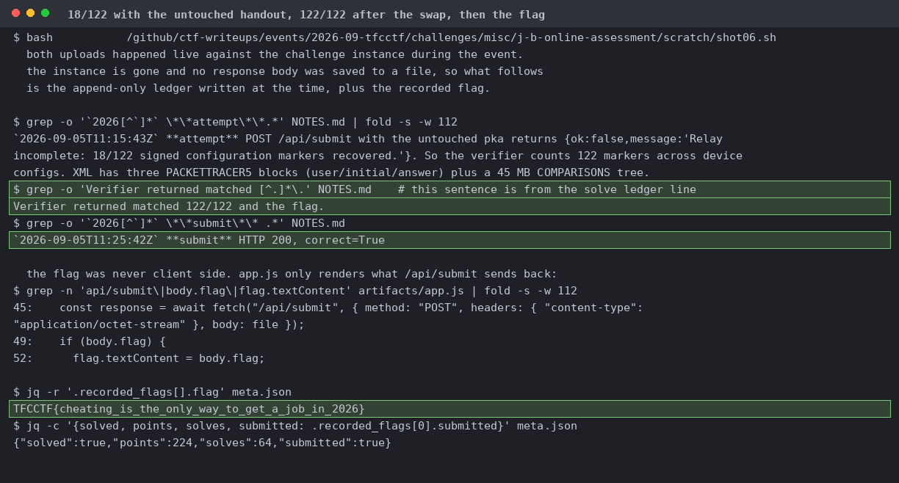

# J*B Online Assessment

| | |
|---|---|
| Event | The Few Chosen CTF 2026 |
| Category | misc |
| Difficulty | baby |
| Author | cr0 |
| Points at close | 93 |
| Solves | 142 |
| Status | solved |

> Can you get a j*b in 2026?

Files: [`job-oa.pka`](handout/job-oa.pka)

<details>
<summary><b>Solution</b></summary>

## Solution

The Packet Tracer file you're asked to complete holds three `<PACKETTRACER5>` blocks, and the third is the finished answer network. I decrypt the file, paste block 2 over block 0, and re-encrypt. None of it needs Packet Tracer itself.

## Recon

```bash
file handout/job-oa.pka          # data
wc -c handout/job-oa.pka         # 3002321
xxd handout/job-oa.pka | head    # no magic, no header, high entropy throughout
```

The challenge is dynamic, and instances start on the challenge manager, not the public API.

```bash
python3 solve/instapi.py POST /isolated '{"name":"j-b-online-assessment"}'
python3 solve/instapi.py GET  /isolated
```

The instance at `https://<deployment>.challs.ctf.thefewchosen.com` is a Packet Tracer assessment page. It serves `/downloads/job-oa.pka` and takes the finished file at `POST /api/submit`, with the flag only for 100 percent completion.



Submitting the untouched handout already returns a score:

```json
{"ok": false, "message": "Relay incomplete: 18/122 signed configuration markers recovered."}
```

## Decrypting the .pka

[pka2xml](https://github.com/mircodz/pka2xml) documents the format. From the outside in, it's a byte-level obfuscation pass, Twofish in EAX mode, and a second obfuscation pass. Under those sit a four-byte big-endian length header and zlib. `solve/pka.py` reimplements both directions in pure Python (pka2xml is C++). The obfuscation passes are short:

```python
def _stage1(data):                      # reverse and XOR with a length-dependent counter
    n = len(data)
    return bytes(data[n - 1 - i] ^ ((n - i * n) & 0xFF) for i in range(n))

def _stage3(data):                      # XOR each byte with (len - index), an involution
    n = len(data)
    return bytes(b ^ ((n - i) & 0xFF) for i, b in enumerate(data))
```

The Twofish key is sixteen bytes of `137` and the IV is sixteen bytes of `16`, the fixed constants pka2xml uses. The `twofish` package on PyPI still does `import imp`, which modern Python removed, so `pka.py` installs a shim module under that name first.

```bash
python3 solve/pka.py -d handout/job-oa.pka scratch/job-oa.xml
# -d 3002321 -> 73855166 bytes
```

The XML declares itself `PACKETTRACER5_ACTIVITY` version `8.2.1.0118`.



## Finding the answer key

```bash
grep -c '<PACKETTRACER5>' scratch/job-oa.xml        # 3
```

Next to the blocks sits a 45 megabyte `COMPARISONS` tree with the grading rubric. Block 2 has 55 devices and 6,239 configuration lines, where the other two have 51 and 5,187.



Router `Research-Core` has 123 configuration lines in the candidate block and 249 in the answer block, including four DHCP pools. A `+` in the gutter marks a line the candidate config lacks.



Blocks 0 and 1 have identical device configs, so the file can't say which one the candidate edits. Overwriting block 0 and submitting settled it.

## The swap

`solve/build.py` finds the blocks by regex on `\n  <PACKETTRACER5>` and `\n  </PACKETTRACER5>`, then splices the answer block over the candidate block.

```python
bs = blocks(s)
a0, b0 = bs[0]
a2, b2 = bs[2]
new = s[:a0] + s[a2:b2] + s[b0:]
```

Slicing strings skips a slow parse of a 74 megabyte document. It also avoids a reserialization that could shift whitespace or attribute order, which the grader may check.

As a control, the encryptor round-trips the untouched XML byte for byte, and uploading that file still scores 18 out of 122. So re-encryption alone doesn't move the score. The rebuilt file decrypts with only block 0 replaced.


The page's `app.js` posts the file as the raw request body to `/api/submit`. The grader returned 122 out of 122 and the flag.

In case the grader keyed on activity assets, `build.py` also has a `--keep-banks` mode. It copies the candidate block's `PIXMAPBANK` through `MOVIEBANK` section into the answer block. The plain swap scored, so it went unused.

## Reproduce

```bash
python3 solve/pka.py -d handout/job-oa.pka scratch/job-oa.xml    # 3 MB -> 73.8 MB
python3 solve/build.py answerswap                                # swap and re-encrypt
python3 solve/pka.py -e scratch/answerswap.xml scratch/check.pka # round-trip control
```

`artifacts/solution.pka` is the file that scored, next to the archived page and its `app.js`.



Flag: `TFCCTF{cheating_is_the_only_way_to_get_a_job_in_2026}`
</details>
