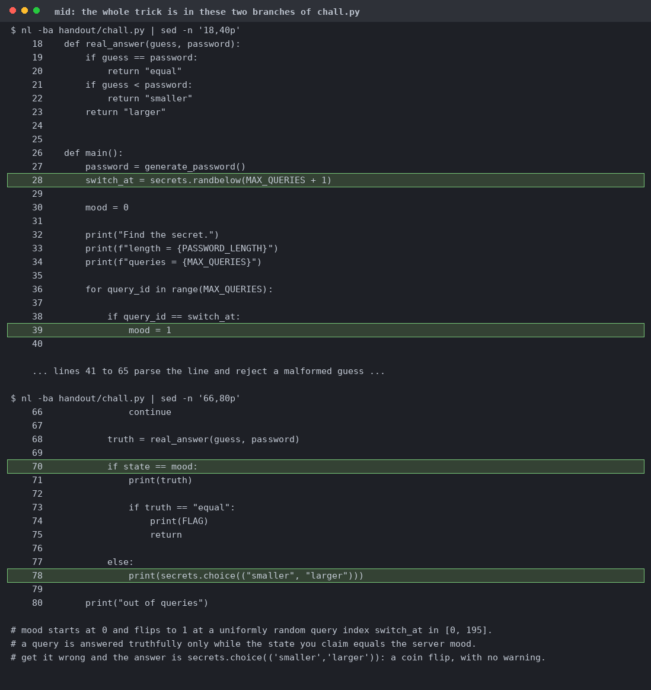
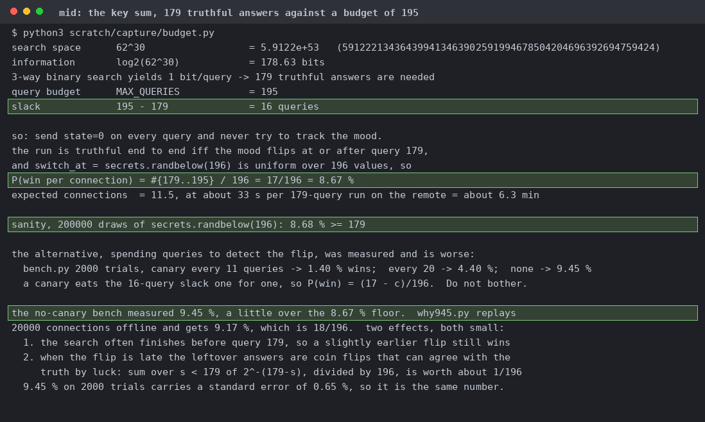
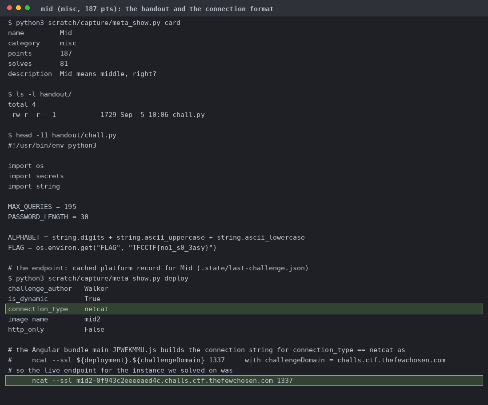
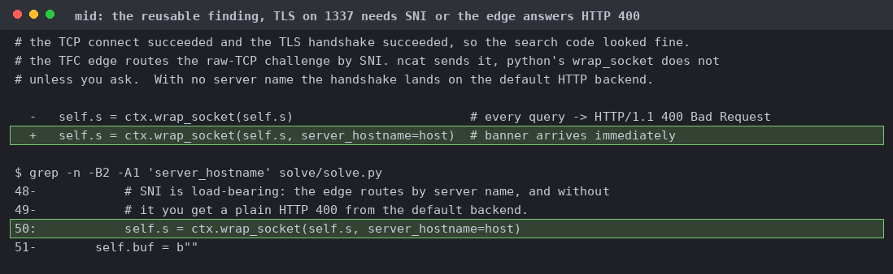
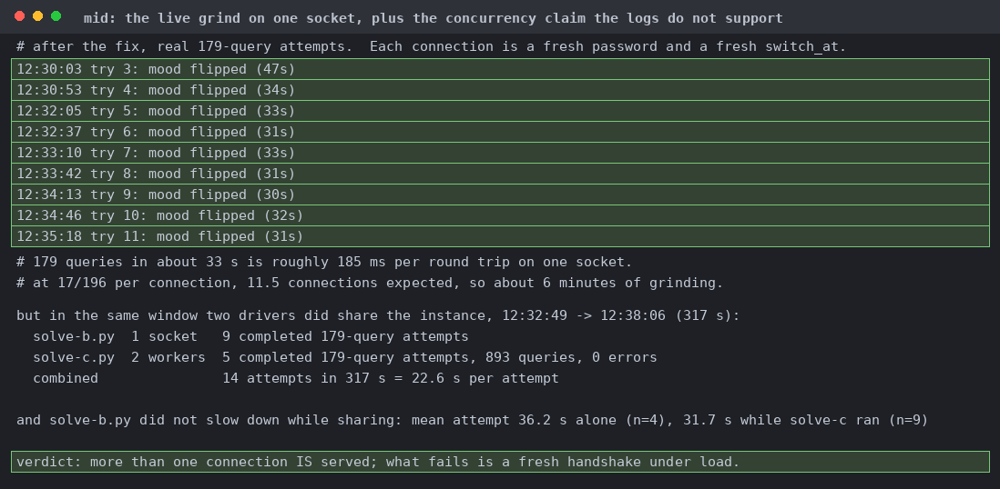
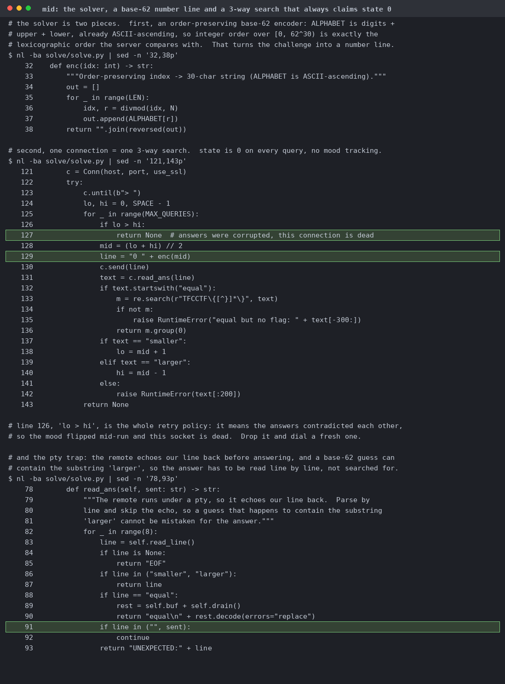
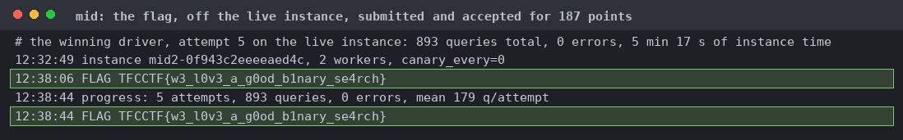

# Mid

| | |
|---|---|
| Event | The Few Chosen CTF 2026 |
| Category | misc |
| Difficulty | baby |
| Author | Walker |
| Points at close | 73 |
| Solves | 159 |
| Status | solved |

> Mid means middle, right?

Files: [`__pycache__`](handout/__pycache__), [`chall.py`](handout/chall.py)

<details>
<summary><b>Solution</b></summary>

## Solution

Claim `state=0` on every query and run a plain three-way binary search over the secret. The search wins whenever the server's mood flips after it ends, at least 17 times in 196, so you redial until a connection wins. The remote is TLS on port 1337 of `<deployment>.challs.ctf.thefewchosen.com`, and the ingress routes raw-TCP challenges by server name. In Python, `ctx.wrap_socket(sock)` doesn't send SNI, so every query comes back as `HTTP/1.1 400 Bad Request` until you pass `server_hostname=host`.

```python
self.s = ctx.wrap_socket(self.s, server_hostname=host)
```

## Recon

```bash
wc -c handout/chall.py                     # 1729
cat handout/chall.py
python3 -c "import math; print(math.log2(62**30))"     # 178.63
```

`chall.py` prints `Find the secret.`, `length = 30`, and `queries = 195`, then reads `<state> <guess>` 195 times. The secret is 30 characters drawn uniformly from `string.digits + string.ascii_uppercase + string.ascii_lowercase`, so 62 symbols. An empty guess, a guess longer than 30, or one with a character outside that alphabet prints `invalid` and still uses up the query.


For a valid guess, the server computes the honest comparison and then decides whether to tell you.

```python
switch_at = secrets.randbelow(MAX_QUERIES + 1)
mood = 0
for query_id in range(MAX_QUERIES):
    if query_id == switch_at:
        mood = 1
    ...
    if state == mood:
        print(truth)
        if truth == "equal":
            print(FLAG); return
    else:
        print(secrets.choice(("smaller", "larger")))
```

`switch_at` is a uniform random query index where the mood flips from 0 to 1. You get the truth only while your claimed state matches the mood. A lie is the same two words as the truth, so you can't spot one.



## The budget

A 30-character base-62 secret holds `log2(62**30) = 178.63` bits. The `equal` branch has probability about `62**-30`, so each query gives at most one bit. The search needs 179 truthful answers, and the budget is 195. An order-preserving base-62 encoder turns the secret into an integer and the server into a comparison oracle.

```python
def enc(idx: int) -> str:
    out = []
    for _ in range(LEN):
        idx, r = divmod(idx, N)
        out.append(ALPHABET[r])
    return "".join(reversed(out))
```

With `state=0` on every query, the whole run is truthful exactly when `switch_at >= 179`. That covers 17 of the 196 equally likely values, or 8.67 percent per connection. The driver redials when `lo > hi`, since an empty interval means some answer lied.



## Dead end: canaries

The guess `0` always has the truthful answer `smaller`, since it's a proper prefix of the secret or smaller at the first character. It looks like a perfect canary for the mood flip.

A canary can only prove bad news. A `state=0` canary answered `larger` proves the mood flipped, but a `smaller` might be a coin flip that agrees with the truth. So a canary can abort a lost run and never confirm a good one, and each canary spends one of the sixteen spare queries. With `c` leading canaries a run needs `switch_at >= 179 + c`, so the odds drop to `(17 - c)/196`.

`solve/bench.py` confirms this over 2000 connections per setting:

| setting | wins | expected queries per flag |
|---|---:|---:|
| `canary_every=0` | 9.45% | 1888 |
| `canary_every=20` | 4.40% | 2730 |
| `canary_every=11` | 1.40% | 8215 |

The baseline beats 17/196 because a late flip doesn't always lose. The search may finish before the flip, or the few coin flips after it may all agree with the truth. An offline replay of 20,000 connections gets 9.17 percent, within the bench's standard error of 0.65 percent.

## Finding the transport

The instance answered every port with `HTTP/1.1 400 Bad Request`, and a browser fetch of `https://<deployment>.challs.ctf.thefewchosen.com/` returned a `TFCCTF Challenge Loading` page. It looked like an HTTP-only proxy. The site's front end builds the connection string it shows you, so it knows the real format.

```bash
curl -s https://ctf.thefewchosen.com/main-JPWEKMMU.js | grep -o 'ncat[^`]*'
# ncat --ssl ${n}.${challengeDomain} 1337
```

Function `jp` in that Angular bundle renders an `http` challenge as a URL and everything else as `ncat --ssl <deployment>.challs.ctf.thefewchosen.com 1337`. The platform's challenge record already said `connection_type: "netcat"` and `http_only: false`, so the endpoint was right all along.



`ncat --ssl` sends SNI, and my `wrap_socket` call didn't, so the ingress handed every handshake to its default HTTP backend. One driver log recorded 89 of those 400 replies. With `server_hostname` set, the banner arrives immediately.



Each team could hold three instances, and claiming one took dozens of retries. After the fix, a single-socket driver and a two-worker driver both completed attempts on the same instance.



## The pty echo and the prompt on stderr

The service runs behind a pty, so it echoes your line before it answers. A base-62 guess can contain `larger` or `equal` by chance, so anchor the answer scan with `(?m)^(?:smaller|larger|equal)`. The local reproduction needs the same pty.

```bash
socat OPENSSL-LISTEN:19139,cert=both.pem,verify=0,reuseaddr,fork \
      EXEC:"python3 -u handout/chall.py",pty,ctty,setsid,echo=1,stderr
```

Keep the `stderr` option. Under a pty, CPython writes the `input()` prompt to stderr, so without it the banner lacks `> ` and a driver waiting on it hangs.

`solve/solve.py` has `enc()`, the `if lo > hi` retry, and `read_ans()` to skip the echo.



Locally, eight connections lose the coin flip and the ninth runs clean. Query 179 returns `equal` and the placeholder flag.


On the remote an attempt takes about 33 seconds, so the expected grind at 17/196 is around six minutes. The winning two-worker run took five attempts and 893 queries without errors.

## Reproduce

```bash
python3 solve/bench.py 2000 0 1 9912     # trials, canary_every, threads, port
python3 solve/solve-c.py 3000            # claim an instance and grind, budget in seconds
```

`solve/solve-c.py` is the two-worker driver that won. `bench.py` drives a plain-TCP copy of `chall.py` on port 9912.



Flag: `TFCCTF{w3_l0v3_a_g0od_b1nary_se4rch}`
</details>
