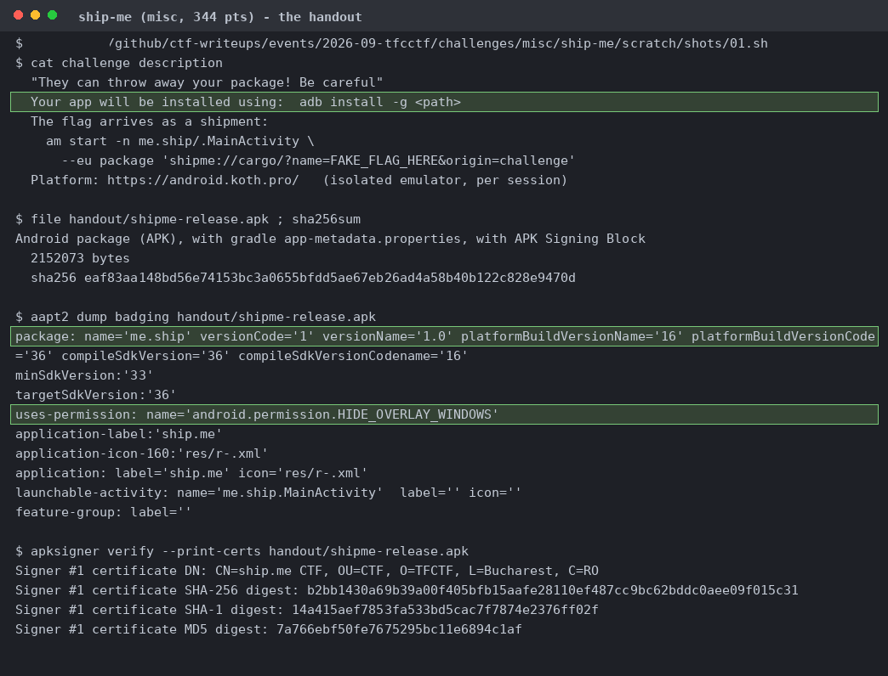
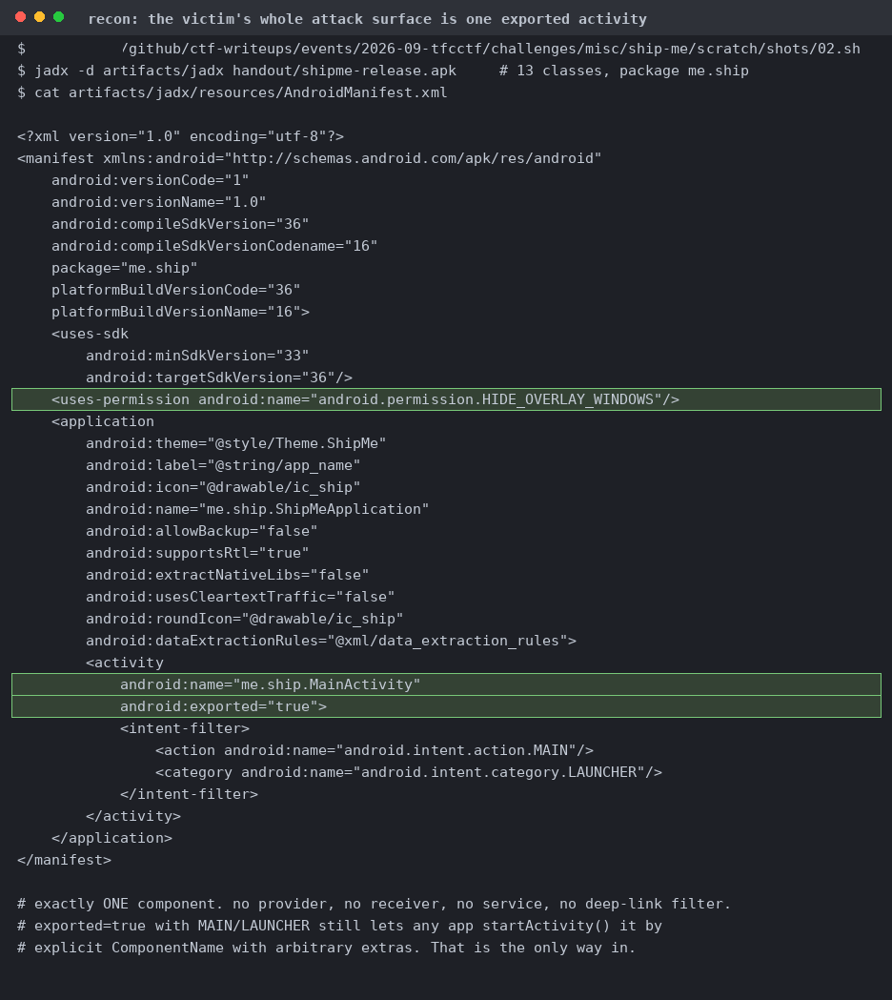
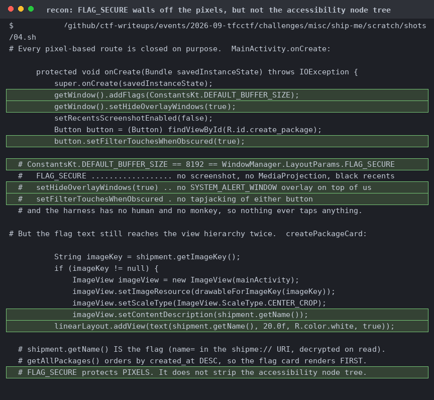
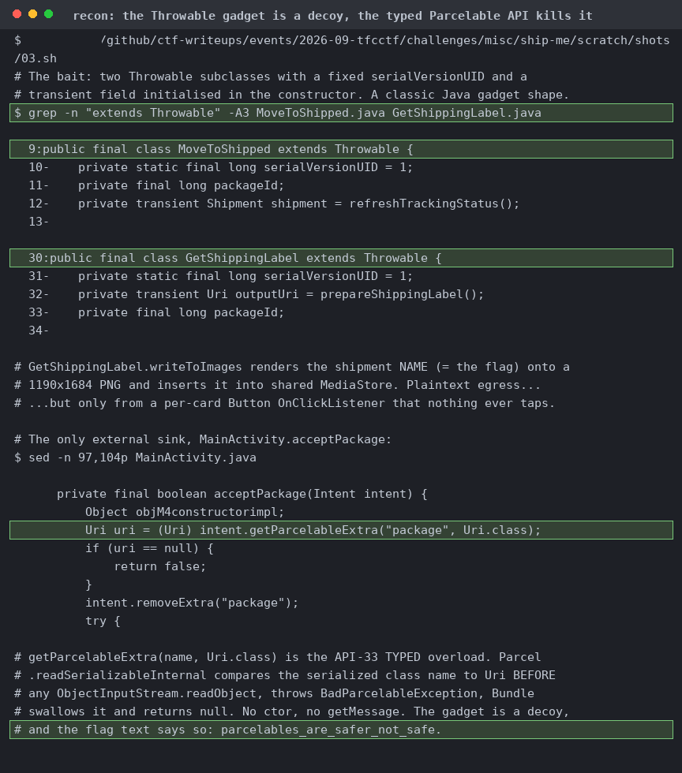
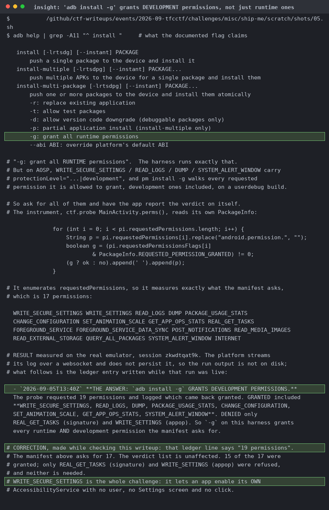
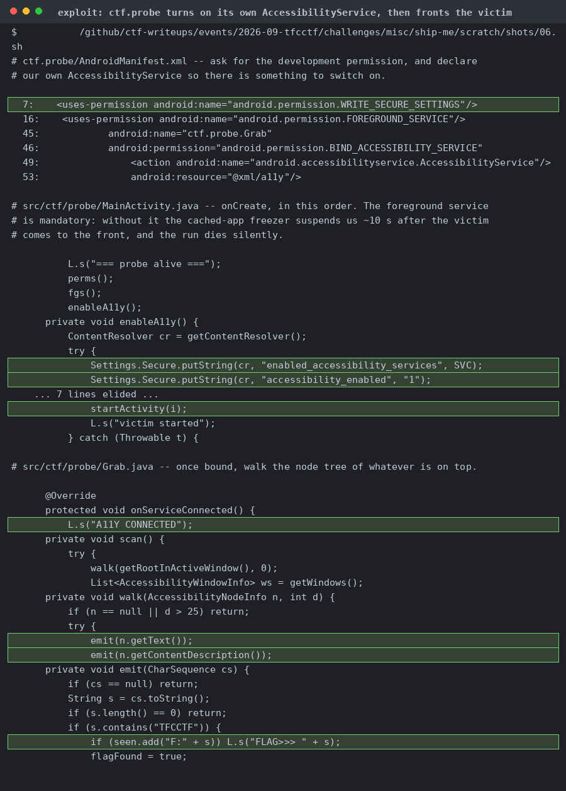
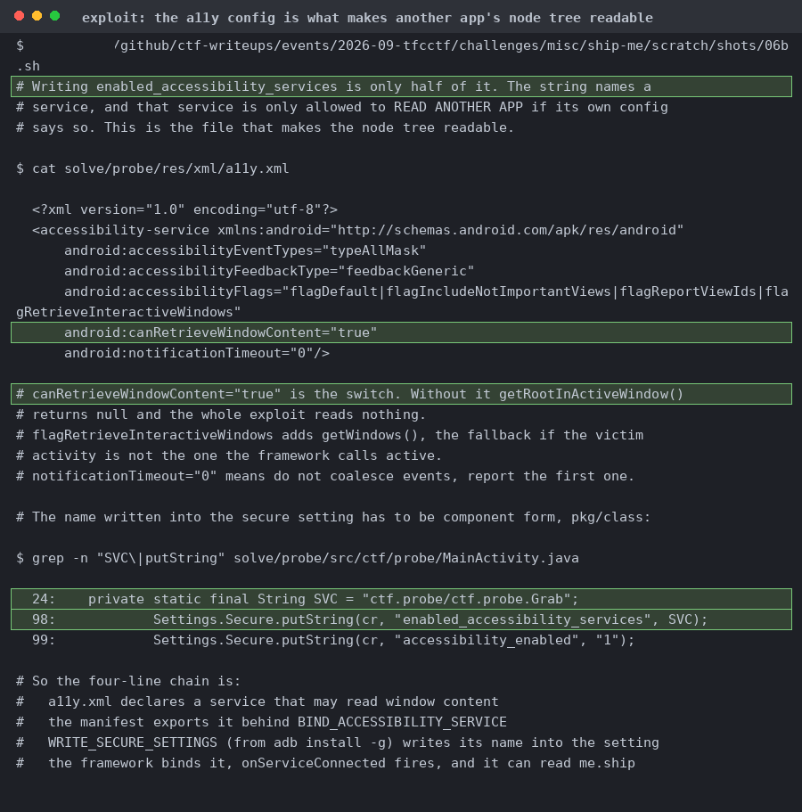
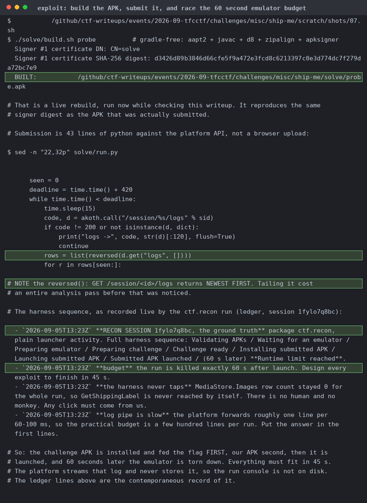
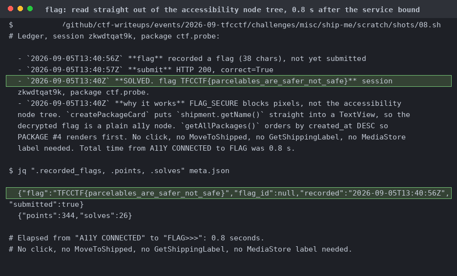

# Ship Me

| | |
|---|---|
| Event | The Few Chosen CTF 2026 |
| Category | misc |
| Difficulty | grandpa |
| Author | Hiumee |
| Points at close | 217 |
| Solves | 67 |
| Status | solved |

> They can throw away your package! Be careful
>
> ---
>
> Challenge detail: You app will be installed using `adb install -g path` and the flag will be a shipment `am start -n me.ship/.MainActivity --eu package 'shipme://cargo/?name=FAKE_FLAG_HERE&origin=challenge`
>
> https://android.koth.pro/

Files: [`shipme-release.apk`](handout/shipme-release.apk)



<details>
<summary><b>Solution</b></summary>

## Solution

The `-g` in the challenge description is the bug. `adb install -g` grants every manifest permission whose protection level is `dangerous` or `development`, so our APK starts out holding `WRITE_SECURE_SETTINGS`. With that, it can write `enabled_accessibility_services` and turn on its own AccessibilityService without a tap. `FLAG_SECURE` hides pixels but not the accessibility node tree, and the victim shows the decrypted shipment name in a plain `TextView`.

## Recon

```bash
sha256sum handout/shipme-release.apk
jadx --output-dir scratch/decompiled handout/shipme-release.apk   # 584 classes, 6 errors
apktool d handout/shipme-release.apk -o scratch/smali             # decoded manifest
```

```bash
grep -nE 'uses-permission|<activity|<service|<provider|<receiver|exported' \
    scratch/smali/AndroidManifest.xml
```

The victim has one component, `me.ship.MainActivity`, exported with only MAIN and LAUNCHER in its intent filter. It requests one permission, `HIDE_OVERLAY_WINDOWS`, at minSdk 33 and targetSdk 36.



That filter doesn't restrict who can start the activity. Any app can call `startActivity` on `me.ship/.MainActivity` with arbitrary extras.

`acceptPackage` reads `intent.getParcelableExtra("package", Uri.class)` and passes it to `PackageUriParser.parse`. The parser accepts scheme `shipme`, host `cargo`, and the parameters `name`, `origin`, `destination`, `description`, and `weight`. A valid URI becomes a row through `ShipMeDatabase.createPackage`. The victim doesn't use `sendBroadcast`, an implicit `startActivity`, a `PendingIntent`, a provider write, or `Log`.

Every text column is AES-256-GCM encrypted under an AndroidKeyStore key (alias `ship.me.package.metadata.v1`), so stealing the sqlite file doesn't help. The flag lands as id 4, and `getAllPackages` orders by `created_at DESC`, so its card renders first.

## The defenses

`MainActivity.onCreate` sets `FLAG_SECURE`, `setHideOverlayWindows(true)`, and `setRecentsScreenshotEnabled(false)`, and every button gets `setFilterTouchesWhenObscured(true)`. Screenshots, MediaProjection, overlays, and tapjacking are all out.



The one plaintext copy outside the UI is `GetShippingLabel.writeToImages`. It draws the shipment name on a PNG at `Pictures/ship.me/ship-me-label-<id>.png` in shared MediaStore, readable by any app holding `READ_MEDIA_IMAGES`. It needs status `SHIPPED` from `MoveToShipped`, and both run only from the card buttons in `createPackageCard`.

## The Throwable decoy

`MoveToShipped` and `GetShippingLabel` both extend `Throwable`, hardcode `serialVersionUID = 1`, and recompute a transient field in `getMessage()`. That looks exactly like a deserialize-then-stringify gadget.



It fails on API 33 and up. `Intent.getParcelableExtra(key, Class)` reaches `Parcel.readSerializableInternal(loader, clazz)`, which compares the serialized class name before `ObjectInputStream.readObject` runs. On a mismatch it throws `BadParcelableException`, and `Bundle.getParcelable` catches that and returns null. The constructor and `getMessage` never run.

`transient` is forced because `Uri` and `Shipment` aren't serializable. The flag (`parcelables_are_safer_not_safe`) reads as a nod to the hardened typed API.

## The harness

`solve/recon/` is a launcher activity that dumps its environment to logcat. The platform installs the challenge APK, installs and launches ours, and kills the run 60 seconds later. The device is an Android 17 emulator on a `userdebug/dev-keys` build. Our own app can't be `me.ship` (`solve/shipme/` tried, and its install failed because the real one was already there).

Every permission recon requested came back granted, including `SYSTEM_ALERT_WINDOW`. That one has the `development` protection flag, so `-g` might grant `WRITE_SECURE_SETTINGS` too. No accessibility service starts out enabled. The MediaStore image count stayed at zero, so nobody taps the buttons for you.

The process also gets frozen. After recon fronted the victim, its `Handler` loop ticked three times over nine seconds and then went silent. The cached-app freezer suspends a backgrounded app, so start a foreground service before fronting the victim.

## Enabling our own accessibility service

`solve/probe/` requests seventeen permissions and logs which ones it got. Fifteen came back granted, including `WRITE_SECURE_SETTINGS`, `READ_LOGS`, `DUMP`, and `PACKAGE_USAGE_STATS`. Only `REAL_GET_TASKS` (signature-level) and `WRITE_SETTINGS` (an appop) were refused.



```java
startForegroundService(new Intent(this, Fg.class));
Settings.Secure.putString(cr, "enabled_accessibility_services", "ctf.probe/ctf.probe.Grab");
Settings.Secure.putString(cr, "accessibility_enabled", "1");
Intent i = new Intent();
i.setComponent(new ComponentName("me.ship", "me.ship.MainActivity"));
i.addFlags(Intent.FLAG_ACTIVITY_NEW_TASK);
startActivity(i);
```

The real code also waits 1.5 seconds before `startActivity`.

`Grab` walks `getRootInActiveWindow()` and every window from `getWindows()` when it connects and every 800 milliseconds after. It logs each node's `getText()` and `getContentDescription()` through `Log.i("TFCCTF", ...)`, the tag the platform streams back.



Without `canRetrieveWindowContent="true"` in `res/xml/a11y.xml`, `getRootInActiveWindow()` returns null and you read nothing. `flagRetrieveInteractiveWindows` adds the `getWindows()` fallback, and `notificationTimeout="0"` stops event coalescing. The setting value has to be a `package/class` component name.



The flag showed up 0.8 seconds after `A11Y CONNECTED`, without a click or a shipping label.

## Reproduce

From `solve/`, the two commands in [`solve/README.md`](solve/README.md) build and submit the APK. That page also covers the build chain and the three apps.



`solve/build.sh` builds and signs the APK without gradle, since the platform rejects an unsigned one. `solve/run.py` submits with backoff on 429 and prints the session log.

The log pipe forwards only a few hundred lines per run, so log the answer first. `Grab` logs any string containing `TFCCTF` immediately and caps everything else at 45 distinct nodes.



Flag: `TFCCTF{parcelables_are_safer_not_safe}`
</details>
