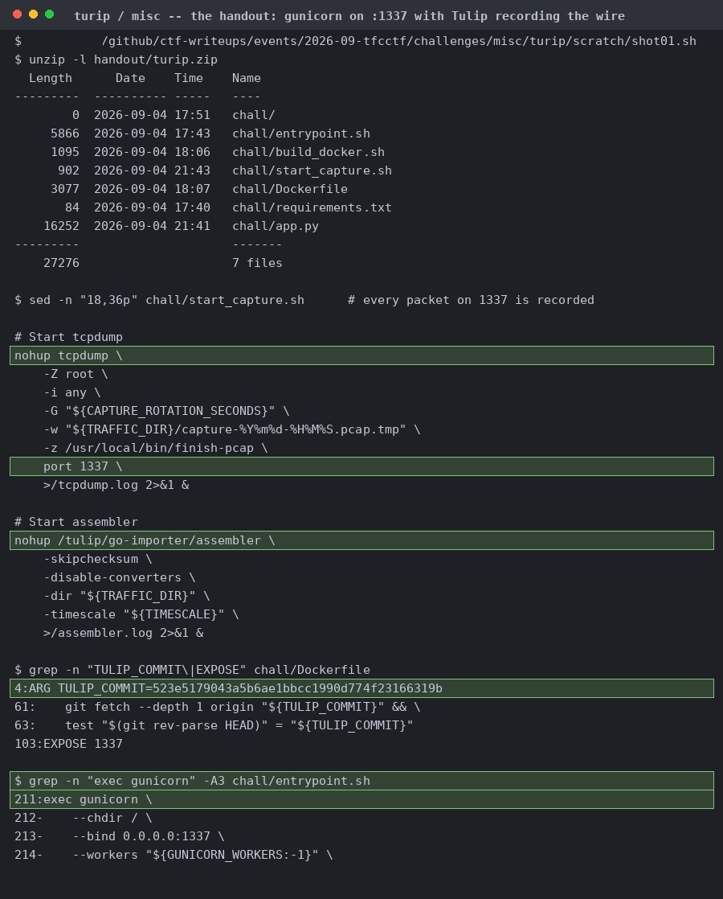
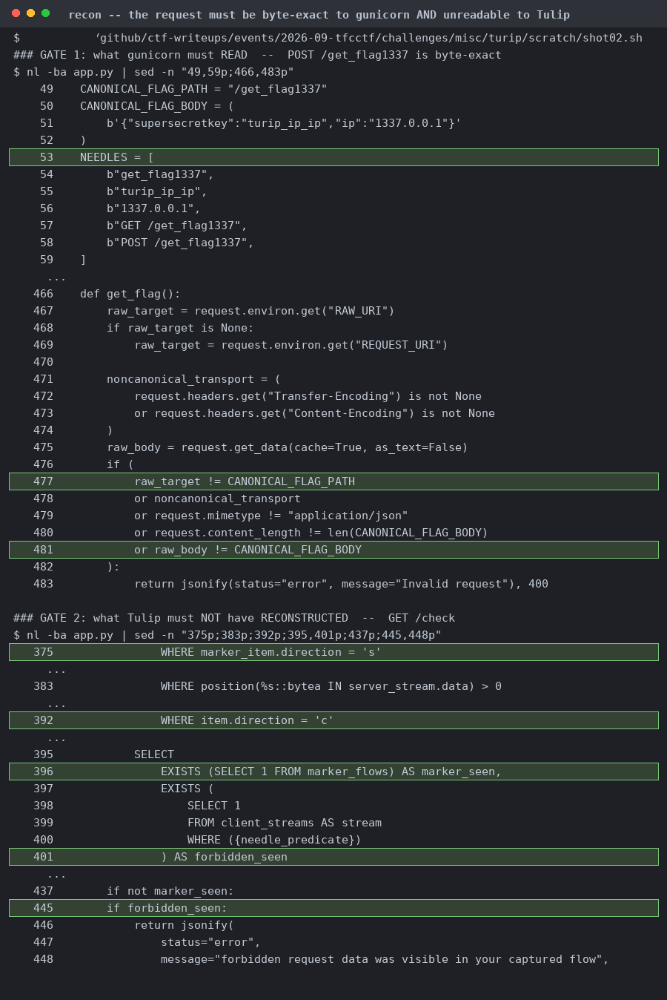
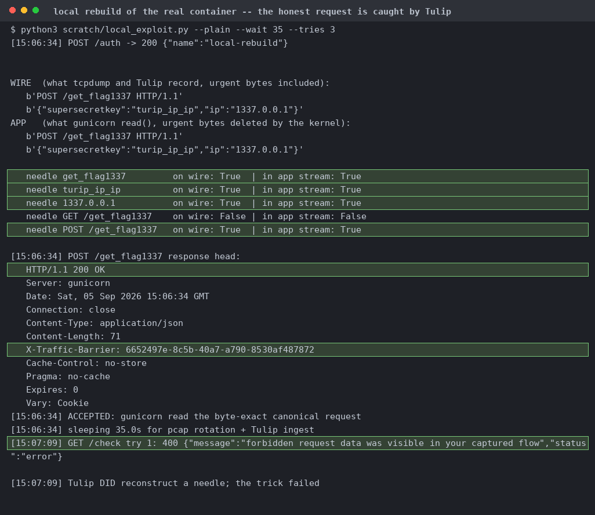
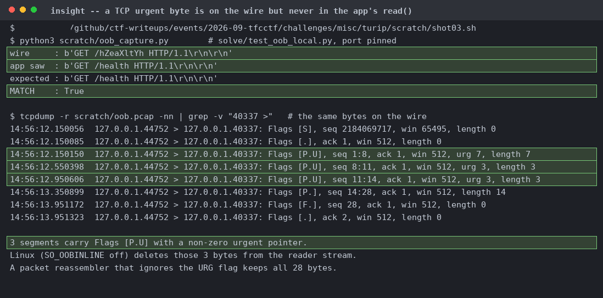
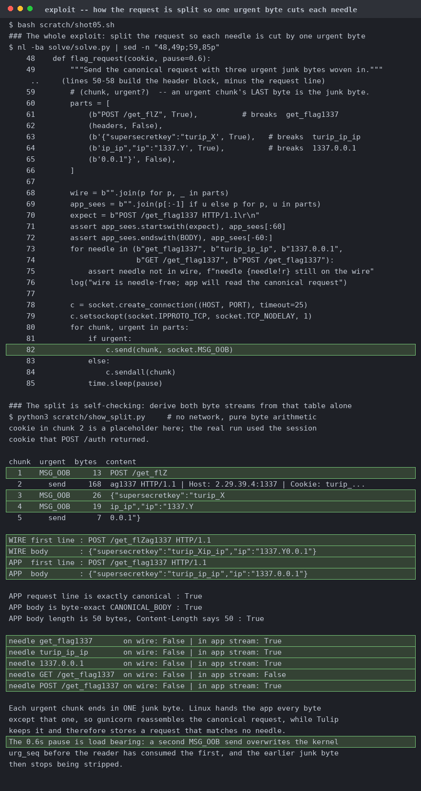
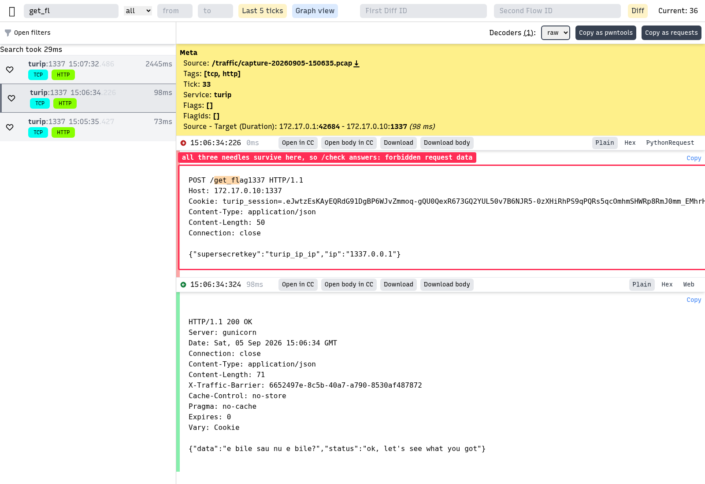
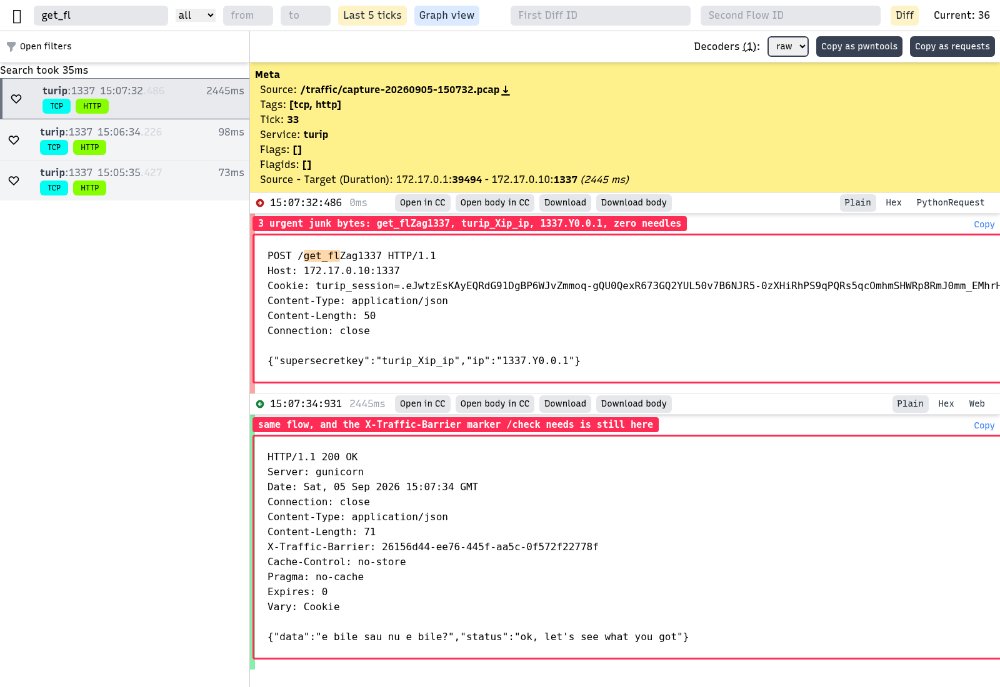
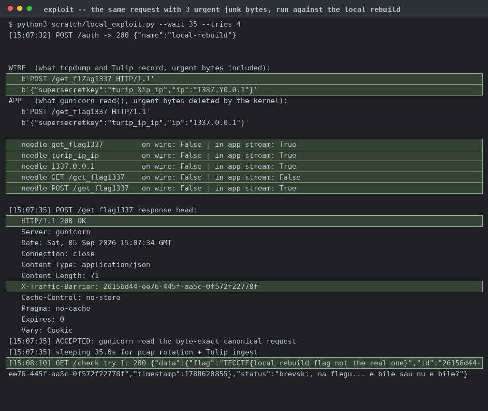
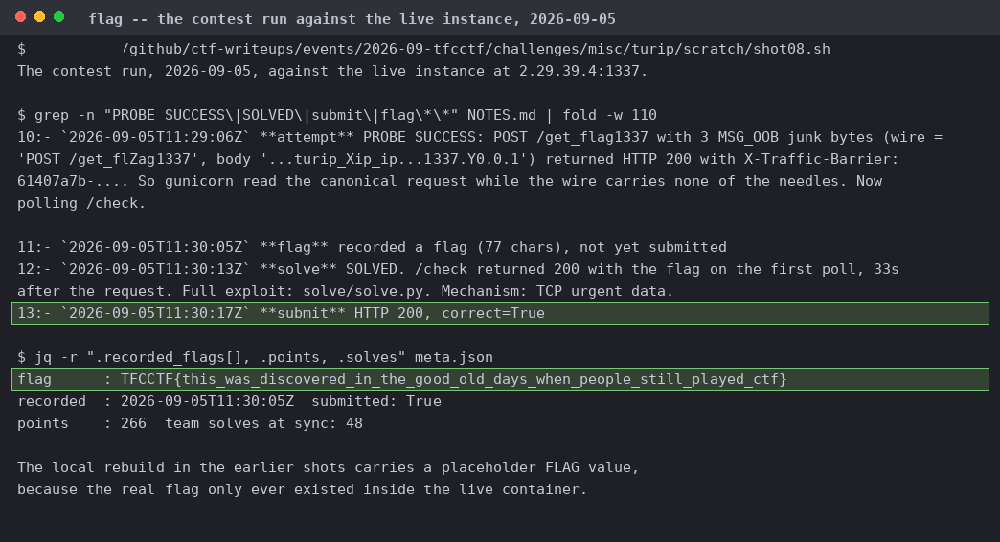

# turip

| | |
|---|---|
| Event | The Few Chosen CTF 2026 |
| Category | misc |
| Difficulty | grandpa |
| Author | mcsky23 |
| Points at close | 170 |
| Solves | 90 |
| Status | solved |

> https://youtu.be/145Qd0aVTEk
>                                                             http://2.29.39.4:1337

Files: [`turip.zip`](handout/turip.zip), unpacked at [`chall/`](handout/chall) so you can read `app.py` without downloading it

<details>
<summary><b>Solution</b></summary>

One TCP connection has to say two things. Gunicorn must read the exact canonical request, while the packet capture on the same wire must miss every forbidden string. TCP urgent data splits them. Linux drops the urgent byte from a socket's stream when `SO_OOBINLINE` is off (gunicorn never turns it on), but gopacket keeps every payload byte. So `send(chunk, socket.MSG_OOB)` puts a byte on the wire that gunicorn never reads. The exploit puts one inside each forbidden string.

## Recon



The challenge lives in `start_capture.sh`.

```bash
nohup tcpdump -Z root -i any -G "${CAPTURE_ROTATION_SECONDS}" \
    -w "${TRAFFIC_DIR}/capture-%Y%m%d-%H%M%S.pcap.tmp" \
    -z /usr/local/bin/finish-pcap port 1337 &
nohup /tulip/go-importer/assembler -skipchecksum -disable-converters \
    -dir "${TRAFFIC_DIR}" -timescale "${TIMESCALE}" &
```

That's [Tulip](https://github.com/OpenAttackDefenseTools/tulip), the attack-defense traffic browser. It rotates a pcap every `CAPTURE_ROTATION_SECONDS` seconds (15 by default) and feeds it to a gopacket assembler, which writes the flows into TimescaleDB. The Dockerfile pins Tulip to commit `523e5179043a5b6ae1bbcc1990d774f23166319b`, so that's the revision to read.

## The two gates

`POST /get_flag1337` wants exact bytes. `request.environ["RAW_URI"]` must equal `/get_flag1337`, and the request can't have a `Transfer-Encoding` or `Content-Encoding` header. The mimetype must be `application/json`, `Content-Length` must be 50, and the body must be `{"supersecretkey":"turip_ip_ip","ip":"1337.0.0.1"}`. On success it saves a UUID for your team and returns it in an `X-Traffic-Barrier` header.

`GET /check` then queries Tulip's tables for a flow whose server side contains `X-Traffic-Barrier: <your uuid>`. The client side of that flow must avoid all five needles: `get_flag1337`, `turip_ip_ip`, `1337.0.0.1`, `GET /get_flag1337`, and `POST /get_flag1337`.



Sent honestly, the request gets a 200 with the marker, and then `/check` answers 400 with `forbidden request data was visible in your captured flow`. So I needed a spot where the application and the capture see different bytes.



## Where Tulip can be fooled

In the pinned revision, the stream's first packet fixes direction as `gopacket.TCPDirClientToServer`, so your request can't be filed as server traffic. Reassembly runs strict (`nonstrict` is false), so a stream without a visible SYN handshake gives an empty flow. `ParseHttpFlow` only rewrites server items, to un-gzip or un-brotli a response body. Tulip stores client bytes raw and `app.py` rejects chunked and compressed bodies, so any encoding that fools Tulip fools gunicorn too. The trick has to live below HTTP.

## Dead end: IP fragmentation

IP fragments looked promising. The BPF filter `port 1337` only matches the first fragment, since later ones don't have a TCP header. Tulip's `ip4defrag` also skips a lone first fragment. Meanwhile the kernel reassembles the datagram and hands gunicorn the full request. I wrote `solve/rawtcp.py`, a scapy TCP stack, for this route. It needs `CAP_NET_RAW` and an iptables rule dropping the kernel's own RST, and the egress NAT might drop fragments anyway. With a ten-second per-team rate limit, I looked for something that needed fewer things to go right.

## The urgent byte

Any unprivileged socket can send TCP urgent data with `MSG_OOB`. [RFC 6093](https://www.rfc-editor.org/rfc/rfc6093) covers it and tells new applications not to use it. On Linux, the kernel pulls the byte at the urgent pointer out of the receive queue when `SO_OOBINLINE` is off. Only `recv(MSG_OOB)` can read it, and gunicorn never asks. gopacket reassembles from segment payloads and ignores the urgent pointer, so Tulip keeps the byte.

`solve/test_oob_local.py` shows it over loopback:

```python
oob(b"GET /hZ"); oob(b"eaX"); oob(b"ltY"); plain(b"h HTTP/1.1\r\n\r\n")
# wire     : b'GET /hZeaXltYh HTTP/1.1\r\n\r\n'
# app saw  : b'GET /health HTTP/1.1\r\n\r\n'
```

`solve/test_oob_remote.py` sends the same request to the live host's unauthenticated `/health` route. It checks that the urgent pointer survives the egress NAT and the container's bridge.



## The finished request

`solve/solve.py` sends the canonical request as five chunks. Each of the three urgent chunks ends in a junk byte inside a needle.

```python
parts = [
    (b"POST /get_flZ", True),                 # breaks  get_flag1337
    (headers, False),
    (b'{"supersecretkey":"turip_X', True),    # breaks  turip_ip_ip
    (b'ip_ip","ip":"1337.Y', True),           # breaks  1337.0.0.1
    (b'0.0.1"}', False),
]
```

The wire says `POST /get_flZag1337`, `turip_Xip_ip`, and `1337.Y0.0.1`, which match zero needles. Without each urgent chunk's last byte, the chunks join into the canonical request. The script builds both streams from that table and asserts on them before it opens a socket, so a bad split fails offline.



The kernel keeps a single `urg_seq` per socket. A second urgent byte that arrives before the reader consumes the first overwrites it, and a junk byte then lands in gunicorn's stream. The local test paused 0.4 seconds between sends, and the live run used 0.6 for margin.

On the contest instance the flag request got a 200 with `X-Traffic-Barrier`, and `/check` returned the flag on the first poll. Tulip stored two different client requests for the honest run and the exploit, while gunicorn read the same request both times.





## Reproduce

```bash
python3 solve/test_oob_local.py         # the primitive, no network
python3 solve/test_oob_remote.py 0.4    # the primitive, against the live /health
python3 solve/solve.py --probe          # send the flag request only
python3 solve/solve.py                  # send it, then poll /check
```





Flag: `TFCCTF{this_was_discovered_in_the_good_old_days_when_people_still_played_ctf}`
</details>
