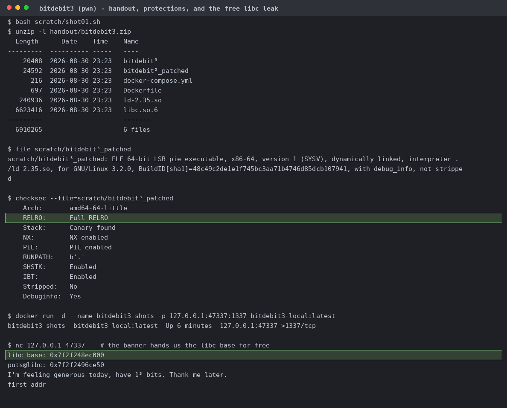
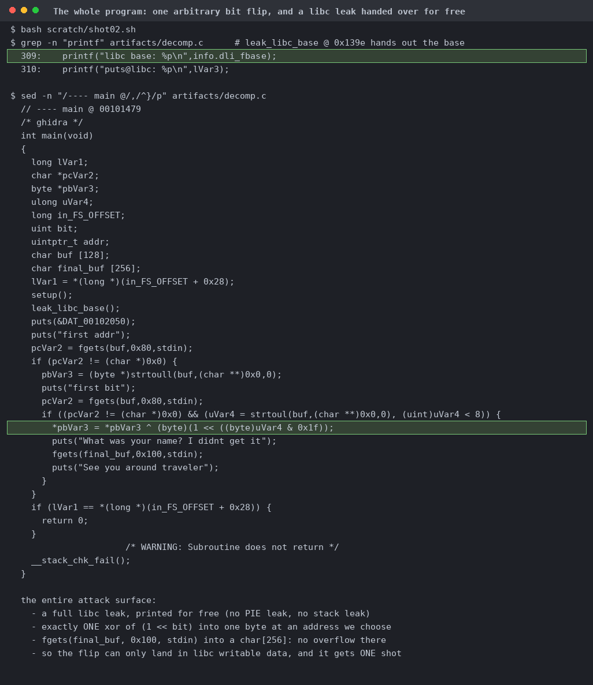
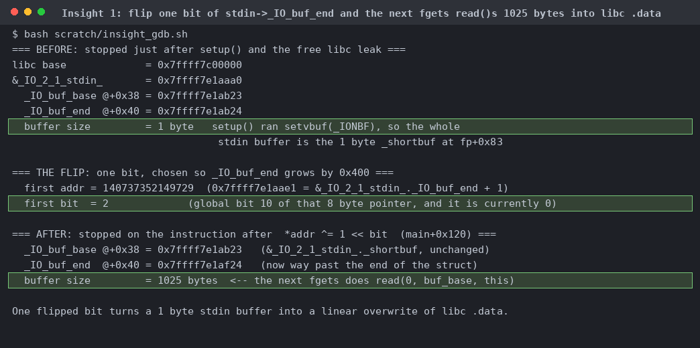
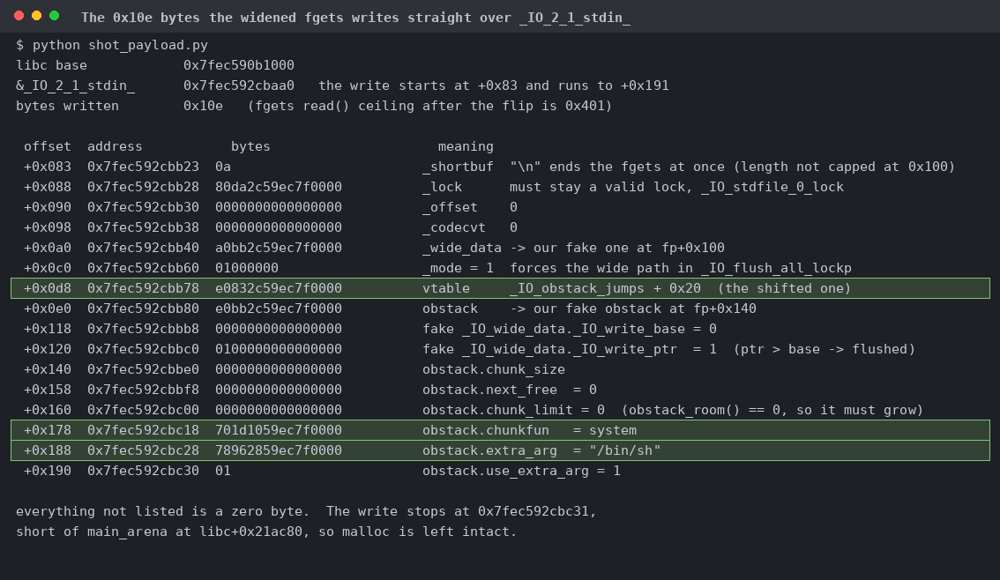
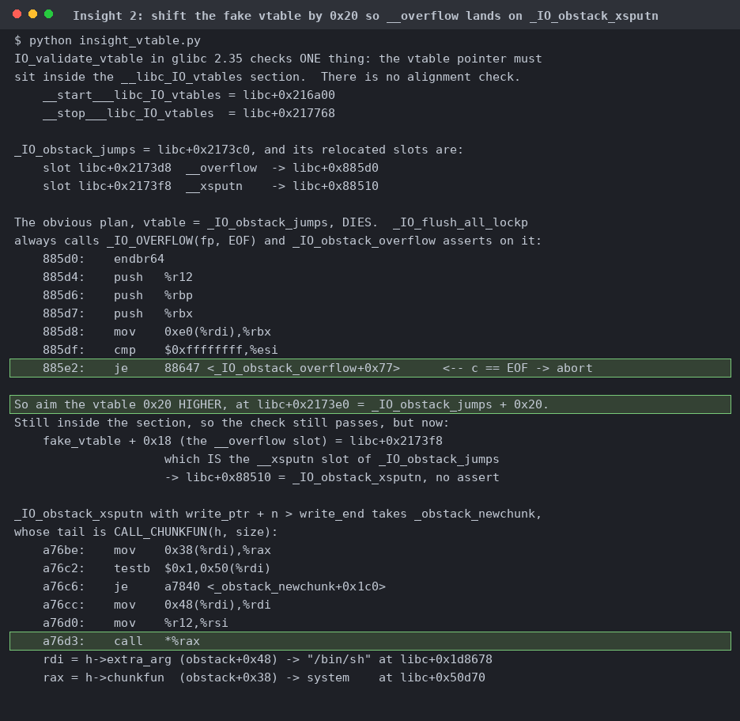
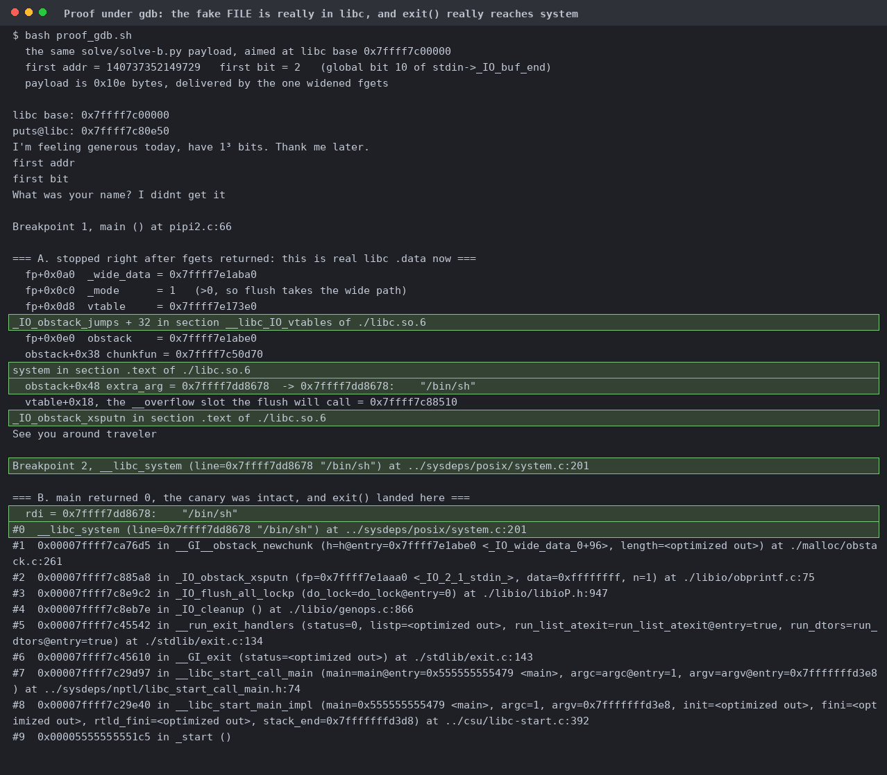
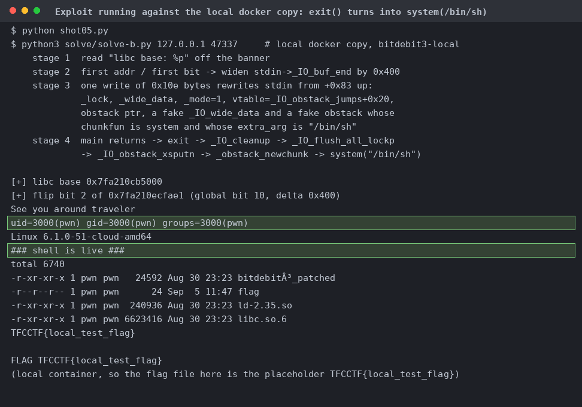
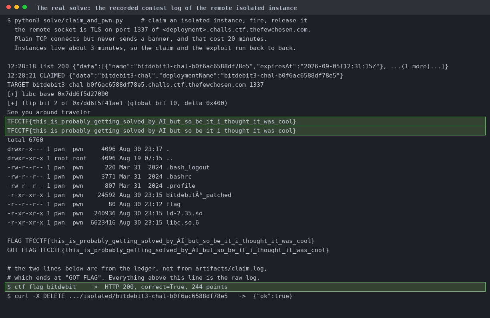

# bitdebit³

| | |
|---|---|
| Event | The Few Chosen CTF 2026 |
| Category | pwn |
| Difficulty | grandpa |
| Author | minipif |
| Points at close | 141 |
| Solves | 107 |
| Status | solved |

> a bit flipped me off

Files: [`bitdebit3.zip`](handout/bitdebit3.zip)

<details>
<summary><b>Solution</b></summary>

The one flip belongs on `_IO_2_1_stdin_._IO_buf_end`. `setup()` makes stdin unbuffered, so its whole buffer is the one-byte `_shortbuf` inside the FILE structure. If I set one clear bit of that pointer, the next `fgets` performs `read(0, libc+0x21ab23, 2^p + 1)`, a linear write across libc's writable data. The rest is FILE-structure work, ending in a house of obstack with a misaligned vtable.

## Recon

The zip ships the binary twice (one copy patchelf'd) next to `ld-2.35.so` and a local `libc.so.6`. Its Dockerfile runs `socat TCP-LISTEN:1337 EXEC:./bitdebit3_patched` on ubuntu:24.04 with the flag at `/home/pwn/flag`. `checksec` reports Full RELRO, a stack canary, NX, and PIE, so the GOT can't be written and the binary's own addresses can't be guessed.



```
$ nc 127.0.0.1 47337
libc base: 0x7f4f2e4d2000
puts@libc: 0x7f4f2e552e50
I'm feeling generous today, have 1 bits. Thank me later.
first addr
```

The banner leaks libc but no other address, so the write has to land in libc. `main` is short (Ghidra's full output is in [`artifacts/decomp.c`](artifacts/decomp.c)).

```c
setup();                       // setvbuf(..., _IONBF) on all three streams
leak_libc_base();              // dlsym + dladdr, prints "libc base: %p", free
addr = strtoull(read_line());  // arbitrary pointer
bit  = strtoul(read_line());   // must be < 8
*addr ^= 1 << bit;             // one flip, that's it
puts(...); fgets(final_buf, 0x100, stdin); puts(...);
return 0;                      // canary checked
```



`final_buf` is a `char[256]` and the canary is checked on return, so the stack buffer overflows nothing. The `fgets` call still matters, because its widened `read()` delivers the payload.

## Widening stdin

Once the XOR lands, `main` only does a `puts`, an `fgets` on stdin, another `puts`, and a return into `exit`. So the flip has to hit a FILE structure those calls walk, or the `_IO_list_all` chain that `_IO_cleanup` walks on exit. Stdin is the one to hit, because unbuffered mode leaves `_IO_buf_base` and `_IO_buf_end` bracketing the one-byte `_shortbuf` at `fp+0x83`.

```
$ readelf -sW scratch/libc.so.6 | grep -E '_IO_2_1_stdin_|_IO_obstack_jumps|system@@'
  8544: 000000000021aaa0   224 OBJECT  GLOBAL DEFAULT   34 _IO_2_1_stdin_
  5098: 00000000002173c0   168 OBJECT  LOCAL  DEFAULT   29 _IO_obstack_jumps
  1481: 0000000000050d70    45 FUNC    WEAK   DEFAULT   15 system@@GLIBC_2.2.5
```

The `_IO_buf_end` field is at `libc+0x21aae0` and holds `libc+0x21ab24`, one past `&_shortbuf`. Under gdb the two pointers differ by one before the flip and by 1025 bytes after it.



The flip is an XOR, so a bit that's already set would shrink the pointer. Take the lowest clear bit of the live value. The payload needs 0x10e bytes of reach, so the scan starts at bit 9 (`pick_bit()` in [`solve/solve-b.py`](solve/solve-b.py)). The flip works on one byte, so global bit `p` is bit `p % 8` of the byte at `libc+0x21aae0 + p // 8`.

The `0x100` limit on `fgets` doesn't get in the way. The first payload byte lands in `_shortbuf`, so a leading `\n` ends `getline` after the widened `read()` has already pulled the rest into libc. The payload only has to arrive in one `read()` (a short sleep before the second `sendall` keeps the shell command out of it).

## Rebuilding stdin's tail

The write runs from `fp+0x83` to `fp+0x191` and rebuilds the FILE so that `_IO_cleanup` walks into something useful at exit. `build_payload()` in [`solve/solve-b.py`](solve/solve-b.py) holds the map. These are the fields that matter:

- `_lock` restored to the real `_IO_stdfile_0_lock`
- `_wide_data` pointed at a fake at `fp+0x100` whose `_IO_write_ptr` exceeds its `_IO_write_base`
- `_mode` set to 1 so the flush takes the wide path
- the vtable at `fp+0xd8`
- an obstack pointer at `fp+0xe0`, aimed at a fake obstack at `fp+0x140` whose `chunkfun` is `system` and whose `extra_arg` is `/bin/sh`



In the fake obstack, zero every field below `chunkfun` at 0x38. `obstack_room()` is `chunk_limit - next_free`, and a room of zero sends the call into `_obstack_newchunk`. Set the `use_extra_arg` bit at 0x50, because without it `CALL_CHUNKFUN` hands `system` a size instead of a string.

The payload stops at `libc+0x21ac31`, short of `main_arena` at `libc+0x21ac80`. Running the write through it would corrupt the allocator badly enough that the process dies before `exit` reaches the flush.

## The misaligned vtable

`_IO_flush_all_lockp` calls `_IO_OVERFLOW(fp, EOF)` with EOF hardcoded, and glibc 2.35's `_IO_obstack_overflow` asserts its character isn't EOF. A vtable pointing straight at `_IO_obstack_jumps` aborts instead of calling anything.

`IO_validate_vtable` checks the range but not the alignment, so the pointer only has to land inside `__libc_IO_vtables`.

```
$ readelf -SW scratch/libc.so.6 | grep vtables
  [29] __libc_IO_vtables PROGBITS  0000000000216a00 215a00 000d68 00  WA  0   0 32
```

`_IO_obstack_jumps` sits at `libc+0x2173c0` with its `__overflow` slot at `+0x18`. Shift the pointer by 0x20 to `libc+0x2173e0` and slot `+0x18` resolves to `libc+0x2173f8`, the `_IO_obstack_xsputn` entry. `xsputn(fp, EOF, rdx)` finds `write_ptr + n` past `write_end` and falls into `obstack_grow`, then `_obstack_newchunk`, then `CALL_CHUNKFUN`, which is `system("/bin/sh")`.



Under gdb, once `fgets` returns, the vtable prints as `_IO_obstack_jumps + 32`, the chunkfun as `system`, and the extra_arg as `/bin/sh`. A breakpoint on `system` fires after `main` has returned 0 with the canary intact.



Against a container built from the Dockerfile, [`solve/solve-b.py`](solve/solve-b.py) prints the local placeholder `TFCCTF{local_test_flag}`.



## Remote

Plain TCP to port 1337 connects and never sends the banner, which reads exactly like a hung service. It's TLS with SNI on the same port, and the certificate isn't valid for the deployment name, so verification comes off too.

```python
ctx = ssl.create_default_context()
ctx.check_hostname = False
ctx.verify_mode = ssl.CERT_NONE
s = ctx.wrap_socket(socket.create_connection((host, 1337)), server_hostname=host)
```

A fresh instance expires after about three minutes, so [`solve/claim_and_pwn.py`](solve/claim_and_pwn.py) claims one and fires in the same run.



Flag: `TFCCTF{this_is_probably_getting_solved_by_AI_but_so_be_it_i_thought_it_was_cool}`
</details>
