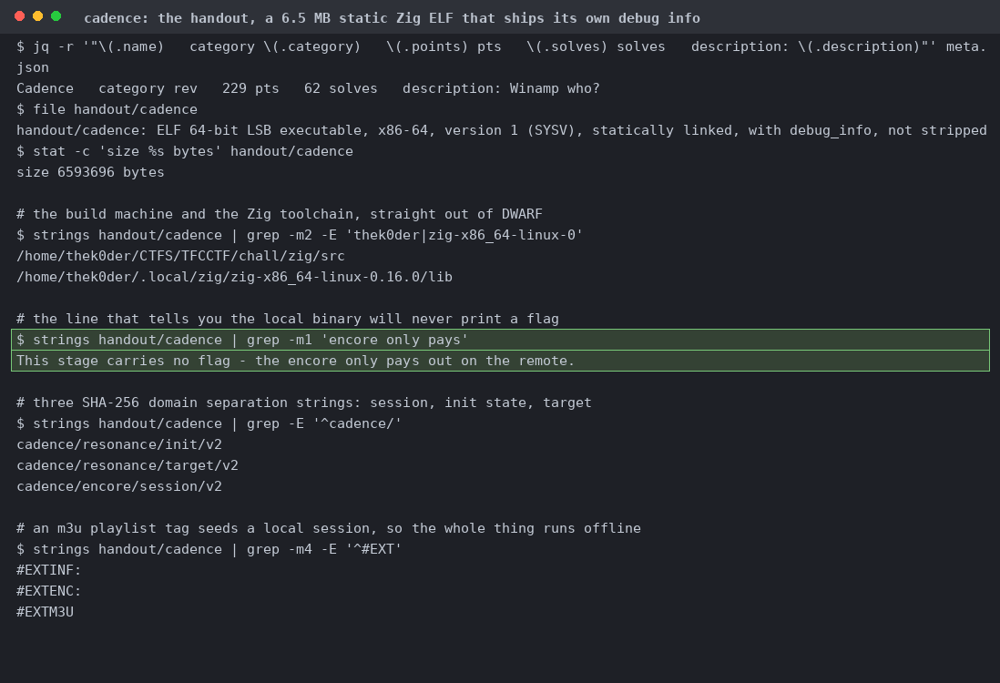
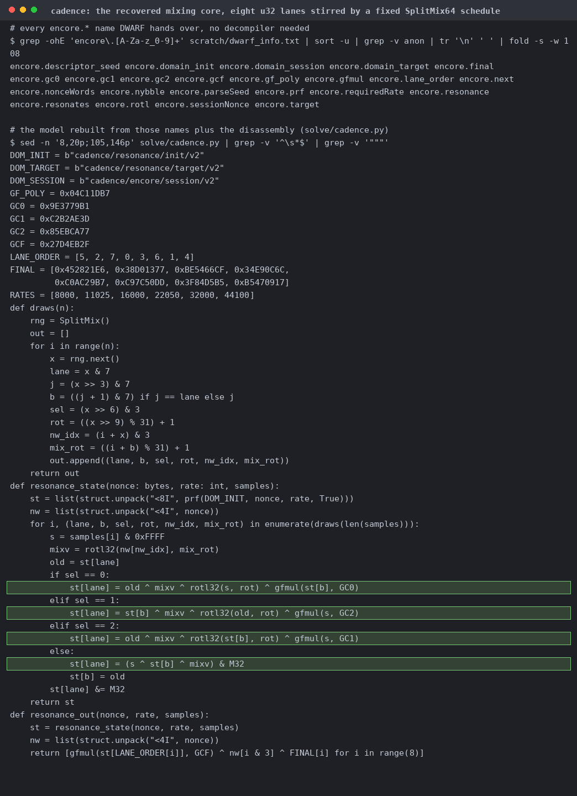
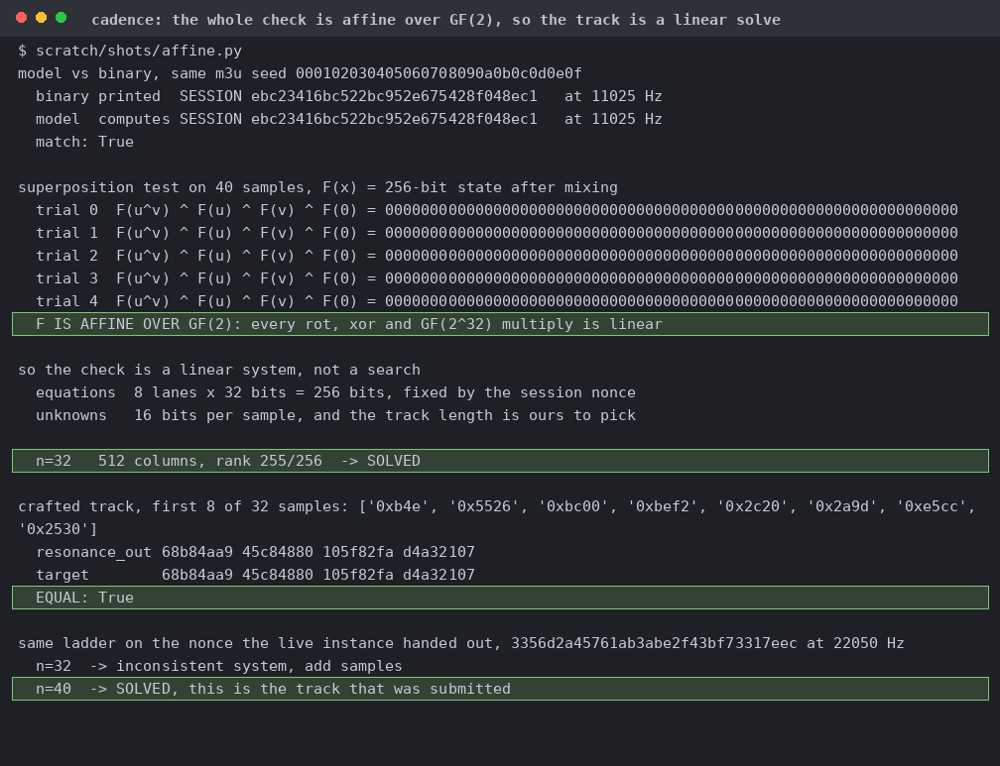
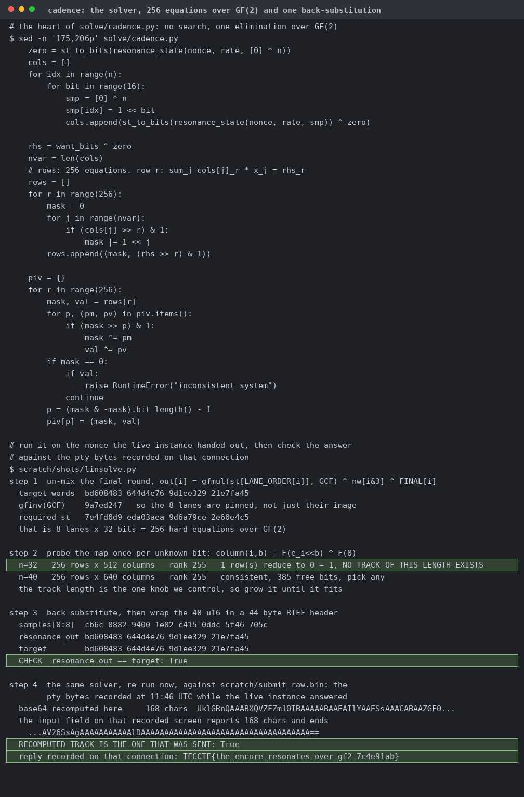
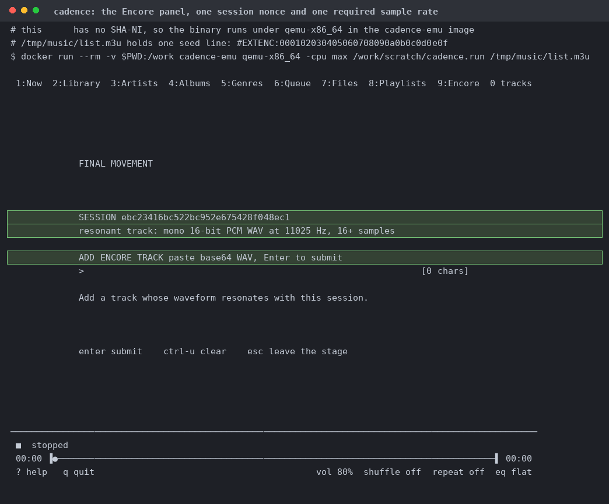
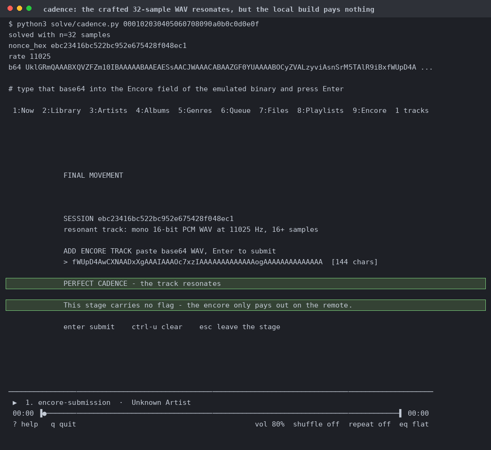
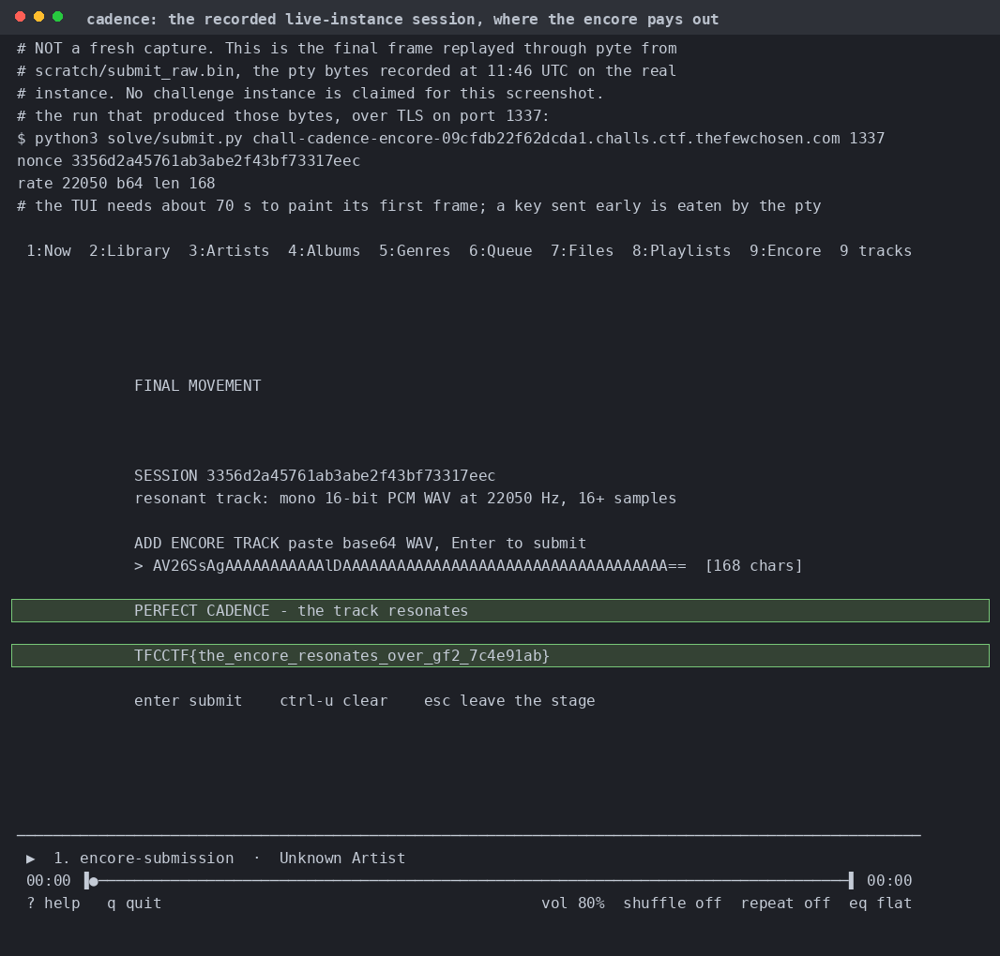

# Cadence

| | |
|---|---|
| Event | The Few Chosen CTF 2026 |
| Category | reverse |
| Difficulty | baby |
| Author | thek0der |
| Points at close | 119 |
| Solves | 122 |
| Status | solved |

> Winamp who?

Files: [`cadence`](handout/cadence)

<details>
<summary><b>Solution</b></summary>

Cadence is a terminal music player with a hidden Encore panel. The panel wants a base64 WAV that "resonates" with a per-session nonce. But the mixer only XORs, rotates, and multiplies by constants in `GF(2^32)`. A SplitMix64 schedule picks every lane and rule from the sample index alone. So the track-to-state map is affine over `GF(2)`, and the check is 256 linear equations.

## Recon

```
$ file handout/cadence
handout/cadence: ELF 64-bit LSB executable, x86-64, version 1 (SYSV), statically linked, with debug_info, not stripped
$ readelf -SW handout/cadence | grep debug
  [12] .debug_info    PROGBITS  0000000000000000 38b6ef 126f36 ...
  [17] .debug_line    PROGBITS  0000000000000000 598c86 0a04b7 ...
```

The debug info names every function.

```
$ readelf --debug-dump=info handout/cadence | grep -o 'encore\.[A-Za-z0-9_]*' | sort -u
encore.descriptor_seed  encore.domain_init   encore.domain_session
encore.domain_target    encore.final         encore.gc0
encore.gc1              encore.gc2           encore.gcf
encore.gf_poly          encore.gfmul         encore.lane_order
encore.next             encore.nonceWords    encore.nybble
encore.parseSeed        encore.prf           encore.requiredRate
encore.resonance        encore.resonates     encore.rotl
encore.sessionNonce     encore.target
```

`gf_poly` and `gcf` point to finite field multiplies, `lane_order` to a permuted state, and `prf` with its `domain_*` values to a domain-separated keyed hash.

```
$ strings handout/cadence | grep -E 'EXTENC|pays out|PERFECT CADENCE|cadence/'
PERFECT CADENCE - the track resonates
#EXTENC:
cadence/resonance/init/v2
cadence/resonance/target/v2
cadence/encore/session/v2
This stage carries no flag - the encore only pays out on the remote.
```

Per that last string, only the remote prints a flag. The `#EXTENC:` playlist tag holds 32 hex characters that seed the session, so you can pin the nonce offline. `encore.prf` is SHA-256 over a domain, a key, and optionally a little-endian counter.



## Rebuilding the source

```
$ readelf --debug-dump=decodedline handout/cadence | grep encore.zig > scratch/encore_lines.txt
$ objdump -d --disassemble='encore.resonates' handout/cadence > scratch/resonates.asm
$ objdump -d --disassemble='encore.prf' handout/cadence > scratch/prf.asm
```

That recovers about 190 lines of `encore.zig`. A 16-byte seed gives `nonce = prf("cadence/encore/session/v2", key=seed)[0:16]`. The required sample rate is `[8000, 11025, 16000, 22050, 32000, 44100][nonce[0] % 6]`. `ui.App.submitEncore` wants a base64 mono 16-bit WAV at that rate with at least 16 samples.

`encore.resonates` seeds eight `u32` lanes from `prf("cadence/resonance/init/v2", key=nonce, counter=rate)` and reads the nonce as four `u32` words. For each sample `i` it draws `x` from the SplitMix64. The lane is `x & 7`, and the partner is `(x >> 3) & 7`, nudged if it collides with the lane. The rule selector is `(x >> 6) & 3`, and the rotation is `((x >> 9) % 31) + 1`.

```
sel 0: st[lane] = old ^ mixv ^ rotl(s, rot) ^ gfmul(st[b], gc0)
sel 1: st[lane] = st[b] ^ mixv ^ rotl(old, rot) ^ gfmul(s, gc2)
sel 2: st[lane] = old ^ mixv ^ rotl(st[b], rot) ^ gfmul(s, gc1)
sel 3: st[lane] = s ^ st[b] ^ mixv,  st[b] = old
```

The final check computes `out[i] = gfmul(st[lane_order[i]], gcf) ^ nonce_words[i & 3] ^ final[i]` and compares it in constant time with `prf("cadence/resonance/target/v2", key=nonce)`.



## Why it's linear

In all four rules the sample `s` is only XORed, rotated, or multiplied in `GF(2^32)` by a constant. Each of those is `GF(2)`-linear in the bits of `s`. Everything else (`mixv`, both lane indices, the selector, and the rotation) comes from the SplitMix64 and `i`. The loop never branches on a sample value, so the map to the 256-bit final state is affine. Finding a waveform that resonates means solving `A x = b` over `GF(2)`.

Before writing a solver, check that the model matches the binary on the nonce and rate for one seed. Then test superposition on five random pairs, since an affine map satisfies `F(u^v) ^ F(u) ^ F(v) ^ F(0) = 0`.

The first check rules out a transcription error in the prf. The second rules out a missed nonlinearity in the mixer.



## Solving the system

`gfinv(gcf)` undoes the final multiply, so each of the eight lanes has an exact required value. That's 8 lanes times 32 bits, so 256 equations.

With `n` samples there are `16n` unknown bits. The column for sample `i` bit `b` is `F(e_i << b) ^ F(0)`, so `16n` model evaluations build the matrix. Transpose into 256 rows, eliminate, and back-substitute. `solve/cadence.py` holds the model and the solver, and asserts that the recovered track reproduces the target words.

On the live nonce, 32 samples looks like plenty for 256 equations, but it fails.

```
live nonce 3356d2a45761ab3abe2f43bf73317eec, rate 22050
n=32   512 columns, rank 255/256 -> inconsistent system
n=40   640 columns, rank 255/256 -> SOLVED
```

At 32 samples the elimination produces a row asserting `0 = 1`. Eight more samples bring the target into the reachable subspace. `solve_auto` grows the track until the system is consistent. Rerunning the solver offline on the live nonce gives the same base64 string as the recorded remote screen.



## Running it locally

The binary uses SHA-NI, so on a host without it, run it under `qemu-x86_64 -cpu max` in an Ubuntu container. The Encore seed comes from the playlist, so write an m3u with the `#EXTENC:` tag and pass it as a positional argument.

```
$ printf '#EXTM3U\n#EXTENC:000102030405060708090a0b0c0d0e0f\n' > /tmp/music/list.m3u
$ qemu-x86_64 -cpu max ./cadence /tmp/music/list.m3u
```



A small pty script runs that command, types the base64 WAV into the Encore field, and presses Enter. The program answers `PERFECT CADENCE - the track resonates` and the no-flag line.



## The remote

`solve/cm.py` talks to a separate challenge-manager service, where `POST /isolated` starts an instance and `DELETE` stops it. Connect over TLS with `ncat --ssl <deployment>.challs.ctf.thefewchosen.com 1337`.

The TUI takes around 70 seconds to paint its first frame, and the pty swallows any key sent before the Encore panel appears. `solve/submit.py` polls until a 32-hex-character nonce appears, solves offline, and types the WAV with a small inter-key delay.

## Reproducing

`solve/cadence.py` takes a 32-hex seed and prints the nonce, the rate, and the base64 WAV. `solve/submit.py` runs the whole remote path from a host and port. The screenshot is the recorded session's raw pty bytes, replayed offline through pyte.



Flag: `TFCCTF{the_encore_resonates_over_gf2_7c4e91ab}`
</details>
