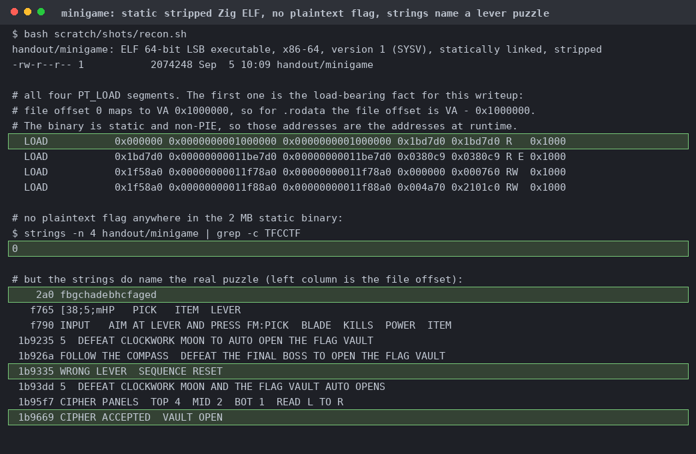
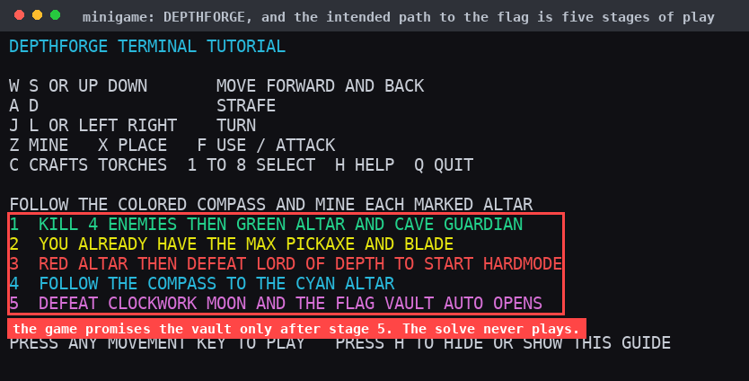
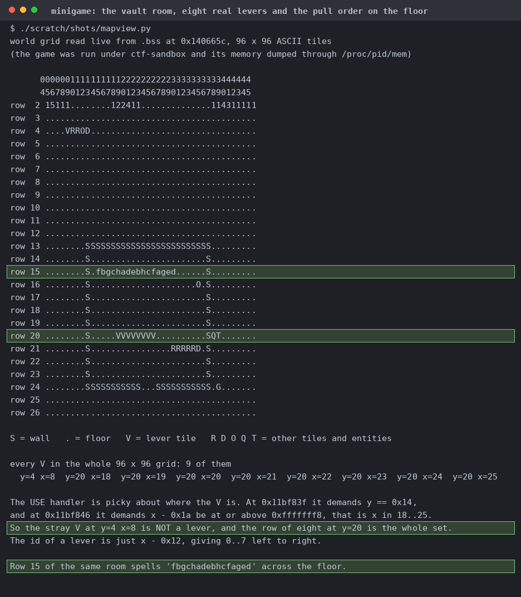
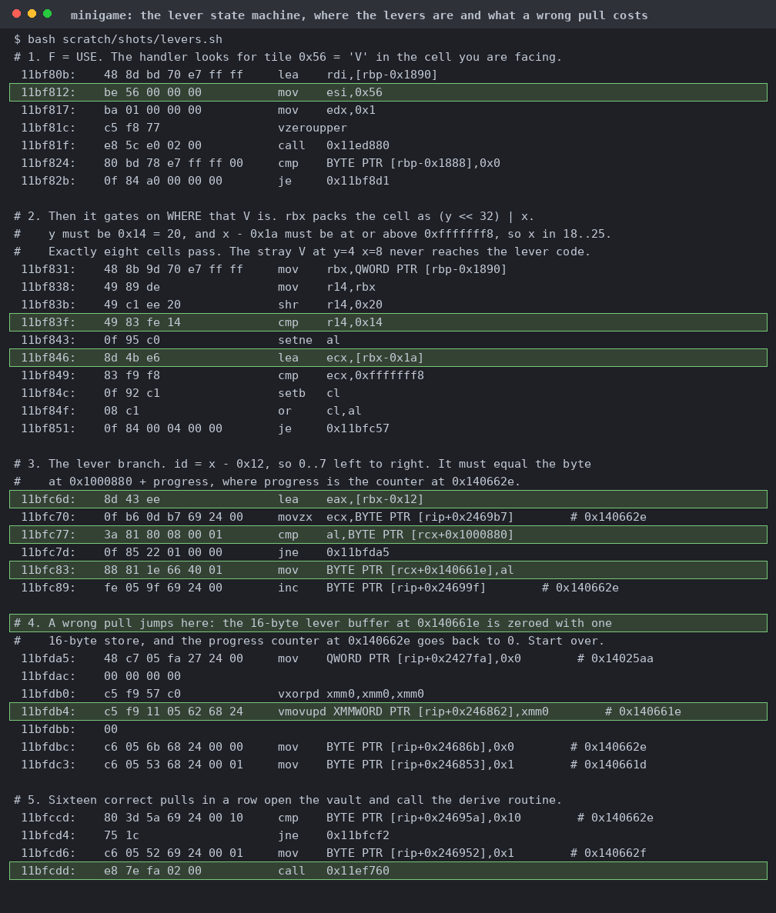
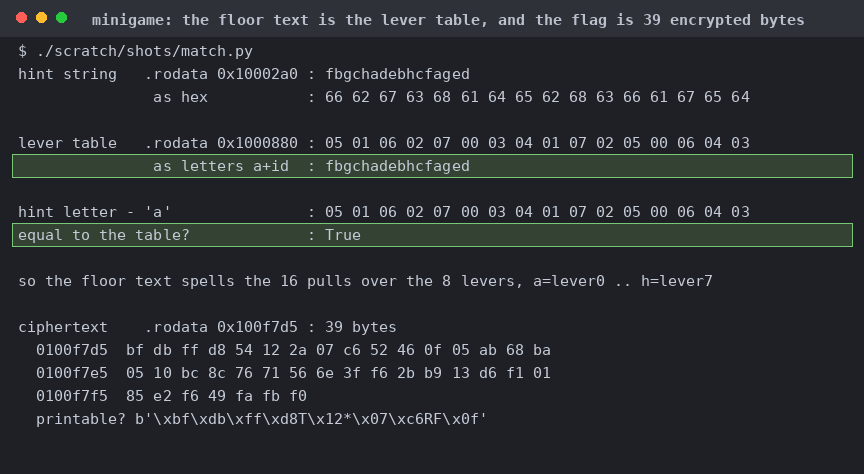
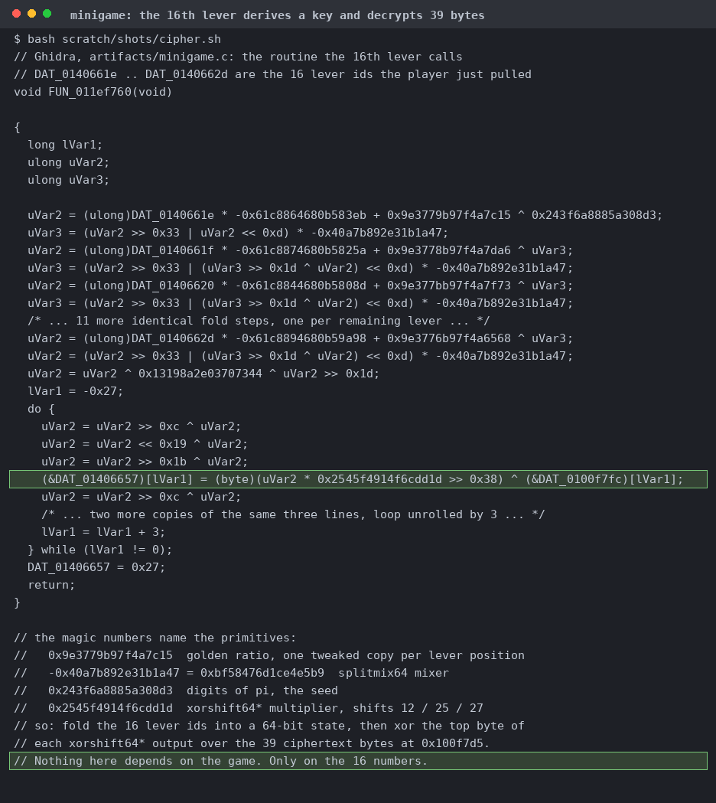
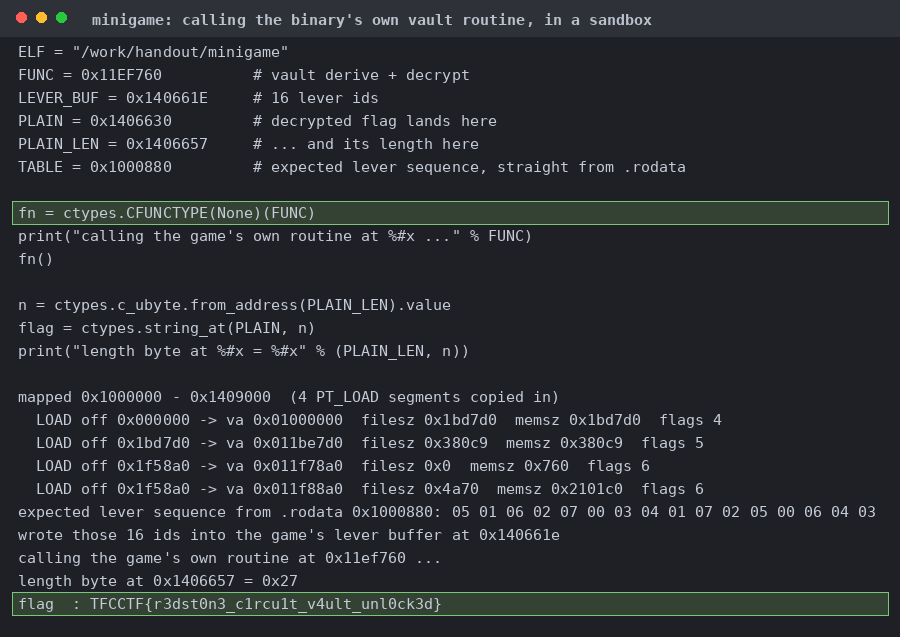
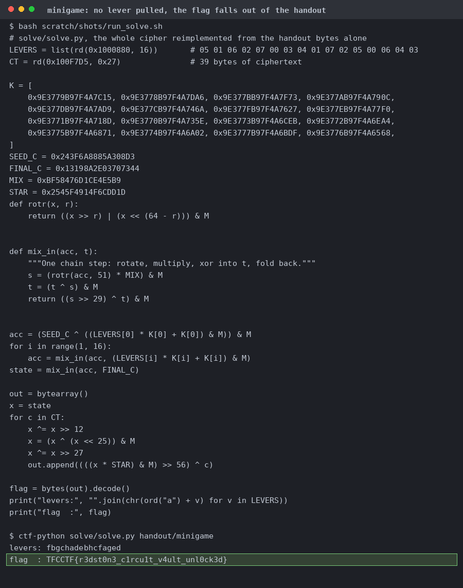
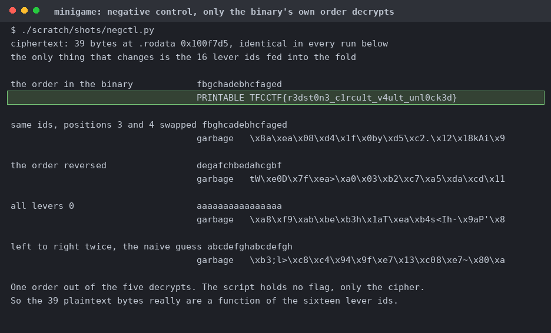

# minigame

| | |
|---|---|
| Event | The Few Chosen CTF 2026 |
| Category | reverse |
| Difficulty | grandpa |
| Author | minipif |
| Points at close | 50 |
| Solves | 191 |
| Status | solved |

> a game

Files: [`minigame`](handout/minigame)

<details>
<summary><b>Solution</b></summary>

The handout is a 2 MB static stripped Zig roguelike. Its flag vault opens only after you kill enemies, mine the marked altars, and beat three bosses.


The vault routine's only player input is the sixteen lever ids. The right sixteen are a constant in read-only data. The game also paints them on the vault room floor. So I never had to play the game. The rest is porting one fold and one stream cipher to Python.

## Recon

```
$ file handout/minigame
handout/minigame: ELF 64-bit LSB executable, x86-64, version 1 (SYSV), statically linked, stripped
$ readelf -lW handout/minigame | grep -E "^  LOAD"
  LOAD  0x000000 0x0000000001000000 0x0000000001000000 0x1bd7d0 0x1bd7d0 R   0x1000
  LOAD  0x1bd7d0 0x00000000011be7d0 0x00000000011be7d0 0x0380c9 0x0380c9 R E 0x1000
  LOAD  0x1f58a0 0x00000000011f78a0 0x00000000011f78a0 0x000000 0x000760 RW  0x1000
  LOAD  0x1f58a0 0x00000000011f88a0 0x00000000011f88a0 0x004a70 0x2101c0 RW  0x1000
```

The binary is non-PIE, and the first segment maps file offset 0 to `0x1000000`. So any read-only constant sits in the file at `VA - 0x1000000`.

```
$ strings -n 4 handout/minigame | grep -c TFCCTF
0
$ strings -t x -n 6 handout/minigame | grep -E "LEVER|VAULT|CIPHER|^ *2a0 "
    2a0 fbgchadebhcfaged
 1b9335 WRONG LEVER  SEQUENCE RESET
 1b95f7 CIPHER PANELS  TOP 4  MID 2  BOT 1  READ L TO R
 1b9669 CIPHER ACCEPTED  VAULT OPEN
 1b926a FOLLOW THE COMPASS  DEFEAT THE FINAL BOSS TO OPEN THE FLAG VAULT
```

A search for `TFCCTF` in the file finds zero matches, so the binary builds the flag at run time. A wrong lever resets a sequence, and a correct cipher opens the vault. File offset `0x2a0` holds a sixteen-letter word over `a` through `h`, the kind of thing you'd write for pulls over eight levers.





## The vault room

A small script runs the game under a pty in a throwaway container and copies its writable memory out through `/proc/pid/mem`. Another prints the 96-by-96 world grid at `0x140665c`.

```
$ python3 scratch/shots/mapview.py
row 15 ........S.fbgchadebhcfaged......S.........
row 20 ........S.....VVVVVVVV..........SQT.......
every V in the whole 96 x 96 grid: 9 of them
  y=4 x=8  y=20 x=18  y=20 x=19  y=20 x=20  y=20 x=21  y=20 x=22  y=20 x=23  y=20 x=24  y=20 x=25
```

The hint string is painted on the floor five rows above eight lever tiles at y=20. The grid has a ninth `V` elsewhere, and it isn't a lever.



## The lever handler

Ghidra headless produces `artifacts/minigame.c` and `artifacts/full.asm`. The USE handler looks for tile `0x56`, a `V`, in the cell the player faces. It then demands `y == 0x14` and `x - 0x1a` at or above `0xfffffff8`, so `x` runs 18 through 25. The stray `V` at `y=4 x=8` fails that gate.

The lever id is `x - 0x12`, 0 through 7 left to right. The handler compares it with the byte at `0x1000880 + n`, where `n` is a progress counter at `0x140662e`. A wrong pull zeroes the lever buffer at `0x140661e` and resets the counter. The sixteenth match in a row calls `0x11ef760`.



So the expected sequence sits in the file. `scratch/shots/match.py` reads it and lines it up with the floor text.

```
$ python3 scratch/shots/match.py
hint string   .rodata 0x10002a0 : fbgchadebhcfaged
lever table   .rodata 0x1000880 : 05 01 06 02 07 00 03 04 01 07 02 05 00 06 04 03
               as letters a+id  : fbgchadebhcfaged
hint letter - 'a'               : 05 01 06 02 07 00 03 04 01 07 02 05 00 06 04 03
equal to the table?             : True
ciphertext    .rodata 0x100f7d5 : 39 bytes
```

Each floor letter minus `'a'` is the matching lever id. The routine at `0x11ef760` turns the 39 ciphertext bytes at `0x100f7d5` into the flag.



## The cipher

The routine is `FUN_011ef760` in `artifacts/minigame.c`, and its magic numbers identify the primitives. The seed `0x243f6a8885a308d3` is the first 64 bits of the fractional part of pi. `0xbf58476d1ce4e5b9` is the SplitMix64 mixer. Each lever position gets a tweaked copy of the golden ratio constant `0x9e3779b97f4a7c15`. `0x2545f4914f6cdd1d` with shifts of 12, 25, and 27 is `xorshift64*`.

The routine folds the sixteen ids into a 64-bit state, then XORs the top byte of each `xorshift64*` output over the ciphertext. It never reads the clock, the player position, the score, or a random source, so a static port is exact.



## Reproduce

The safest route lets the binary run its own routine, so a transcription slip can't matter. A short script maps the four `PT_LOAD` segments at their fixed addresses with `MAP_FIXED_NOREPLACE`. It writes the sixteen ids into the game's lever buffer and calls `0x11ef760` through `ctypes`. That runs handout code, so it goes in a sandbox.



The pure-Python route, `solve/solve.py`, reads the lever table and the ciphertext from the file and redoes the fold and the stream cipher in Python.

```
$ python3 solve/solve.py handout/minigame
levers: fbgchadebhcfaged
flag  : TFCCTF{r3dst0n3_c1rcu1t_v4ult_unl0ck3d}
```



## Wrong orders

A wrong key could in principle decode 39 bytes into something plausible. I kept the cipher fixed and varied only the ids.

```
$ python3 scratch/shots/negctl.py
the order in the binary            fbgchadebhcfaged
                                   PRINTABLE TFCCTF{r3dst0n3_c1rcu1t_v4ult_unl0ck3d}
same ids, positions 3 and 4 swapped fbghcadebhcfaged
                                   garbage   \x8a\xea\x08\xd4\x1f\x0by\xd5\xc2.\x12\x18kAi\x9
the order reversed                 degafchbedahcgbf
                                   garbage   tW\xe0D\x7f\xea>\xa0\x03\xb2\xc7\xa5\xda\xcd\x11
all levers 0                       aaaaaaaaaaaaaaaa
                                   garbage   \xa8\xf9\xab\xbe\xb3h\x1aT\xea\xb4s<Ih-\x9aP'\x8
left to right twice, the naive guess abcdefghabcdefgh
                                   garbage   \xb3;l>\xc8\xc4\x94\x9f\xe7\x13\xc08\xe7~\x80\xa
```

Only the binary's order decodes.



Flag: `TFCCTF{r3dst0n3_c1rcu1t_v4ult_unl0ck3d}`
</details>
