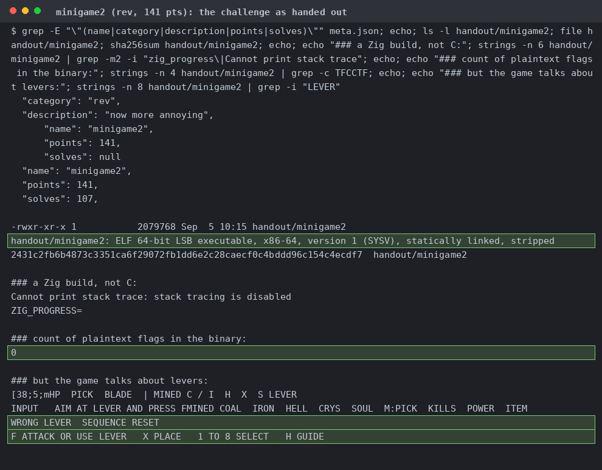
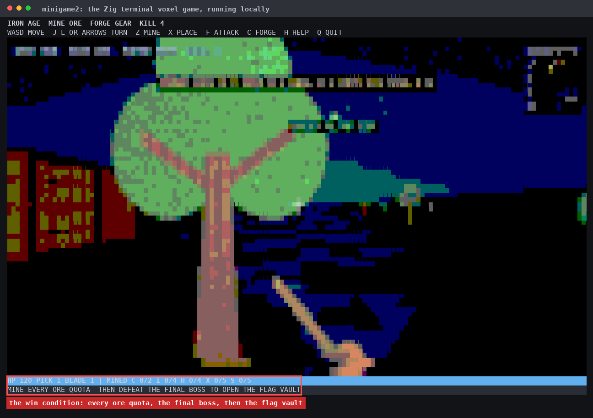
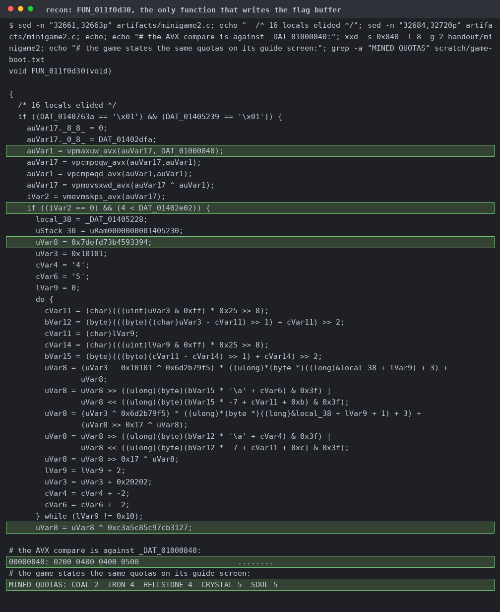
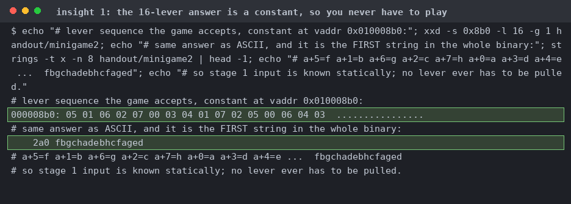
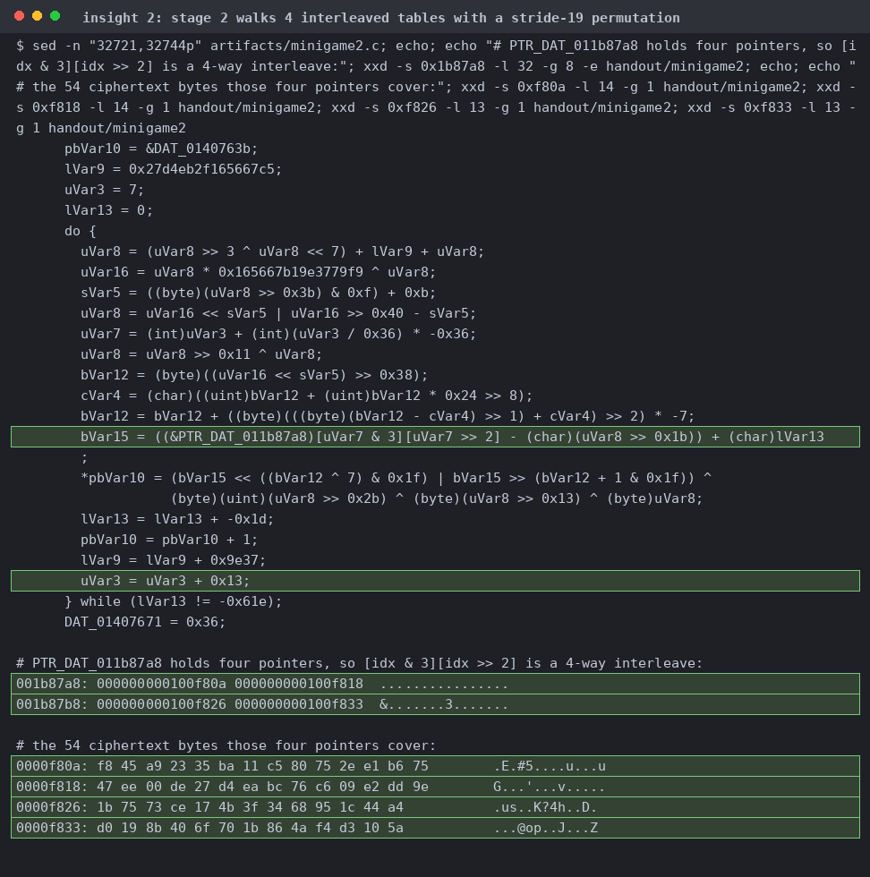
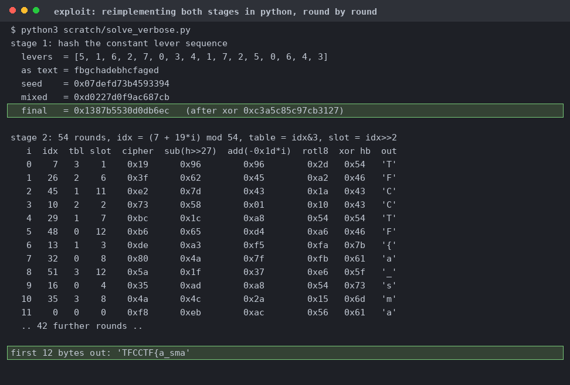
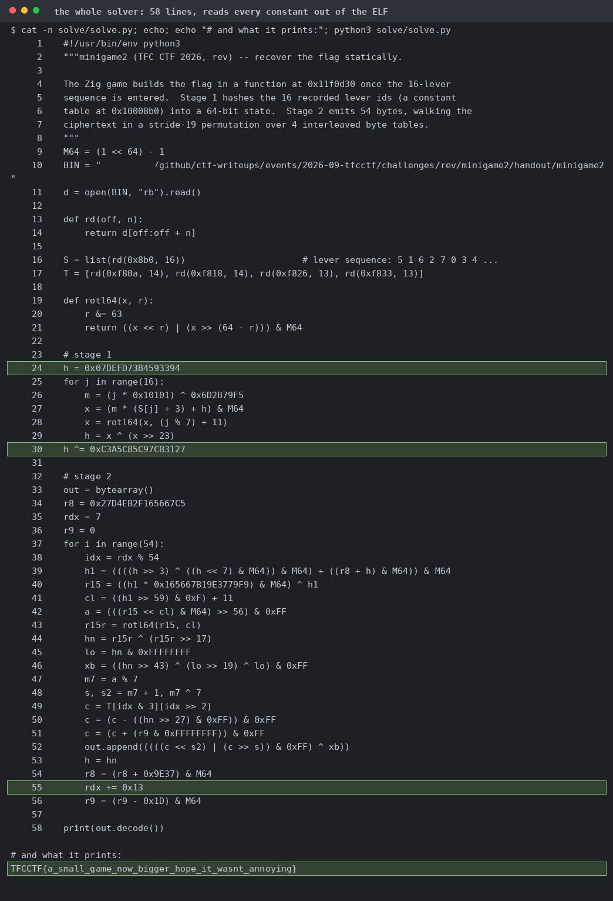
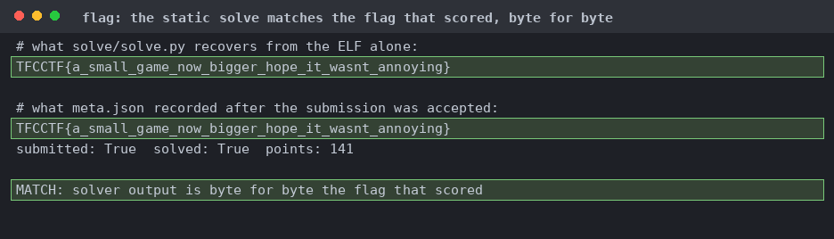

# minigame2

| | |
|---|---|
| Event | The Few Chosen CTF 2026 |
| Category | reverse |
| Difficulty | grandpa |
| Author | minipif |
| Points at close | 50 |
| Solves | 180 |
| Status | solved |

> now more annoying

Files: [`minigame2`](handout/minigame2)

<details>
<summary><b>Solution</b></summary>

This is [minigame](../minigame/README.md) with a second cipher stage. The sixteen-pull answer is a constant in read-only data, so the flag builder's input is known before the game runs. The quotas, bosses, and lever room are decoration, and the new stage is short enough to replay in Python.

## Recon

```
$ file handout/minigame2
handout/minigame2: ELF 64-bit LSB executable, x86-64, version 1 (SYSV), statically linked, stripped
$ readelf -lW handout/minigame2 | grep -E '^  LOAD'
  LOAD  0x000000 0x0000000001000000 0x0000000001000000 0x1bda70 0x1bda70 R   0x1000
  LOAD  0x1bda70 0x00000000011bea70 0x00000000011bea70 0x0393b9 0x0393b9 R E 0x1000
$ strings handout/minigame2 | grep -c TFCCTF
0
$ strings -n 8 handout/minigame2 | head -3
fbgchadebhcfaged
te kexpand 32-by
```

It's a stripped, static x86-64 Zig build. The first `PT_LOAD` maps file offset 0 to `0x1000000`, so a constant sits at file offset `VA - 0x1000000`. There's no literal flag, and the first long string is a sixteen-letter word over `a` to `h`.



```
$ strings -n 6 handout/minigame2 | grep -iE 'lever|vault|quota|mine'
MINE EVERY ORE QUOTA  THEN DEFEAT THE FINAL BOSS TO OPEN THE FLAG VAULT
WRONG LEVER  SEQUENCE RESET
CIPHER ACCEPTED  VAULT OPEN
ONLY ORE BROKEN WITH Z FILLS MINED  DROPS AND CACHES DO NOT COUNT
```

The intended path is to mine every quota, beat the final boss, and then pull the levers. That's a long grind.



## The flag builder

Ghidra headless decompiles the binary into `artifacts/minigame2.c`. I didn't hunt for the flag. I asked what writes the buffer the game prints it from, and that led to `FUN_011f0d30`. Its callers gate it on the quotas.

```c
if ((DAT_0140763a == '\x01') && (DAT_01405239 == '\x01')) {
    auVar1 = vpmaxuw_avx(auVar17,_DAT_01000840);
    ...
    if ((iVar2 == 0) && (4 < DAT_01402e02)) {
```

The AVX block compares four mined counts with a quota constant, and `4 < DAT_01402e02` checks the fifth.

```
$ python3 -c "d=open('handout/minigame2','rb').read(); print(' '.join('%02x'%b for b in d[0x840:0x850]))"
02 00 04 00 04 00 05 00 00 00 00 00 00 00 00 00
```

Those are the quotas of 2, 4, 4, and 5 from the game's guide screen. The solve never needs this gate, because it only decides whether the builder runs.



## The lever answer

Stage 1 folds the sixteen bytes of the lever buffer into a 64-bit state. They look like player input, but a wrong pull resets the sequence, so the buffer can only hold the accepted answer when the builder runs. That answer is a constant at `0x010008b0`.

```
$ python3 -c "
d=open('handout/minigame2','rb').read()
print(' '.join('%02x'%b for b in d[0x8b0:0x8c0]))
print(''.join(chr(97+b) for b in d[0x8b0:0x8c0]))"
05 01 06 02 07 00 03 04 01 07 02 05 00 06 04 03
fbgchadebhcfaged
```

Shifted by `'a'`, the ids spell the first string `strings -n 8` printed. Stage 1 seeds with `0x07defd73b4593394` and ends by XORing `0xc3a5c85c97cb3127`, so you can compute the state that drives stage 2 without running anything.



## Stage 2

This is the "now more annoying" part. Each of 54 rounds reads `(&PTR_DAT_011b87a8)[idx & 3][idx >> 2]`, with `idx` stepping by `0x13` modulo 54. Since 19 and 54 are coprime, that visits every slot once. The low two bits pick one of four interleaved tables of 14, 14, 13, and 13 bytes.

```
$ python3 -c "
d=open('handout/minigame2','rb').read()
for off,n in ((0xf80a,14),(0xf818,14),(0xf826,13),(0xf833,13)):
    print(hex(off), ' '.join('%02x'%b for b in d[off:off+n]))"
0xf80a f8 45 a9 23 35 ba 11 c5 80 75 2e e1 b6 75
0xf818 47 ee 00 de 27 d4 ea bc 76 c6 09 e2 dd 9e
0xf826 1b 75 73 ce 17 4b 3f 34 68 95 1c 44 a4
0xf833 d0 19 8b 40 6f 70 1b 86 4a f4 d3 10 5a
```



Each round subtracts `(h >> 27) & 0xff` from the byte and adds a counter that drops by `0x1d` per round. It then rotates left by `7 - (a mod 7)`, for a state byte `a`, and XORs a hash byte. The state advances through a `xorshift` and a multiply by `0x165667b19e3779f9`. Decryption is the forward direction here, so I didn't have to invert anything.

I checked my transcription with a verbose solver that prints both stages round by round. Stage 1 lands on `0x1387b5530d0db6ec` and the first twelve rounds spell `TFCCTF{a_sma`, so a typo shows up within a dozen bytes.



## Reproduce

`solve/solve.py` reads the lever constant from file offset `0x8b0` and the tables from `0xf80a` on, and never runs handout code.



```
$ python3 solve/solve.py
TFCCTF{a_small_game_now_bigger_hope_it_wasnt_annoying}
$ sh scratch/verify_flag.sh
MATCH: solver output is byte for byte the flag that scored
```



Flag: `TFCCTF{a_small_game_now_bigger_hope_it_wasnt_annoying}`
</details>
