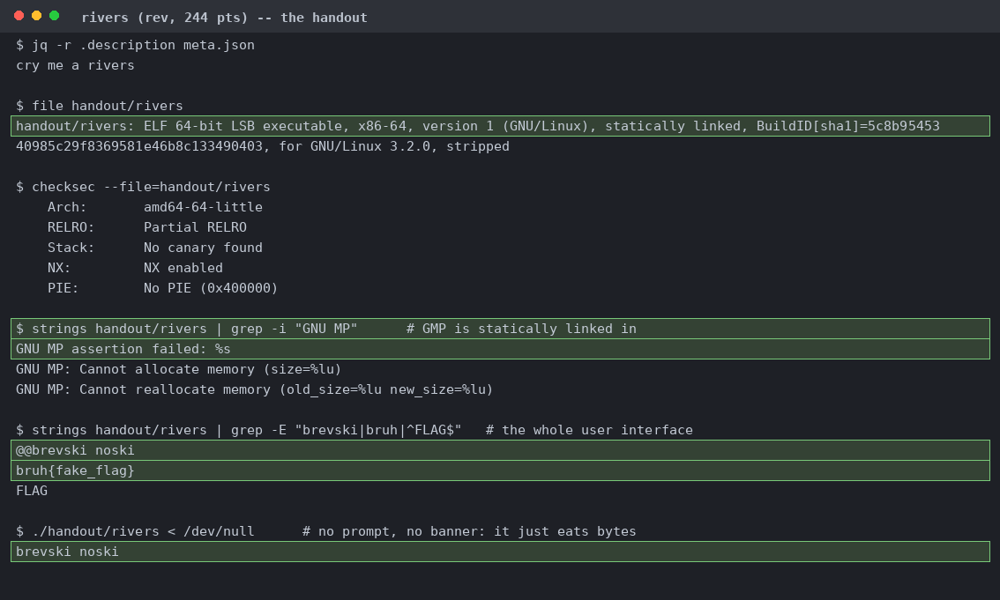
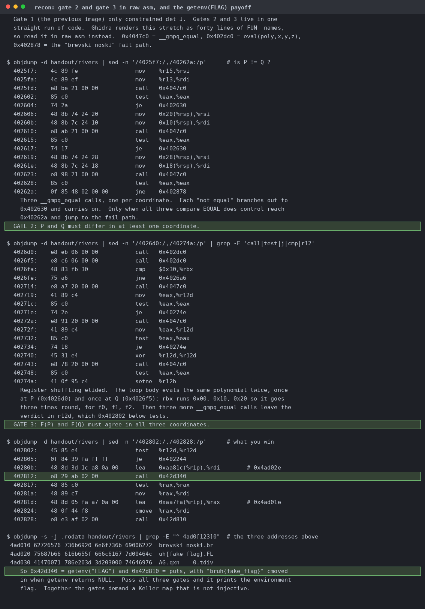
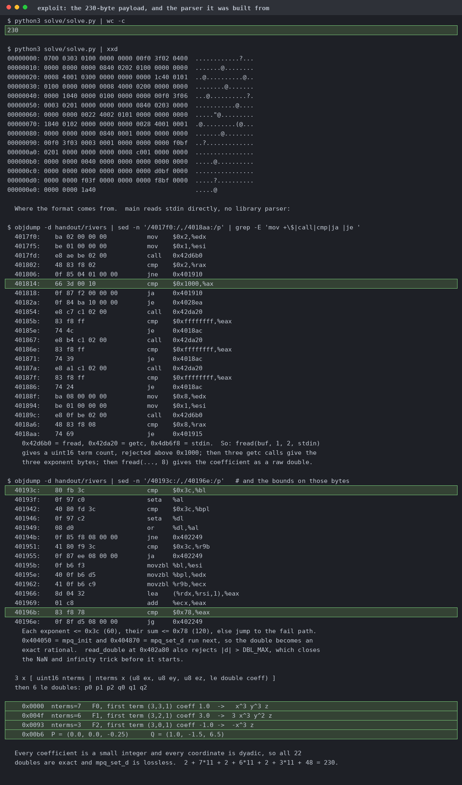
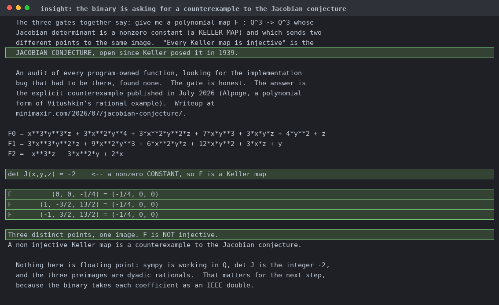
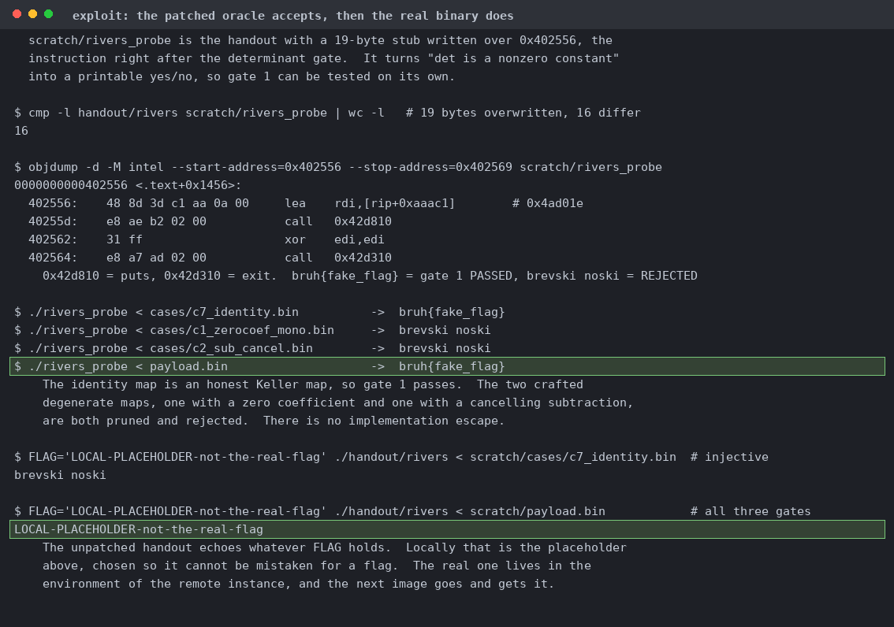
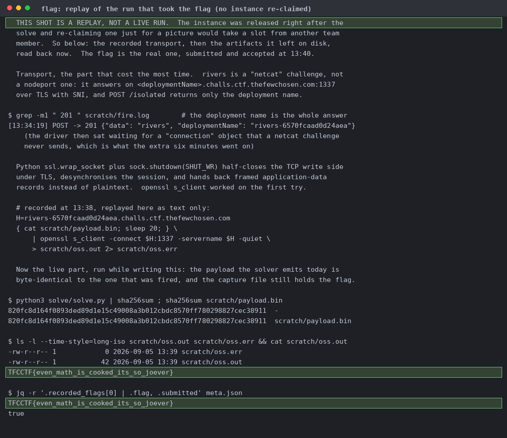

# rivers

| | |
|---|---|
| Event | The Few Chosen CTF 2026 |
| Category | reverse |
| Difficulty | grandpa |
| Author | mcsky23 |
| Points at close | 143 |
| Solves | 106 |
| Status | solved |

> cry me a rivers

Files: [`rivers`](handout/rivers)

<details>
<summary><b>Solution</b></summary>

rivers prints the flag for three polynomials in x, y, and z whose Jacobian determinant is a nonzero constant. They also have to send two different rational points to the same place. That would be a counterexample to the 1939 Jacobian conjecture, and an audit of the gate didn't turn up a bug. Alpöge posted an explicit counterexample in July 2026, about two months before the CTF. The payload is his map in the binary's wire format.

## Recon

```
$ file handout/rivers
ELF 64-bit LSB executable, x86-64, statically linked, stripped
$ strings handout/rivers | grep -iE 'brevski|bruh|flag'
brevski noski
bruh{fake_flag}
FLAG
```

The handout is a stripped 907 KB static binary without PIE, mostly GMP plus glibc. Any bad input just prints `brevski noski`, so there's no feedback to work from.



A headless Ghidra pass produced [`artifacts/rivers.c`](artifacts/rivers.c) and [`artifacts/main.asm`](artifacts/main.asm). The challenge's own code is ten functions, from `main` at `0x4017a0` through `poly_sub` at `0x4036c0`. Everything from `0x403960` upward is GMP, with glibc above that, so a complete audit is realistic.

`main` reads three polynomials in three variables and differentiates each one three times to build a 3x3 Jacobian. It expands the determinant by cofactors and then applies three gates.

```
$ objdump -d handout/rivers | sed -n '/402207:/,/402215:/p; /40253a:/,/402556:/p'
```

Gate 1 is `det.size == 1` at `0x402207`, plus a test at `0x40253a` that the monomial's three exponents are zero. The determinant has to be one monomial of degree zero. Gate 2 at `0x4025f7` makes three `__gmpq_equal` calls and fails only when P and Q agree in all three coordinates. Gate 3 evaluates each polynomial at P and at Q, compares the pairs, and leaves the verdict in `r12d`.


```
$ objdump -d handout/rivers | sed -n '/402802:/,/402828:/p'
$ objdump -s -j .rodata handout/rivers | grep -E "^ 4ad0[123]0"
 4ad010 62726576 736b6920 6e6f736b 69006272  brevski noski.br
 4ad020 75687b66 616b655f 666c6167 7d00464c  uh{fake_flag}.FL
 4ad030 41470071 786e203d 3d203000 74646976  AG.qxn == 0.tdiv
```

`getenv` gets the `FLAG` string at `0x4ad02e`. When it returns NULL, a cmov swaps in the `bruh{fake_flag}` at `0x4ad01e`. If all three gates pass, the process prints its environment flag.



The input format comes off the parser too.

```
$ objdump -d handout/rivers | sed -n '/4017f0:/,/4018aa:/p' | grep -E 'call|cmp|ja |je '
$ objdump -d handout/rivers | sed -n '/40193c:/,/40196e:/p'
```

Each polynomial starts with a uint16 term count from `fread(buf, 1, 2, stdin)`, rejected above `0x1000`. Each term is three `getc` exponents and a little-endian double from `fread(..., 8)`. An exponent is capped at `0x3c` (60) and the sum at `0x78` (120). `poly_mul` re-checks those bounds on every product monomial (with a cap of 20,000 terms), so exponent overflow doesn't work either. Six doubles follow the three polynomials: P, then Q.

```
3 x [ uint16 nterms | nterms x (u8 ex, u8 ey, u8 ez, le double coeff) ]
then 6 le doubles: p0 p1 p2 q0 q1 q2
```



## Looking for a bug

I didn't know the conjecture had fallen, so my first guess was an implementation bug. The coefficient path looked best, since `mpq_set_d` on a NaN or an infinity is undefined behavior in GMP. But the reader at `0x402a80` accepts a double only if `|d| <= DBL_MAX`, which fails for both. Gate 1 never reads the coefficient, but `add_term`, `poly_add`, `poly_sub`, and `poly_mul` all prune a term whose numerator hits zero. A zero determinant can't pose as a constant.

A rejected input and a wrong input print the same string, so testing this needed an oracle. A copy of the handout with 19 bytes patched at `0x402556` prints `bruh{fake_flag}` the moment gate 1 passes. Five crafted degenerate maps all failed it while the identity passed, and 300 random low-degree maps matched sympy every time. The cofactor expansion, the derivative loops, and the stock GMP `mpq_set_d` and `mpq_equal` also read clean in the assembly.

## The counterexample

Alpöge's map is a polynomialized form of Vitushkin's rational example. A [July 2026 note](https://www.ulam.ai/research/jacobian.pdf) verifies it, and a readable account is at [minimaxir.com](https://minimaxir.com/2026/07/jacobian-conjecture/).

```
F0 = (1+xy)^3 z + y^2 (1+xy)(4+3xy)
F1 = y + 3x(1+xy)^2 z + 3xy^2(4+3xy)
F2 = 2x - 3x^2 y - x^3 z
```

In exact rationals, sympy confirms `det J == -2`, and the map sends `(0,0,-1/4)`, `(1,-3/2,13/2)`, and `(-1,3/2,13/2)` all to `(-1/4,0,0)`.



Every coefficient is a small integer and every coordinate is a dyadic rational, so all 22 doubles in the payload convert exactly.

[`solve/solve.py`](solve/solve.py) emits the 230-byte payload. The patched copy prints `bruh{fake_flag}` when you pipe it in. With `python solve/solve.py | FLAG=LOCAL-PLACEHOLDER ./handout/rivers`, the untouched handout prints `LOCAL-PLACEHOLDER`.



## The remote

The challenge API marks `rivers` as a netcat challenge, so `POST /isolated` returns only a `deploymentName`, without a connection object. The instance answers at `<deploymentName>.challs.ctf.thefewchosen.com:1337` over TLS with SNI.

Don't call `shutdown(SHUT_WR)` on a Python `SSLSocket`. Half-closing under TLS desynchronizes the session, and the `\x17\x03\x03` records that come back look like a TLS-in-TLS proxy. A shell pipeline that holds the connection open with a sleep worked on the first try.

```sh
{ cat payload.bin; sleep 20; } | openssl s_client -connect H:1337 -servername H -quiet
```



Flag: `TFCCTF{even_math_is_cooked_its_so_joever}`
</details>
